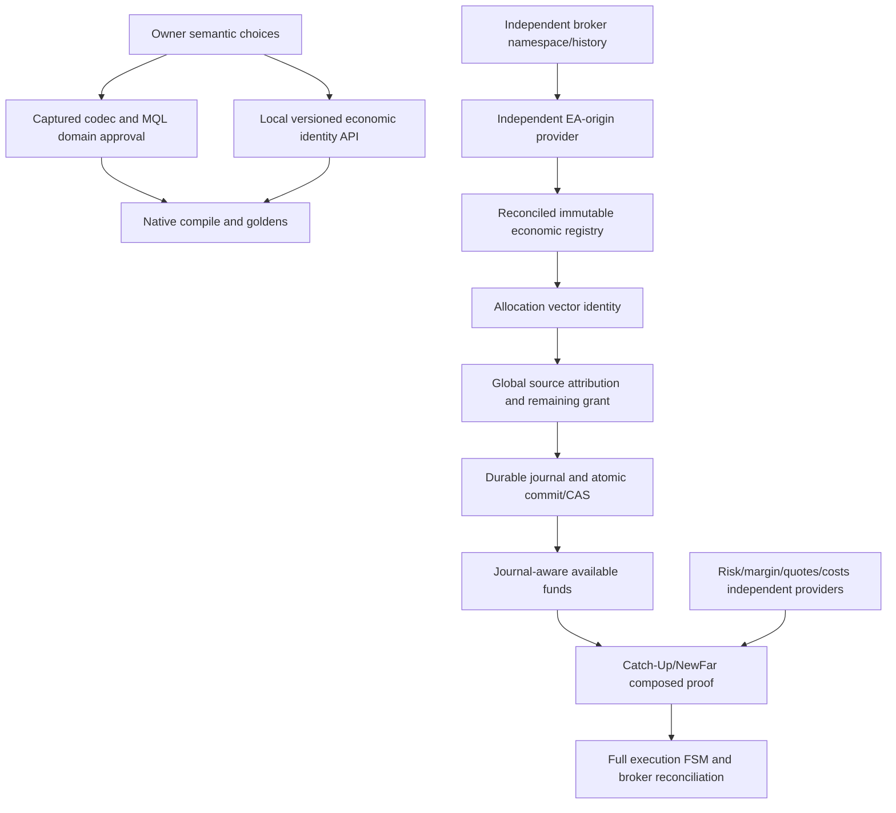

# DG01 — зависимости и безопасная граница

Ветви можно проверять независимо. Native-tested local identity не зависит от выбора Transition Loss для чистого comparator, но не разрешает funding/торговлю. Independent provider и durable backend не создаются bool-флагами test fixture. D-01/D-03..D-07/CR-09 могут быть deferred для локального API, но не для дальнейшего финансового использования. Прямые prerequisites Minimal: D-02/D-08, выбранная schema/domain, compatibility policy; serialization требует NUM-CODEC. Нет автоматической цепочки approval→implementation.

Global funding требует source uniqueness по полному broker/account namespace across allocations, логического source lifetime, reversals/transfers policy и реального complete history. Exactly-once требует backend locking/CAS/crash-recovery ordering; serialized Python revision simulation — только specification. Rollback/migration неизвестных records не решаются временным присвоением текущего account.
