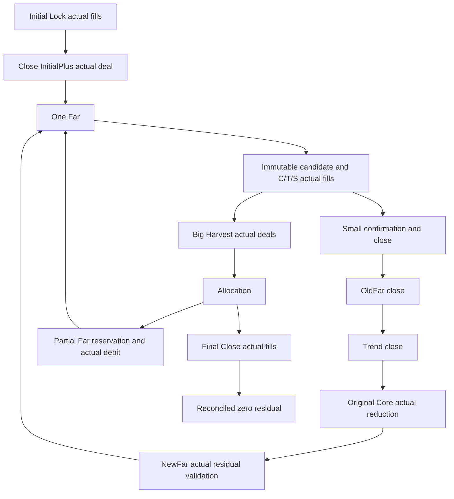
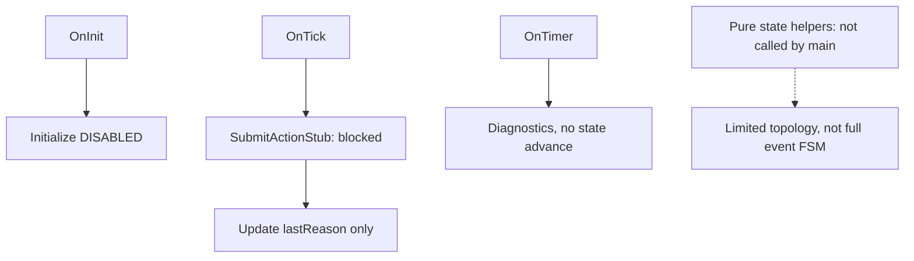

# AUDIT 02 — нормативная и реализованная FSM

Нормативный источник: `Docs/03_FULL_SYSTEM_MANUAL_RU.md`, разделы «Полный цикл», «Transaction», «Restart/error». Реализация: `Include/Core/HSBI_StateMachine.mqh` и основной `.mq5`.

Машиночитаемый полный 33×33 topology inventory: `Tests/Contracts/HSBI_FULL_SYSTEM_AUDIT_02_FSM_MATRIX.json`. Это **не** полная нормативная event-level таблица. В ней явно отсутствуют implemented handlers. Нормативная часть описывает фазы мануала; полный перечень event/preconditions/actions/retry/out-of-order/restart combinations ещё не формализован.

Pure table допускает self-loop, ранний путь до CoreOpening, generic переходы в RECONCILING/TERMINAL_SAFE/EMERGENCY и выходы RECONCILING в FarActive/Idle/TerminalSafe. CoreOpening→TrendOpening отсутствует. Generic разрешение topology не является authority для manual resume. Текущий EA эту таблицу не использует для торговли. Внешние fills и out-of-order события не поступают: OnTradeTransaction отсутствует.

Для каждого нормативного перехода нужны shape/owner/actual-fill/replay/partial/timeout/reject/restart guards, экономический ledger и persistence. Их отсутствие отмечено UNIMPLEMENTED, а не PASS. Диагностический far-count helper достижим по OnTimer, но дефектный fixture с двумя FAR не создаётся текущим main. Из fail-counterexamples нет доказанного пути к реальному исполнению.
