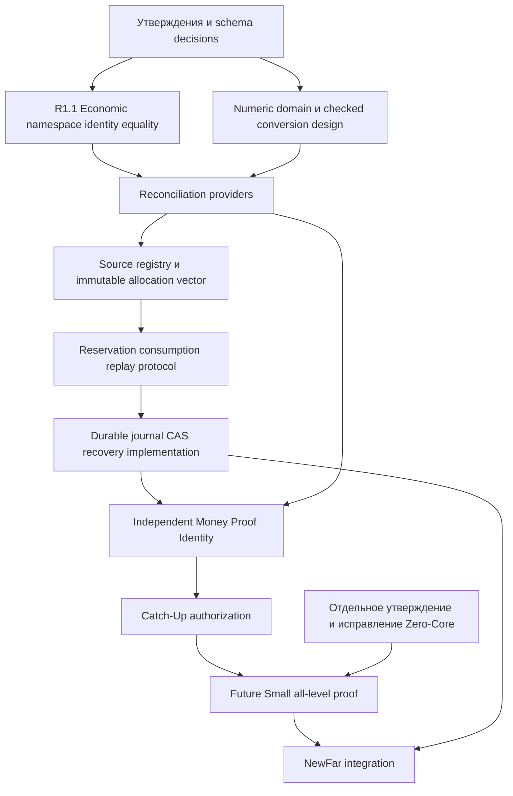

# 02B-R0E — production-дефекты и ограниченный план будущего remediation

BASE_SHA=2d34c3378edc5f2df064282fa067bb4af2a1e3b0

Статус: PROPOSED / AWAITING_ADMIN_APPROVAL. Только audit/test-only; никаких production-изменений и торговли.

## Граница доказательства

На базе R0E повторён frozen runner R0: Tests/Evidence/NEXT_STAGE_02B_R0E_02B_R0_RECHECK.json. 81 native cases:35 сравнений соответствуют proposed contract,46 расходятся. Это извлечённый C++ subset реальных функций с MQL shims; не компиляция/исполнение MQL5 и не доказательство поведения брокера. Source probes и caller inspection дополняют результат. Все Include и основной mq5 неизменны. Ни один дефект не объявляется исправленным.

| DefectID / severity | File:line / Function | MandatoryCaller / CurrentBehavior | Counterexample / RequiredContract / ProposedFix | RegressionTest / EvidenceStatus |
|---|---|---|---|---|
| M-01 / P0 | Include/Money/HSBI_ReserveAllocationTypes.mqh:25 HSBI_ValidateReserveConsumption; HSBI_ReserveCatchUpEvaluator.mqh:35 HSBI_EvaluateReserveCatchUp | NewFarSolver:127 вызывает evaluator; RuntimeDecisionValidator:25 повторяет локальную форму key, но source-allocation cross-binding не добавляет | Foreign SourceDealKey/AllocationKey с согласованными plan/revision принимается; D07/08 требуют authoritative source+allocation+bucket+event/ownership+complete journal | M01-foreign-deal/allocation; CONFIRMED_NATIVE_SUBSET, MQL5 NOT_RUN |
| M-02 / P0 | Include/Planning/HSBI_NewFarSolver.mqh:94 HSBI_SolveNewFar, строка124 expectedReserveIdentity=control.reserveSourceProof.identity | Caller evaluator:127 проверяет равенство с предъявленным proof; независимый history expected не создаётся | Иностранный Account/Magic/Cycle с самосогласованным proof; независимая expected chain по D08 | M02 cases + source probe; CONFIRMED_STATIC/SUBSET, полная NewFar интеграция UNPROVEN |
| L-01 / P0 | Include/Money/HSBI_EconomicLedgerTypes.mqh:9 HSBI_SameEconomicRecord, :10 HSBI_ClassifyEconomicDuplicate | Обязательный production caller ledger duplicate classifier не найден; это публичный primitive, а не доказанный транзакционный pipeline | Profit50/Commission0 vs Profit60/Commission-10, одинаковые net/volume/price/key →NO_OP; полный immutable vector должен датьCONFLICT | L01-*; CONFIRMED_NATIVE_SUBSET |
| L-02 / P0 | Include/Money/HSBI_AllocationLedgerTypes.mqh:8 HSBI_ClassifyAllocationDuplicate | Обязательный production caller не найден; сумма total вместо bucket vector | Reserve50/PF0 vs Reserve0/PF50 →NO_OP; immutable vector/event/policy compare →CONFLICT; consumed/available отдельный mutable state | L02-*; CONFIRMED_NATIVE_SUBSET |
| M-05 / P1 экономический блокер | Include/Money/HSBI_BasketMoneyEvaluator.mqh:11 HSBI_EvaluateBasketMoney, :17 reserveGainMoney | FutureSmallSolver:80 вызывает evaluator, NewFar использует future proof | Core0 Trend0 Small10 →поле10. Это projected field, не доказанный фактический перевод в Big Reserve. D03 изолирует Small; переименовать projected value и связать spendable reserve с eligible sources после решения | M05-small-only; CONFIRMED_SUBSET, фактический broker spend NOT_RUN |
| Zero-Core / P0 для geometry consumer | Include/Planning/HSBI_GeometrySolver.mqh:21 HSBI_SolveBigGeometry | FutureSmallSolver:63; coreGrid разрешает0; большой Trend способен пройти slope | Положительный raw Core floor→0 при положительном Trend/slope; дополнительно min/max/grid всех обязательных legs, lot step/origin и finite/slope contracts | F-zero-core; CONFIRMED_NATIVE_SUBSET; одного Core>=min недостаточно |
| Persistence stub / P0 | Include/Persistence/HSBI_PersistenceInterface.mqh:7 HSBI_PersistSnapshotStub | Возвращает success=false, PERSISTENCE_NOT_IMPLEMENTED; production SHA256 macro false | No real durable write/recovery/CAS; docs16 protocol нельзя приравнивать к backend; реализовывать отдельной фазой | static exact return; CONFIRMED_STUB, durable restart UNPROVEN |
| Global allocation funding / P0 | Include/Money/HSBI_AllocationLedgerTypes.mqh:7 HSBI_ValidateAllocationConservation | Локальная проверка одного record; независимый global registry обязательным caller не найден | A50 B50 одного source50 локально выглядят valid; R0E _fund отклоняет второе funding; production registry/CAS/provider необходимы | D07-double-allocation и overfund-prepared; MODEL_PASS, production global enforcement UNPROVEN |
| Broker precision / P0 dependency | Include/Money/HSBI_EconomicLedgerTypes.mqh:9 epsilon; Include/Money/HSBI_AllocationLedgerTypes.mqh:7 epsilon | Наличие double-format/digits helper не доказывает independently posted broker policy | posted1.005 приdigits2, raw/posted mismatch; currency/precision provider + reconciliation; нельзя утверждать HALF_EVEN универсальным | frozen R0D precision suite PASS model; BROKER_EVIDENCE UNPROVEN |
| Partial-fill reconciliation / P0 dependency | Docs/24; Include/Money/HSBI_EconomicLedgerTypes.mqh:6 HSBI_EconomicLedgerRecord | End-to-end mandatory history→partial batch→ledger commit pipeline не доказан | unique fills .4/-5 + .6/-10 cap12 →OVER_CAP15; independent full batch and lineage needed | D05-* MODEL_PASS; real partial-fill execution NOT_RUN |
| Restart recovery / P0 dependency | Docs/16; Include/Persistence/HSBI_PersistenceInterface.mqh:7 | Missing journal/history нельзя заменить hasPrior=false | SnapshotC10 подделан какC0 даже с новымchecksum: model replays independent journal иCONFLICT; production durable recovery отсутствует | RESTART-* MODEL_PASS, durable restart UNPROVEN |

Дополнительно validators: HSBI_ValidateMoneyState (Include/Money/HSBI_MoneyState.mqh:5) проверяет только nonnegative buckets, не valid/revision/finite. HSBI_CanConsumeBucket (:9 AllocationLedgerTypes) отклоняет FinalReserve для partial consumer, но неизвестный enum иначе разрешает. Положительный контроль FinalReserve-for-partial отклоняется — эту защиту не объявляем отсутствующей. Обязательный end-to-end caller, делающий недостающие проверки неизбежными, не установлен; местный predicate не является самостоятельной transaction authorization. E-* native cases фиксируют конкретные результаты, не доказывают активный trading обход.

## Immutable Economic Ledger identity / будущий R1.1

Allowlist первого отдельного задания после утверждения: Include/Money/HSBI_EconomicLedgerTypes.mqh и новые test-only harness. Любой зависимый caller, serialization или type file, который потребует изменения, сначала перечисляется в отдельном точном scope; автоматически расширять allowlist нельзя. Запрещены остальные Include, NewFar/Big/Small/Runtime/Persistence trading implementation и основной mq5. На этом этапе R1.1 ничего не меняется.

Account namespace: Broker+Server+AccountLogin+Deal; AccountLogin positive signed long; Magic configured signed nonzero long; Deal/Order/Position/Event/Cycle/Plan/Revision ulong 1..2^64-1; bool не ID. Immutable fields: schema/record policy version; broker/server/account; symbol/magic/cycle; deal/order/position; entry/type/source role; event ID и execution time with known domain; volume/price in declared broker grids; Profit/Swap/Commission/Fee signed raw components; rawNet and independently posted net; currency/digits/provider policy; reconciled source receipt identity. OriginPlan/OriginRevision при наличии сохраняются отдельно от current context. Перечень дополняется при обнаружении семантически значимых полей, но не сокращается до net.

Duplicate: namespace/source event новый→NEW; exact immutable record→NO_OP; тот же source/event с изменённым immutable field→CONFLICT. Изменённые комиссии при том же net не identical. Mutable grant consumption не входит в immutable economic equality; не смешивать execution updates с повторным историческим record. Migration неизвестного account/precision/role→quarantine, не guessed values; shadow read/compare, versioned schema, backup и explicit approval до switch. Rollback: восстановить approved old read-only path/снимок без повторного funding/spend; downgrade без потери journal не выполнять. Stop: ambiguity, hash mismatch, unknown namespace, conversion mismatch, compile/runtime failure, изменившийся baseline/remote. Complete R1.1: approved types/equality+negative/mutation/serialization tests, no-trade unchanged, MQL compile когда доступен; никаких заявлений о глобальном funding.

## Dependency graph и фазы

Протокол recovery/commit проектируется до реализации registry, чтобы исключить цикл «сначала неизменяемые данные, потом неизвестная durable schema». Фаза R реализует DTO/test state machine, D делает backend; до D ни F/R не создают live spend authority. Geometry Z может проектироваться параллельно после своего утверждения, но требуется до принятия потребляющих geometry Small/NewFar. Никакая фаза не включает dispatch.

| Фаза | Будущая allowlist для отдельного задания | Dependencies / stop | Обязательные tests/evidence |
|---|---|---|---|
| R1.1 identity | Только EconomicLedgerTypes.mqh; новые tests | Approved D08/NUM/schema; stop unknown immutable field | account collision, changed signed components same net, exact/changed replay, mutation, serialization roundtrip |
| Numeric | Новый money DTO/checked arithmetic module, конкретные callers только по отдельному allowlist | MQL-DOMAIN; stop unknown currency/grid/overflow | LONG_MIN/MAX, scaling, rounding, provider reconciliation, compile |
| Providers | Новые read-only history/reconciliation interfaces | identity+numeric; stop missing/partial/stale history | broker fixture vs independent receipt, partial fills, account lineage; real broker evidence separately |
| Funding | AllocationLedgerTypes/ReserveAllocationTypes, новый source registry после утверждения scope | providers+protocol design; stop double funding or unknown attribution | A/B same deal, vector permutation, policy revision, negative debit handling |
| Reservation | Новый owned reservation/consumption protocol | funding; stop owner/journal ambiguity | free/reserve/release/own consume, replay, zero deltas, CAS schema |
| Durable | PersistenceInterface плюс явно перечисленный backend | protocol/schema; stop torn/incomplete journal | actual filesystem crash points, concurrent CAS, restart replay, durable evidence |
| Identity proof | MoneyProofIdentity и provider binding | durable+providers; stop selfcopy | all15 fields, digest/content receipt, independent expected, source mutation |
| Catch-Up | ReserveCatchUpEvaluator и validators | identity+durable funding | source/allocation/ownership/revision/currency bound, no bypass caller |
| Geometry Z | GeometrySolver только отдельным approved scope | geometry contract; stop min/step/broker ambiguity | raw>0→Core0, min/grid/max/step, recovery slope, full broker grid |
| Future Small | FutureSmallProofAggregator/solver | Catch-Up+Z+CR09 approval | required set, stale/missing, min margin vsmaxT, sequential conservation |
| NewFar | NewFarSolver только отдельным заданием | все предыдущие принятия, durable provider evidence | end-to-end independent expected, no recycled grants, snapshot freshness, no-trade |

Каждое будущее задание обязано указать baseline, точные файлы, rollback, scope, compile/runtime evidence и критерии приёмки. Таблица — план, а не разрешение менять перечисленные файлы сейчас.
