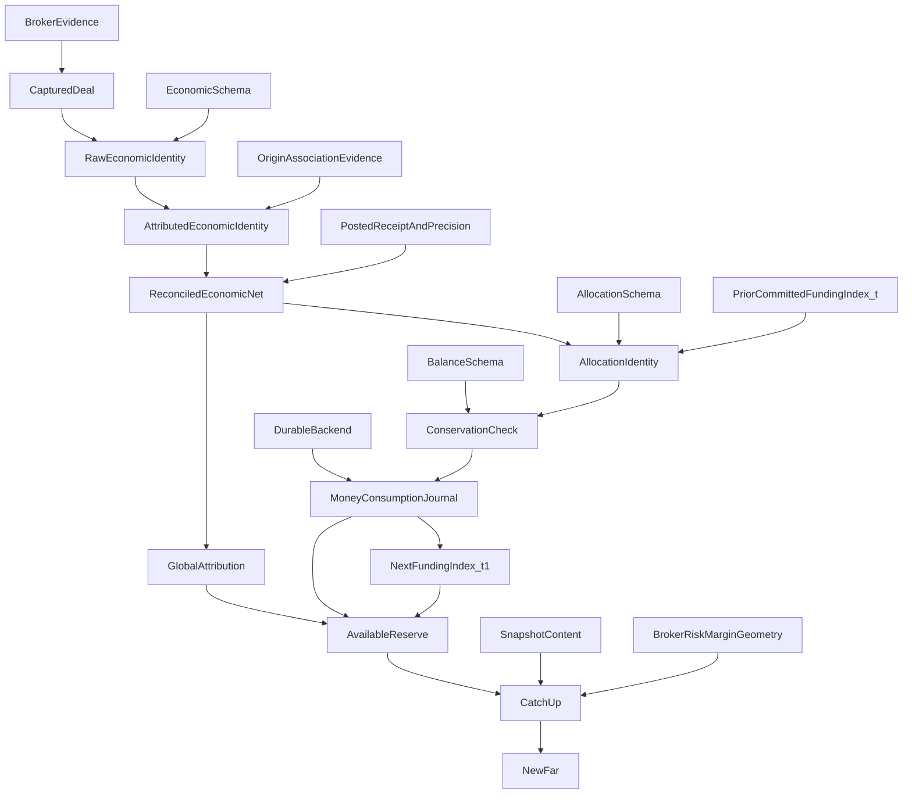

# R0F — граф зависимостей

BASE_SHA=ad5ce78d74c53b34358cd7508982aa888976057a

PROPOSED / AWAITING_ADMIN_APPROVAL. CONTRACT-DECISION-PREPARATION / TEST-ONLY. Не разрешение production или торговли.

Approval definitions и runtime evidence — разные DAG. Schema можно проверить offline, но observed record требует independent facts. Статус каждого runtime узла — PROPOSED/UNPROVEN либо FINITE_REFERENCE_ONLY, не IMPLEMENTED.

OriginAssociationEvidence — prior EA origin journal, отдельный от будущего MoneyConsumptionJournal. PriorCommittedFundingIndex_t — внешний доказанный input; MoneyConsumptionJournal формирует NextFundingIndex_t1. Нельзя рисовать одну и ту же mutable funding state входом и выходом одного атомарного proof и объявлять круг доказанным. Следующий шаг использует t+1 как новый prior state, не текущий self-authority.

Основной путь: Broker Evidence→Raw/Attributed Economic Identity→Reconciliation→Allocation Identity→Conservation→Durable Money Journal→Available Reserve→Catch-Up/NewFar. Отдельные branches: approved schemas, currency/posted receipts, origin association, snapshots, broker risk/margin/geometry, global debit attribution. Projected FutureSmall proof не создаёт ActualAvailable и не используется для собственного funding.

Матрица содержит отдельный topological order для16 approval definitions и runtime graph. D01 definition не зависит от legacy adapter; BALANCE-SCHEMA-MAPPING зависит от D01, поэтому нет ложного цикла. Native primitive-domain evidence не зависит от выбранного codec; совместная проверка происходит позже на acceptance gate. Все реальные broker/durable/concurrent/NewFar dependencies остаются UNPROVEN.
