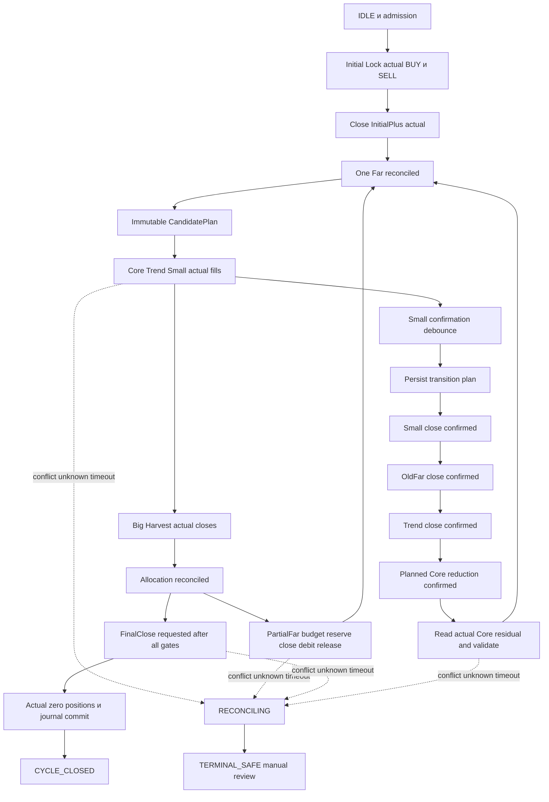
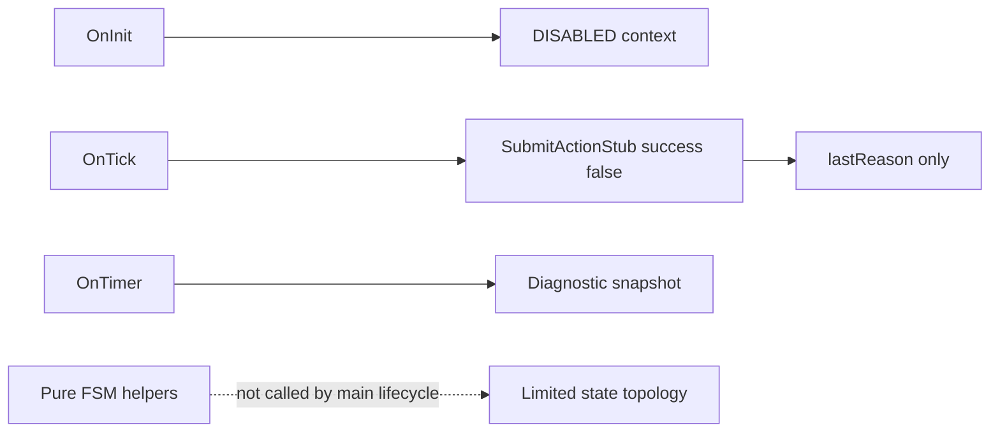

# AUDIT03 — нормативный и фактический жизненный цикл

Первичные источники: `Docs/03_FULL_SYSTEM_MANUAL_RU.md:6,39-48`, `Docs/06_STATE_MACHINE_SPECIFICATION_RU.md:6-21`, `Docs/07_TRANSACTION_EXECUTION_CONTRACT_RU.md:6-25`, `Docs/13_SMALL_TRANSITION_SPECIFICATION_RU.md:12-20`, `Docs/17_RECONCILIATION_AND_TERMINAL_SAFE_RU.md:6-26`. Соответствующие записи: ERR-016/017/025/030/031/033/041; IMP-008/009/013/022. Формулы F015/F024–026/F052–058.

## Нормативная карта фаз

Это прочитанная спецификация, **не реализованный автомат**. Каждая стрелка требует independently confirmed conditions, immutable action, actual outcome, accounting и persistence. Сокращённые имена узлов не вводят новые enum.

Нормативное сокращение “переход завершён” означает подтверждённый итог, не retcode request. Отдельный emergency liquidation не обязан удовлетворять recovery profit threshold и не может маркироваться successful recovery.

## Таблица условий фаз

Для каждой строки actions имеют свои ActionID и barrier. Успешный NextState разрешён только после confirmed complete outcome; partial/timeout/unknown не проходят дальше.

| State/phase | Event и необходимые условия | Next phase и действия | Сохраняемый инвариант | Реализованный handler текущего main |
|---|---|---|---|---|
| DISABLED | Отдельное разрешение стратегии, account admission | IDLE | Нет автоматической торговли | Нет |
| IDLE | Valid immutable initial plan, ownership, account margin | INITIAL_PLAN_READY | Нет pending foreign cycle | Нет |
| INITIAL_PLAN_READY | Persist same action, valid actual account | INITIAL_OPENING_BUY | Один action outcome track | Нет |
| INITIAL_OPENING_BUY | Полный actual BUY fill | INITIAL_OPENING_SELL | BUY volume/identity сохранены | Нет |
| INITIAL_OPENING_SELL | Полный actual SELL fill, lock reconciled | INITIAL_LOCK_ACTIVE | Обе actual legs, no duplicate | Нет |
| INITIAL_LOCK_ACTIVE | Confirmed plus close plan | INITIAL_PLUS_CLOSING | Остаток не угадывается | Нет |
| INITIAL_PLUS_CLOSING | Actual plus close и independent remaining leg | FAR_ACTIVE | Один Far | Нет |
| FAR_ACTIVE | Complete candidate/geometry/money/risk/margin proof | CANDIDATE_PLANNED | Plan immutable/fresh | Нет |
| CANDIDATE_PLANNED | Persist valid Core action | BASKET_OPENING_CORE | Required Core>=min | Нет |
| BASKET_OPENING_CORE | Complete actual Core | BASKET_OPENING_TREND либо approved absent-leg branch | No projected fill promotion | Нет |
| BASKET_OPENING_TREND | Complete actual Trend, либо approved absence | BASKET_OPENING_SMALL | Exactly active-leg schema | Нет |
| BASKET_OPENING_SMALL | Complete Small и whole basket reconciliation | BASKET_ACTIVE | Actual roles/directions/volumes | Нет |
| BASKET_ACTIVE | Big level and revalidation | BIG_HARVEST_PLANNED | One scenario wins revision | Нет |
| BIG_HARVEST_PLANNED | Persist closes C/T/S | BIG_HARVEST_EXECUTING | Actual Far не переприсваивается | Нет |
| BIG_HARVEST_EXECUTING | All actual closes reconciled | ALLOCATION_PENDING | Negative flows не скрыты | Нет |
| ALLOCATION_PENDING | Authoritative complete allocation и FinalClose gate | FINAL_CLOSE_PLANNED | Source funding once | Нет |
| FINAL_CLOSE_PLANNED | Coverage/PL/ownership/no pending still valid | FINAL_CLOSE_EXECUTING | No forecast funding | Нет |
| FINAL_CLOSE_EXECUTING | Actual zero, settled ledger consumption, persistence | CYCLE_CLOSED | No managed residual | Нет |
| ALLOCATION_PENDING | FinalClose не разрешён, PartialFar budget available | PARTIAL_FAR_PLANNED | Не расходуется FinalReserve | Нет |
| PARTIAL_FAR_PLANNED | Reserve owner budget, revalidation, persist | PARTIAL_FAR_EXECUTING | Budget не отдан второму owner | Нет |
| PARTIAL_FAR_EXECUTING | Completed actual closes, consume/release | FAR_ACTIVE | Residual0 или>=min, same source | Нет |
| BASKET_ACTIVE | Small close-side touch | SMALL_CONFIRMING | Touch не completion | Нет |
| SMALL_CONFIRMING | Repeated fresh/hold/retrace/debounce,no active transition | SMALL_TRANSITION_PLANNED | Duplicate trigger NO_OP | Нет |
| SMALL_TRANSITION_PLANNED | Persist loss caps/prefix plan | SMALL_CLOSING | No new basket before reconciliation | Нет |
| SMALL_CLOSING | Complete actual Small close | OLD_FAR_CLOSING | Prefix risk/margin допустимы | Нет |
| OLD_FAR_CLOSING | Complete old Far close | BIG_TREND_CLOSING | Старый Far больше не active | Нет |
| BIG_TREND_CLOSING | Complete Trend close | BIG_CORE_REDUCING | Original Core не заменён | Нет |
| BIG_CORE_REDUCING | Complete planned part, re-read actual residual | NEW_FAR_VALIDATING | Identifier/ticket unchanged | Нет |
| NEW_FAR_VALIDATING | All gates/actual identity/one position | FAR_ACTIVE нового cycle | 0<N<F, no dual tail | Нет |
| RETRY_PENDING | History/reconciliation подтверждают отсутствие completion | Same ActionID retry либо reconciliation | Нет нового request blindly | Нет |
| RECONCILING | Actual history+state+journals independent | Manual authorised outcome / safe block | No auto-resume after critical conflict | Нет |
| EMERGENCY | Approved emergency conditions, own authority | MANUAL_REVIEW / TERMINAL_SAFE | Не recovery success | Нет |
| MANUAL_REVIEW | Отдельное решение владельца и reconciliation | Только явно разрешённая фаза | Никакого guessed Far | Нет |
| TERMINAL_SAFE | Неопределённость/critical unresolved | Блокировка до manual decision | Нет автоматического продолжения | Нет |
| CYCLE_CLOSED | Journal persisted, zero positions, no pending | Завершение; новый cycle отдельно | Source не становится new повторно | Нет |

Указана каждая из33 enum states `HSBI_Enums.mqh:8` и основные нормативные дуги. Полная таблица всех Event×State×partial-fill×restart комбинаций ещё не формализована; нельзя объявлять полноту FSM proof по этой фазовой карте. Отсутствие реального handler не означает, что дуга математически запрещена: она UNIMPLEMENTED.

## Фактически достижимое поведение

`Hybrid_Split_Big_Independent_EA.mq5:19-44`: OnInit создаёт policy DISABLED и context, OnTick вызывает `HSBI_SubmitActionStub`, OnTimer diagnostics, OnDeinit выключает timer. `HSBI_NoTradeExecution.mqh:5` возвращает success=false/TRADING_NOT_IMPLEMENTED. `HSBI_RuntimePolicy.mqh:25` безусловно false для broker dispatch.

Pure `HSBI_IsTransitionAllowed:5` допускает self-loop для каждого state; ранний normal path DISABLED→IDLE→INITIAL_PLAN_READY→BUY→SELL→LOCK→PLUS_CLOSE→FAR→CANDIDATE→CORE_OPENING; из любого state общие targets RECONCILING/TERMINAL_SAFE/EMERGENCY; из RECONCILING разрешены TERMINAL_SAFE/FAR_ACTIVE/IDLE. Другие normal дуги отсутствуют. `HSBI_ApplyPureStateTransition:7` сам по себе не проверяет money/outcome/authority; это topology-helper, не complete trade commit. `revision+1` требует bound (ERR-025).

`HSBI_RuntimeTransactionBarrier.mqh:7-17` и `HSBI_RuntimeRestartValidator.mqh:7-16` имеют локальные DTO guards. Их bool confirmation fields не доказывают independently acquired actual broker facts. Они не подключены к полному торговому lifecycle в main. В частности context передаётся и как часть собственного expected account namespace; независимость expected должна обеспечиваться обязательным внешним provider, не этим повторением scalar.

## Retry, timeout и restart

Request accepted/PLACED не completed. Частичные fills должны накапливаться с finite volumes, authoritative membership, immutable event body; amount equality не заменяет side/owner/deal checks (ERR-010). Timeout — неизвестный итог до broker history, повтор request без reconciliation может дублировать сделку. Out-of-order события не переставляют произвольно экономические prefix caps (ERR-035).

Restart reconstruction проверяет accounting/bindings в своей области, но не историческую eligibility без полного provider. Новый расход всегда проходит текущую authorization заново. Snapshot/checksum с правильным форматом не является durable authenticity. Без backend once и concurrent ordering UNPROVEN (ERR-017/030/033).

## Несогласованные описания

HSB.2E `HSB_2E_FSM_TRANSITION_TABLE_RU.md:5-20` использует другую naming/proposal модель BOOTSTRAP→...→CYCLE_COMPLETED и future simulation phases. Нельзя молча выдать её enum за уже существующий `HSBI_State`. Primary manual states, historical orchestration proposals и фактическая topology — разные слои. Ошибки/рекомендации объединены в ERR-016/028, IMP-008/017; новый approval не сделан.

FSM_SPECIFICATION_VERIFIED=NO, FULL_TRADING_CYCLE_VERIFIED=NO. Нет доказанного действующего финансового обхода через текущий неторговый main; отсутствуют реализованные handlers и proof их будущей композиции.

## COVERAGE-COMPLETION — приоритет actual события и остановки

Для каждой строки фазовой таблицы обязательны три раздельных момента: PREPARED request, OBSERVED partial/complete broker fact, RECONCILED state+money commit. Нельзя считать успешный первый момент третьим. Unique event identity проверяется вместе с immutable payload; exact replay возвращает прежний outcome без increment revision, changed replay блокирует расход и продолжение. Events out-of-order требуют полного ordering/provider контракта; D-05 current/peak/sticky по-разному зависит от префикса.

Если ownership/revision/freshness отсутствует до действия — действие не разрешено. Если неизвестность возникла **после** необратимого fill, предыдущие позиции не восстанавливаются; дальше RECONCILING, сохранение полученных фактов, без нового dispatch. Timeout означает неизвестный результат до independent history. Crash после fill до local commit требует durable reconciliation, а не повторной отправки по пустому journal. При critical conflict автоматическое восстановление FAR_ACTIVE не считается разрешённым просто потому, что topology helper допускает эту дугу.

Фактический `HSBI_IsTransitionAllowed` находится в `Include/Core/HSBI_StateMachine.mqh:5`, а не в несуществующем HSBI_FSM.mqh. Самопереход topology helper допустим и может инкрементировать revision при pure apply; это не API exact event replay и не доказательство его нарушения без соответствующего caller. Для финансового event NO_OP требуется отдельный once/journal guard.

Историческая HSB.2E таблица имеет собственные BOOTSTRAP/SIMULATION_DISPATCHED/FULL_FILL_OBSERVED naming и scope. Она прочитана целиком, но её дуги не подменяют enum существующего EA. Подробная матрица всех state/event/partial/timeout/restart комбинаций и проверка каждого исторического normative event ещё не завершены. Поэтому FULL_FSM_VERIFIED=NO и AUDIT_COMPLETENESS=PARTIAL; нормативная фазовая карта выше — полезная основа, а не full proof.

Для полного концептуального SELL/BUY цикла, отсутствия safe NewFar, Emergency и prefix money/risk/margin см. новое дополнение [полного цикла](HSBI_AUDIT03_FULL_CYCLE_REVIEW_RU.md). Никакого actual handler или исполнимого теста этим дополнением не создано.

## FINAL-CLOSURE — раздельные domains и relation

Подробная новая [матрица FSM](HSBI_AUDIT03_FSM_COMPLETE_MATRIX_RU.md):36 нормативных состояний против33 enum;9 нормативных rule cards по22 поля;20 аналитических случаев без исполнения.140 разрешённых topology pairs — ручная мощность union по33-state domain, не140 безопасных financial transitions. Общий нормативный transition count NOT_DEFINED, gaps NOT_FULLY_ENUMERATED. Generic TransactionBarrierPassed не вызывается из Runtime barrier; совпадение имён не композиция. Полный mandatory event/actual/ledger/persisted-result orchestrator отсутствует; SPECIFICATION_GAP/NOT_IMPLEMENTED остаются раздельными. AUDIT_COMPLETENESS=PARTIAL.
