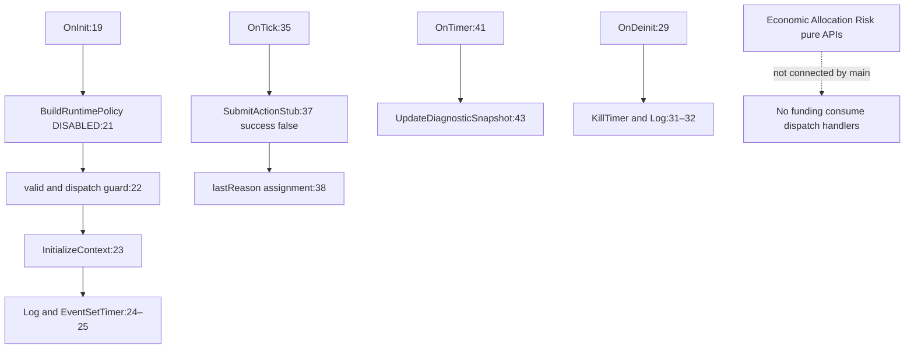

# AUDIT03 FINAL-CLOSURE — guards, обязательные callers и границы данных

База b4d8f1ea5caf492f3abd030e5502d40582c52dc8. Только статический анализ; нет выполненных тестов. Это crosswalk, не второй реестр ошибок. Ни одна строка NOT_VERIFIED не превращается автоматически в source defect. Accepted-path обязательность локального предиката отличается от доказанной обязательности во всей production-композиции. Полный inventory всех199 functions ещё не завершён; нижеследующая первая группа не выдаётся за полный охват.

## Реально существующий главный путь

Main: Hybrid_Split_Big_Independent_EA.mq5:19–44; NoTradeExecution.mqh:5–8; RuntimePolicy.mqh:12–29. Чтение include не является runtime вызовом. В main нет источника actual broker history, финансового commit или OnTradeTransaction обработчика. Graph не переносит отсутствие торговли в доказательство будущей финансовой безопасности.

## Первая группа guards

| GuardID | Function / source line | Формальное условие / accepted path | GUARD_EXISTS | GUARD_CORRECT | GUARD_CALLED | GUARD_MANDATORY | GUARD_INDEPENDENT | GUARD_FAIL_CLOSED | GUARD_BINDS_ACTUAL_DATA | Contract / finding |
|---|---|---|---|---|---|---|---|---|---|---|
| A03-G-001 | HSBI_ValidateEconomicRecord, EconomicLedgerTypes:8 | IDs>0, symbol/key nonempty, volume>0, valid | YES | PARTIAL_RECORD_SHAPE; нет finite/net/key recomputation/full payload | NO_PRODUCTION_CALLER_FOUND | NO_GLOBAL_CALLER | NO_PROVIDER | PARTIAL; positive Infinity volume не исключён | NO | Docs08/31; ERR-001/002/033; F007/F017/F060 |
| A03-G-002 | HSBI_SameEconomicRecord, EconomicLedgerTypes:9 | key equal, abs(Net delta)<1e-7, volume/price exact | YES | MISMATCH_FULL_IMMUTABLE | ClassifyEconomicDuplicate:10 | YES_LOCAL_SAME_KEY_BRANCH; NO_GLOBAL_CALLER | NO_PROVIDER | NO_FULL_PAYLOAD; equal Net hides changed signed components | NO | ERR-001; IMP-001; F017/F057 |
| A03-G-003 | HSBI_ClassifyEconomicDuplicate, EconomicLedgerTypes:10 | key unequal→0, otherwise Same→1 else2 | YES | INCOMPLETE_STATUS_DOMAIN; unavailable not represented | NO_PRODUCTION_CALLER_FOUND | NO_GLOBAL_CALLER | NO_PROVIDER | UNKNOWN_KEY_CAN_LOOK_NEW; no registry authority | NO | ERR-001/002/033; D02/D08 |
| A03-G-004 | HSBI_IsHarvestSourceEntry, EconomicLedgerTypes:12 | entryType!=0 AND net>0 | YES | LOCAL_FILTER_ONLY; role/known entry/valid/history absent | NO_PRODUCTION_CALLER_FOUND | NO_GLOBAL_CALLER | NO_PROVIDER | NOT_FULL_FUNDING_GATE | NO | ERR-022/033/047; D02/D03 |
| A03-G-005 | HSBI_ValidateAllocationConservation, AllocationLedgerTypes:7 | valid and key; total≤source+epsilon, consumed≤available+epsilon | YES | MISMATCH_NONNEGATIVE_PARTITION; negative-source branch ignores latter bound | NO_PRODUCTION_CALLER_FOUND | NO_GLOBAL_CALLER | NO_PROVIDER | NO_COMPLETE_DOMAIN; negative offset buckets pass | NO | ERR-005/006; F012–015/F064 |
| A03-G-006 | HSBI_ClassifyAllocationDuplicate, AllocationLedgerTypes:8 | source/event mismatch→0; equal total within epsilon→1 | YES | MISMATCH_IMMUTABLE_VECTOR | NO_PRODUCTION_CALLER_FOUND | NO_GLOBAL_CALLER | NO_PROVIDER | NO; same total/different vector admitted identical | NO | ERR-004; F016/F057 |
| A03-G-007 | HSBI_CanConsumeBucket, AllocationLedgerTypes:9 | partial consumer and FinalReserve→false else true | YES | PARTIAL_PURPOSE_FILTER; unknown enum not rejected | NO_PRODUCTION_CALLER_FOUND | NO_GLOBAL_CALLER | NOT_APPLICABLE_STATIC_ENUM | PARTIAL; other ownership/authority absent | NO | ERR-007/049; F019 |
| A03-G-008 | HSBI_CanConsumeAmount, AllocationLedgerTypes:10 | amount≥0 AND amount≤available+epsilon | YES | LOCAL_NUMERIC_FILTER_ONLY; valid/owner/source absent | NO_PRODUCTION_CALLER_FOUND | NO_GLOBAL_CALLER | NO_PROVIDER | PARTIAL; positive Infinity can pass against Infinity | NO | ERR-005/007/033; F015/F019 |
| A03-G-009 | HSBI_ValidateMoneyState, MoneyState:5 | five budgets≥0 | YES | MISMATCH_STATE_DOMAIN; valid/revision/finite not checked | NO_PRODUCTION_CALLER_FOUND | NO_GLOBAL_CALLER | NO_PROVIDER | PARTIAL; NaN budget rejected by >=, Infinity passes | NO | ERR-011; F013/F036 |
| A03-G-010 | HSBI_ValidateRiskInput, RiskGateResult:6 | stale false; six cap groups, then passed=true | YES | MISMATCH_FINITE_DOMAIN; limits not validated | NO_PRODUCTION_CALLER_FOUND | NO_GLOBAL_CALLER | NO_PROVIDER | NO; unordered NaN cap comparisons can miss rejection | NO | ERR-009; F026/F031–033/F036 |
| A03-G-011 | HSBI_BuildRuntimePolicy, RuntimePolicy:12–22 | recognized mode initializes named flags, dispatch remains false | YES | MATCH_LOCAL_NO_DISPATCH_POLICY | main:21 and capability helpers | YES_FOR_MAIN_INITIALIZATION | NOT_APPLICABLE_CONFIG_TABLE | YES_UNKNOWN_MODE_INVALID | NOT_APPLICABLE | Docs00/HSB.2C policy; ERR-016/028 |
| A03-G-012 | HSBI_IsBrokerDispatchAllowed, RuntimePolicy:25 | always false for every mode | YES | MATCH_LOCAL_NO_DISPATCH | main:22 and other runtime gates | YES_FOR_MAIN_INITIALIZATION; no send path exists | NOT_APPLICABLE | YES_UNCONDITIONAL_FALSE | NOT_APPLICABLE | Docs00; main19–44 |
| A03-G-013 | HSBI_IsCompletionSourceAllowed, RuntimePolicy:28–29 | terminalCompletionAllowed(mode) AND source==0 | YES | TYPE_LABEL_ONLY; source0 not broker authenticity | ExternalOutcome/Transaction caller scope to be completed | NOT_VERIFIED_ALL_CALLERS | NO_PROVIDER | REJECTS_OTHER_SOURCE; authenticity not proven | NO | ERR-010/013/033; F060 |
| A03-G-014 | OnInit, main:22 | !policy.valid OR dispatchAllowed→INIT_FAILED | YES | MATCH_DISABLED_STARTUP_SCOPE | MQL OnInit entry | YES_LOCAL_ENTRY | NOT_APPLICABLE | YES_FOR_POLICY_CHECK | NOT_APPLICABLE | Docs00/18; source21–23 |
| A03-G-015 | HSBI_SubmitActionStub, NoTradeExecution:5 | success=false, reason TRADING_NOT_IMPLEMENTED | YES | MATCH_NO_TRADE_STUB | main:37, Open/Close/Partial stubs:6–8 | YES_LOCAL_STUB_RESULTS | NOT_APPLICABLE | YES_NEVER_REPORTS_SUCCESS | NOT_APPLICABLE | Docs00; ERR-016 |

NO_PRODUCTION_CALLER_FOUND означает полный текстовый поиск вызовов по всем74 production sources для этой функции, исключая собственное объявление; не отсутствие test/reference usages. Нативная compilation/reachability не исполнялась. Для функций, где callers ещё не проверены, стоит NOT_VERIFIED, а не выдуманное NO.

## Контрольные аналитические примеры, без исполнения

G002: P50/C0 и P60/C−10, при одинаковых key/volume/price/net50, возвращают equality=true по прочитанному выражению; полного immutable proof нет. G006: Reserve50/PF0 и Reserve0/PF50 дают total50 и identical1. G005: source50, buckets−10/+60/0/0/0 даютtotal50; остальные валидные scalar поля не исправляют отрицательный bucket. G009: valid=false,revision0,всеbudgets0 проходит только сравнения>=0. NaN budget здесь **не проходит**; это отличается от G010 upper/lower bound comparisons. G010: один projectedMargin=NaN при остальных допустимых значениях не делает выражение >cap истинным; отсутствие finite guard остаётся локальной source проблемой. Эти выводы не claims о реальных сделках.

## Открытый остаток

Это15 именованных guard groups, не число атомарных clauses всего проекта. Составные AND/OR здесь не засчитаны как независимые полноценно проанализированные guards. Параметры/размерности, отдельные условия и все callers остальных functions дополняются далее; GUARDS_TOTAL/полное mapped count пока NOT_VERIFIED.

## FINAL-CLOSURE —10 clauses локального TransactionBarrier

Source: Include/Execution/HSBI_TransactionTypes.mqh:9–19. Для всех строк GUARD_EXISTS=YES, GUARD_CALLED=LOCAL_FUNCTION_BODY, GUARD_MANDATORY=YES_LOCAL_ACCEPTED_PATH_ONLY. Полный поиск74 sources не нашёл production caller HSBI_TransactionBarrierPassed; NO_GLOBAL_CALLER. Это не обход действующего торгового execution, которого нет. Analytic controls ниже не запускались и не являются mutation results.

| ClauseID | Source line | Formal condition | Scope / missing property | GUARD_CORRECT | GUARD_INDEPENDENT | GUARD_FAIL_CLOSED | GUARD_BINDS_ACTUAL_DATA | Analytic positive / negative |
|---|---|---|---|---|---|---|---|---|
| TX01 | 11 | outcome==HSBI_TX_COMPLETED | PLACED/partial/timeout не accepted; это enum label, не actual proof | YES_LOCAL_ENUM | NO_PROVIDER | YES_LABEL_ONLY | NO | COMPLETED vs PARTIAL |
| TX02 | 12 | expectedActionId>0 AND actualActionId==expectedActionId | два clauses независимы: нулевые0/0 не допустимы | YES_LOCAL_ID | EXPECTED_ARGUMENT_NOT_PROVIDER | YES_FOR_ID | NO | expected1/action1 vs expected0/action0; expected1/action2 |
| TX03 | 13 | eventId>lastAppliedEventId | ordering predicate обязателен локально, не immutable payload equality | YES_LOCAL_ORDER | EXPECTED_ARGUMENT_NOT_PROVIDER | YES_ORDER_ONLY | NO | last1/event2 vs last2/event2 |
| TX04 | 14 | actualPositionRead | caller flag обязан true, но не independently obtained position | FLAG_ONLY | NO_PROVIDER | YES_FLAG_ONLY | NO | true vs false при других true |
| TX05 | 14 | actualDealRead | отдельный flag, не volume/price/commission validation | FLAG_ONLY | NO_PROVIDER | YES_FLAG_ONLY | NO | true vs false при других true |
| TX06 | 14 | ownershipConfirmed | отдельный flag не полное account/ticket/batch сравнение | FLAG_ONLY | NO_PROVIDER | YES_FLAG_ONLY | NO | true vs false при других true |
| TX07 | 15 | expectedVolume>0 | <=0 rejection не finite guard: NaN не делает <=0 истинным | NO_COMPLETE_DOMAIN | NO_PROVIDER | NO_FOR_NONFINITE | NO | expected1 vs0; NaN требует отдельного finite guard |
| TX08 | 15 | abs(accumulatedVolume−expectedVolume)<=1e-7 на конечном domain | для NaN difference исходный >epsilon rejection не срабатывает | NO_COMPLETE_DOMAIN | NO_PROVIDER | NO_FOR_NONFINITE | NO | expected1/actual1 vs actual0.4; NaN отдельная domain ошибка |
| TX09 | 16 | actualStateRevision==expectedStateRevision | равенство двух предъявленных revision не authority proof | YES_LOCAL_EQUALITY | EXPECTED_ARGUMENT_NOT_PROVIDER | YES_EQUALITY_ONLY | NO | expected2/actual2 vs actual3 |
| TX10 | 17 | reconciliationConflict==false | unknown history не представлена этим одним bool | FLAG_ONLY | NO_PROVIDER | YES_KNOWN_CONFLICT_ONLY | NO | false vs true |

TX02 содержит два отдельно указанных causal inputs, но пока один именованный conjunct group: не объявляется полным atomic inventory. LedgerApplied в metadata объявлен, но TransactionBarrierPassed его не читает; persisted-result guard не принимает вообще. Docs/06:9 и Docs/07:6 требуют их до advance. Это existing ERR010 integration gap, не автоматически новый defect ID. Formula F024/F025/F036/F063.

## Runtime barrier — другой API, не caller generic barrier

Include/Runtime/HSBI_RuntimeTransactionBarrier.mqh:7 обязательно вызывает HSBI_ValidateRuntimeDecisionContext до любого accepted/NO_OP результата. Но expected account/symbol/magic берёт из того же context, поэтому независимость этих трёх параметров этим вызовом не доказывается. Его completedOutcome:8 означает early duplicate/conflict branch, не generic TX_COMPLETED eligibility. После admission отдельно проверяются freshness:9, reconciliation:10, event:11, action:12, position flags:13, money/margin/risk:14, persistencePrepared:15, expectedDigest:16. Эти checks mandatory только на final ADVANCE accepted path; early NO_OP имеет иной limited scope. HSBI_CanAdvanceRuntimeDecision не вызывает HSBI_TransactionBarrierPassed и не применяет FSM/ledger. Совпадающий термин barrier не доказывает композицию двух API.

HSBI_ValidateRestartedRuntimeState:17 передаёт собственный current namespace как expected при final validation; это локальная coherence check. DuplicateConsumption:11 возвращает diagnostic NO_OP после prechecks, до полного reauthorization; не считать это разрешением нового расхода. Неизвестная внешняя authority остаётся UNPROVEN. Root ERR013/017/033/048; не считать отсутствие source provider runtime exploit.

Текущий scope:15 прежних guard groups плюс10 именованных TX clause rows. Эти множества не суммируются в GUARDS_TOTAL: первые группы составные и частично пересекаются с clause relation. Глобальный атомарный inventory и обязательные финансовые callers ещё NOT_VERIFIED.

## R2 — A03-G-016, обязательный progress guard NewFar iterator

| Поле | Вывод |
|---|---|
| GuardID | A03-G-016 |
| Normative source | Docs/14_NEW_FAR_SOLVER_SPECIFICATION_RU.md:9–26, ascending grid / plateau reject |
| Condition | nextN finite AND nextN>currentN; bounded iteration count or equivalent checked integer index |
| Implementation | Include/Planning/HSBI_NewFarSolver.mqh:109 update n+=step; guard отсутствует |
| Inputs | min/max/step,upper actualresidual; approved numericgrid domain |
| Provenance | Brokerprofile внешний; progress property требует локальной arithmetic validation, не caller bool |
| Callers | SolveNewFar public; production callsites NO_CALLER_FOUND во всех74source bodies |
| Mandatory | Не обеспечен перед continue/update пути |
| Bypass | Нет проверкивнутрицела; повторный тотжеgridpoint послеcandidate reject |
| Negative outcome | Явный plateau/unsupported-domain refusal требуетсянормой; сейчас guardmissing |
| Fail-closed | Нормальное завершение отказом не обеспечено вcounterdomain |
| Partial fills | Не применяется: чистыйforecastenumerator, никакиеfillsнеотправляет |
| Restart | Persistencyнеimplemented; restartнеисправляет deterministicnonprogress arithmetic |
| Money link | Не создаётденьги; блокируетполучениеdecision/можетисчерпатьресурсы |
| Status | GUARD_MISSING; ERR051/IMP023; staticbinary64RNEproof, nativeNOT_RUN |

Сейчас16именованных guard groups +10локальныхTXrows; онине глобальный atomic total. Review оставшихся236contracts/reports и нормы caller ownership ещё не закрыты; GUARDS_TOTAL нельзявывести из199карточек или числаif/and.

## R3 — индивидуальные admission guards

199 function cards уже существуют; прежняя вводная строка о незавершённом function inventory является историческим checkpoint. Ни16groups,ни10TXrows не являются denominator всехguards. Ниже47 новых индивидуальных admission obligations: они не переименовывают старыеIDs. Составные helper predicates прямо обозначены, их внутренниеclauses не считаются автоматически закрытыми. Это промежуточный namespace HSBI-A03-GRD-001..047; полный normative census ещё открыт после обнаружения дополнительно46StaticJSON.

Все47conditions присутствуют на accepted VALID path одной pure-функции; это не47глобально защищённых денежных действий. НиRuntimeRestart,ниRuntimeBarrier не выполняют financialcommit/dispatch и не имеют productioncallers; это установлено199картами с поискомвсех74sources. Status INCOMPLETE относится к полной нормативной границе source/caller, не означает,что каждое локальное сравнение математически неверно.

### HSBI-A03-GRD-001 — Immutable DTO

| Поле | Статическое основание |
|---|---|
| Guard ID | HSBI-A03-GRD-001 |
| Имя | Immutable DTO |
| Нормативный источник | Docs/HSB_2D_RUNTIME_INTEGRATION_RU.md:3–5; Docs/07_TRANSACTION_EXECUTION_CONTRACT_RU.md:6,12,18,24; scope — pure admission, не funding |
| Обязательная граница | До результата HSBI_DECISION_VALID; для нового финансового действия требуется последующий authoritative orchestrator, которого нет |
| Условие | x.immutable |
| Формальное выражение | Accepted⇒(x.immutable); false⇒REJECTED; converse не даёт trading authority |
| Входные данные | const HSBI_RuntimeDecisionContext &x; independently expected account,symbol,magic,cycle,plan,revision; Неизменность всего принятого контекста |
| Источник данных | Caller immutable flag, не объект immutable storage |
| Независимость | Локальный DTO не независимый provider; Caller immutable flag, не объект immutable storage |
| Production-функция | HSBI_ValidateRuntimeDecisionContext |
| Точные строки | Include/Runtime/HSBI_RuntimeDecisionValidator.mqh:8; fullfunction6–29 |
| Все callers | HSBI_CanAdvanceRuntimeDecision:RuntimeTransactionBarrier.mqh:7; HSBI_ValidateRestartedRuntimeState:RuntimeRestartValidator.mqh:16; прямой public helper entry |
| Public entry points | ValidateRuntimeDecisionContext; CanAdvanceRuntimeDecision; ValidateRestartedRuntimeState. Ниодин не financial mutation API; main ихневызывает |
| Пути обхода | Внутри final VALID branch этотпредикатобязателен. Прямой вызовдругогоpureAPI не обязанчерезadmission. Нетреализованногоfinancial executionpath,длякоторого доказан обход |
| При false | REJECTED через HSBI_RuntimeReject; valid=false; inputs const |
| При ошибке | Нет broker/storage IO вданномpred; exception/native/runtime неисполнялись. Unknown upstream authority не становитсяknownиз callerbool |
| Partial execution | Этотhelperнеaccumulatefills иневыполняетaction; partial допустимость должнапроверятьсяorchestrator/barrier,неVALID |
| Restart | Restart-validator finalcall16 послеownprechecks; diagnosticduplicateNO_OP11 невыполняетэтотfinalcall и неразрешаетновыйрасход |
| Связанные формулы | F007/F024–026/F036/F053/F057/F060/F062; применимость отдельногопредиката ограниченаописаннымDTO |
| ERR/IMP | ERR013/016/027/028/033; amount-binding ERR048, enumdomain ERR049 применимыкакотдельныеобязательства; IMP005/009/014/017/018 |
| Итоговый статус | INCOMPLETE: localacceptedpathmandatory; financialprovider/caller composition NOT_IMPLEMENTED |

### HSBI-A03-GRD-002 — Allowed preflight profile

| Поле | Статическое основание |
|---|---|
| Guard ID | HSBI-A03-GRD-002 |
| Имя | Allowed preflight profile |
| Нормативный источник | Docs/HSB_2D_RUNTIME_INTEGRATION_RU.md:3–5; Docs/07_TRANSACTION_EXECUTION_CONTRACT_RU.md:6,12,18,24; scope — pure admission, не funding |
| Обязательная граница | До результата HSBI_DECISION_VALID; для нового финансового действия требуется последующий authoritative orchestrator, которого нет |
| Условие | HSBI_IsProductionPreflightAllowed(x.runtimeMode) |
| Формальное выражение | Accepted⇒(HSBI_IsProductionPreflightAllowed(x.runtimeMode)); false⇒REJECTED; converse не даёт trading authority |
| Входные данные | const HSBI_RuntimeDecisionContext &x; independently expected account,symbol,magic,cycle,plan,revision; Профиль допускает именно статический preflight |
| Источник данных | RuntimePolicy capability table; не broker dispatch |
| Независимость | Локальный DTO не независимый provider; RuntimePolicy capability table; не broker dispatch |
| Production-функция | HSBI_ValidateRuntimeDecisionContext |
| Точные строки | Include/Runtime/HSBI_RuntimeDecisionValidator.mqh:8; fullfunction6–29 |
| Все callers | HSBI_CanAdvanceRuntimeDecision:RuntimeTransactionBarrier.mqh:7; HSBI_ValidateRestartedRuntimeState:RuntimeRestartValidator.mqh:16; прямой public helper entry |
| Public entry points | ValidateRuntimeDecisionContext; CanAdvanceRuntimeDecision; ValidateRestartedRuntimeState. Ниодин не financial mutation API; main ихневызывает |
| Пути обхода | Внутри final VALID branch этотпредикатобязателен. Прямой вызовдругогоpureAPI не обязанчерезadmission. Нетреализованногоfinancial executionpath,длякоторого доказан обход |
| При false | REJECTED через HSBI_RuntimeReject; valid=false; inputs const |
| При ошибке | Нет broker/storage IO вданномpred; exception/native/runtime неисполнялись. Unknown upstream authority не становитсяknownиз callerbool |
| Partial execution | Этотhelperнеaccumulatefills иневыполняетaction; partial допустимость должнапроверятьсяorchestrator/barrier,неVALID |
| Restart | Restart-validator finalcall16 послеownprechecks; diagnosticduplicateNO_OP11 невыполняетэтотfinalcall и неразрешаетновыйрасход |
| Связанные формулы | F007/F024–026/F036/F053/F057/F060/F062; применимость отдельногопредиката ограниченаописаннымDTO |
| ERR/IMP | ERR013/016/027/028/033; amount-binding ERR048, enumdomain ERR049 применимыкакотдельныеобязательства; IMP005/009/014/017/018 |
| Итоговый статус | INCOMPLETE: localacceptedpathmandatory; financialprovider/caller composition NOT_IMPLEMENTED |

### HSBI-A03-GRD-003 — Account namespace

| Поле | Статическое основание |
|---|---|
| Guard ID | HSBI-A03-GRD-003 |
| Имя | Account namespace |
| Нормативный источник | Docs/HSB_2D_RUNTIME_INTEGRATION_RU.md:3–5; Docs/07_TRANSACTION_EXECUTION_CONTRACT_RU.md:6,12,18,24; scope — pure admission, не funding |
| Обязательная граница | До результата HSBI_DECISION_VALID; для нового финансового действия требуется последующий authoritative orchestrator, которого нет |
| Условие | x.accountLogin==account |
| Формальное выражение | Accepted⇒(x.accountLogin==account); false⇒REJECTED; converse не даёт trading authority |
| Входные данные | const HSBI_RuntimeDecisionContext &x; independently expected account,symbol,magic,cycle,plan,revision; Account должен происходить из независимой current authority |
| Источник данных | Barrier7/Restart16 передают тот же current.accountLogin: равенство с собой |
| Независимость | Локальный DTO не независимый provider; Barrier7/Restart16 передают тот же current.accountLogin: равенство с собой |
| Production-функция | HSBI_ValidateRuntimeDecisionContext |
| Точные строки | Include/Runtime/HSBI_RuntimeDecisionValidator.mqh:9; fullfunction6–29 |
| Все callers | HSBI_CanAdvanceRuntimeDecision:RuntimeTransactionBarrier.mqh:7; HSBI_ValidateRestartedRuntimeState:RuntimeRestartValidator.mqh:16; прямой public helper entry |
| Public entry points | ValidateRuntimeDecisionContext; CanAdvanceRuntimeDecision; ValidateRestartedRuntimeState. Ниодин не financial mutation API; main ихневызывает |
| Пути обхода | Внутри final VALID branch этотпредикатобязателен. Прямой вызовдругогоpureAPI не обязанчерезadmission. Нетреализованногоfinancial executionpath,длякоторого доказан обход |
| При false | REJECTED через HSBI_RuntimeReject; valid=false; inputs const |
| При ошибке | Нет broker/storage IO вданномpred; exception/native/runtime неисполнялись. Unknown upstream authority не становитсяknownиз callerbool |
| Partial execution | Этотhelperнеaccumulatefills иневыполняетaction; partial допустимость должнапроверятьсяorchestrator/barrier,неVALID |
| Restart | Restart-validator finalcall16 послеownprechecks; diagnosticduplicateNO_OP11 невыполняетэтотfinalcall и неразрешаетновыйрасход |
| Связанные формулы | F007/F024–026/F036/F053/F057/F060/F062; применимость отдельногопредиката ограниченаописаннымDTO |
| ERR/IMP | ERR013/016/027/028/033; amount-binding ERR048, enumdomain ERR049 применимыкакотдельныеобязательства; IMP005/009/014/017/018 |
| Итоговый статус | INCOMPLETE: localacceptedpathmandatory; financialprovider/caller composition NOT_IMPLEMENTED |

### HSBI-A03-GRD-004 — Symbol namespace

| Поле | Статическое основание |
|---|---|
| Guard ID | HSBI-A03-GRD-004 |
| Имя | Symbol namespace |
| Нормативный источник | Docs/HSB_2D_RUNTIME_INTEGRATION_RU.md:3–5; Docs/07_TRANSACTION_EXECUTION_CONTRACT_RU.md:6,12,18,24; scope — pure admission, не funding |
| Обязательная граница | До результата HSBI_DECISION_VALID; для нового финансового действия требуется последующий authoritative orchestrator, которого нет |
| Условие | x.symbol==symbol |
| Формальное выражение | Accepted⇒(x.symbol==symbol); false⇒REJECTED; converse не даёт trading authority |
| Входные данные | const HSBI_RuntimeDecisionContext &x; independently expected account,symbol,magic,cycle,plan,revision; Symbol привязан к независимому namespace |
| Источник данных | Barrier7/Restart16 используют тот же current.symbol |
| Независимость | Локальный DTO не независимый provider; Barrier7/Restart16 используют тот же current.symbol |
| Production-функция | HSBI_ValidateRuntimeDecisionContext |
| Точные строки | Include/Runtime/HSBI_RuntimeDecisionValidator.mqh:9; fullfunction6–29 |
| Все callers | HSBI_CanAdvanceRuntimeDecision:RuntimeTransactionBarrier.mqh:7; HSBI_ValidateRestartedRuntimeState:RuntimeRestartValidator.mqh:16; прямой public helper entry |
| Public entry points | ValidateRuntimeDecisionContext; CanAdvanceRuntimeDecision; ValidateRestartedRuntimeState. Ниодин не financial mutation API; main ихневызывает |
| Пути обхода | Внутри final VALID branch этотпредикатобязателен. Прямой вызовдругогоpureAPI не обязанчерезadmission. Нетреализованногоfinancial executionpath,длякоторого доказан обход |
| При false | REJECTED через HSBI_RuntimeReject; valid=false; inputs const |
| При ошибке | Нет broker/storage IO вданномpred; exception/native/runtime неисполнялись. Unknown upstream authority не становитсяknownиз callerbool |
| Partial execution | Этотhelperнеaccumulatefills иневыполняетaction; partial допустимость должнапроверятьсяorchestrator/barrier,неVALID |
| Restart | Restart-validator finalcall16 послеownprechecks; diagnosticduplicateNO_OP11 невыполняетэтотfinalcall и неразрешаетновыйрасход |
| Связанные формулы | F007/F024–026/F036/F053/F057/F060/F062; применимость отдельногопредиката ограниченаописаннымDTO |
| ERR/IMP | ERR013/016/027/028/033; amount-binding ERR048, enumdomain ERR049 применимыкакотдельныеобязательства; IMP005/009/014/017/018 |
| Итоговый статус | INCOMPLETE: localacceptedpathmandatory; financialprovider/caller composition NOT_IMPLEMENTED |

### HSBI-A03-GRD-005 — Magic namespace

| Поле | Статическое основание |
|---|---|
| Guard ID | HSBI-A03-GRD-005 |
| Имя | Magic namespace |
| Нормативный источник | Docs/HSB_2D_RUNTIME_INTEGRATION_RU.md:3–5; Docs/07_TRANSACTION_EXECUTION_CONTRACT_RU.md:6,12,18,24; scope — pure admission, не funding |
| Обязательная граница | До результата HSBI_DECISION_VALID; для нового финансового действия требуется последующий authoritative orchestrator, которого нет |
| Условие | x.magic==magic |
| Формальное выражение | Accepted⇒(x.magic==magic); false⇒REJECTED; converse не даёт trading authority |
| Входные данные | const HSBI_RuntimeDecisionContext &x; independently expected account,symbol,magic,cycle,plan,revision; Magic привязан к independently expected owner |
| Источник данных | Barrier7/Restart16 используют тот же current.magic |
| Независимость | Локальный DTO не независимый provider; Barrier7/Restart16 используют тот же current.magic |
| Production-функция | HSBI_ValidateRuntimeDecisionContext |
| Точные строки | Include/Runtime/HSBI_RuntimeDecisionValidator.mqh:9; fullfunction6–29 |
| Все callers | HSBI_CanAdvanceRuntimeDecision:RuntimeTransactionBarrier.mqh:7; HSBI_ValidateRestartedRuntimeState:RuntimeRestartValidator.mqh:16; прямой public helper entry |
| Public entry points | ValidateRuntimeDecisionContext; CanAdvanceRuntimeDecision; ValidateRestartedRuntimeState. Ниодин не financial mutation API; main ихневызывает |
| Пути обхода | Внутри final VALID branch этотпредикатобязателен. Прямой вызовдругогоpureAPI не обязанчерезadmission. Нетреализованногоfinancial executionpath,длякоторого доказан обход |
| При false | REJECTED через HSBI_RuntimeReject; valid=false; inputs const |
| При ошибке | Нет broker/storage IO вданномpred; exception/native/runtime неисполнялись. Unknown upstream authority не становитсяknownиз callerbool |
| Partial execution | Этотhelperнеaccumulatefills иневыполняетaction; partial допустимость должнапроверятьсяorchestrator/barrier,неVALID |
| Restart | Restart-validator finalcall16 послеownprechecks; diagnosticduplicateNO_OP11 невыполняетэтотfinalcall и неразрешаетновыйрасход |
| Связанные формулы | F007/F024–026/F036/F053/F057/F060/F062; применимость отдельногопредиката ограниченаописаннымDTO |
| ERR/IMP | ERR013/016/027/028/033; amount-binding ERR048, enumdomain ERR049 применимыкакотдельныеобязательства; IMP005/009/014/017/018 |
| Итоговый статус | INCOMPLETE: localacceptedpathmandatory; financialprovider/caller composition NOT_IMPLEMENTED |

### HSBI-A03-GRD-006 — Cycle identity

| Поле | Статическое основание |
|---|---|
| Guard ID | HSBI-A03-GRD-006 |
| Имя | Cycle identity |
| Нормативный источник | Docs/HSB_2D_RUNTIME_INTEGRATION_RU.md:3–5; Docs/07_TRANSACTION_EXECUTION_CONTRACT_RU.md:6,12,18,24; scope — pure admission, не funding |
| Обязательная граница | До результата HSBI_DECISION_VALID; для нового финансового действия требуется последующий authoritative orchestrator, которого нет |
| Условие | x.cycleId==cycle |
| Формальное выражение | Accepted⇒(x.cycleId==cycle); false⇒REJECTED; converse не даёт trading authority |
| Входные данные | const HSBI_RuntimeDecisionContext &x; independently expected account,symbol,magic,cycle,plan,revision; Текущий cycle соответствует authoritative plan |
| Источник данных | Barrier expectedCycleId отдельный аргумент; Restart16 передаёт current.cycleId после локальной snapshot check |
| Независимость | Локальный DTO не независимый provider; Barrier expectedCycleId отдельный аргумент; Restart16 передаёт current.cycleId после локальной snapshot check |
| Production-функция | HSBI_ValidateRuntimeDecisionContext |
| Точные строки | Include/Runtime/HSBI_RuntimeDecisionValidator.mqh:9; fullfunction6–29 |
| Все callers | HSBI_CanAdvanceRuntimeDecision:RuntimeTransactionBarrier.mqh:7; HSBI_ValidateRestartedRuntimeState:RuntimeRestartValidator.mqh:16; прямой public helper entry |
| Public entry points | ValidateRuntimeDecisionContext; CanAdvanceRuntimeDecision; ValidateRestartedRuntimeState. Ниодин не financial mutation API; main ихневызывает |
| Пути обхода | Внутри final VALID branch этотпредикатобязателен. Прямой вызовдругогоpureAPI не обязанчерезadmission. Нетреализованногоfinancial executionpath,длякоторого доказан обход |
| При false | REJECTED через HSBI_RuntimeReject; valid=false; inputs const |
| При ошибке | Нет broker/storage IO вданномpred; exception/native/runtime неисполнялись. Unknown upstream authority не становитсяknownиз callerbool |
| Partial execution | Этотhelperнеaccumulatefills иневыполняетaction; partial допустимость должнапроверятьсяorchestrator/barrier,неVALID |
| Restart | Restart-validator finalcall16 послеownprechecks; diagnosticduplicateNO_OP11 невыполняетэтотfinalcall и неразрешаетновыйрасход |
| Связанные формулы | F007/F024–026/F036/F053/F057/F060/F062; применимость отдельногопредиката ограниченаописаннымDTO |
| ERR/IMP | ERR013/016/027/028/033; amount-binding ERR048, enumdomain ERR049 применимыкакотдельныеобязательства; IMP005/009/014/017/018 |
| Итоговый статус | INCOMPLETE: localacceptedpathmandatory; financialprovider/caller composition NOT_IMPLEMENTED |

### HSBI-A03-GRD-007 — Plan identity

| Поле | Статическое основание |
|---|---|
| Guard ID | HSBI-A03-GRD-007 |
| Имя | Plan identity |
| Нормативный источник | Docs/HSB_2D_RUNTIME_INTEGRATION_RU.md:3–5; Docs/07_TRANSACTION_EXECUTION_CONTRACT_RU.md:6,12,18,24; scope — pure admission, не funding |
| Обязательная граница | До результата HSBI_DECISION_VALID; для нового финансового действия требуется последующий authoritative orchestrator, которого нет |
| Условие | x.planId==plan |
| Формальное выражение | Accepted⇒(x.planId==plan); false⇒REJECTED; converse не даёт trading authority |
| Входные данные | const HSBI_RuntimeDecisionContext &x; independently expected account,symbol,magic,cycle,plan,revision; Нельзя заменить план при той же authority |
| Источник данных | Barrier expectedPlanId отдельный; Restart9 проверяет expectedPlanId,16 передаёт current.planId |
| Независимость | Локальный DTO не независимый provider; Barrier expectedPlanId отдельный; Restart9 проверяет expectedPlanId,16 передаёт current.planId |
| Production-функция | HSBI_ValidateRuntimeDecisionContext |
| Точные строки | Include/Runtime/HSBI_RuntimeDecisionValidator.mqh:9; fullfunction6–29 |
| Все callers | HSBI_CanAdvanceRuntimeDecision:RuntimeTransactionBarrier.mqh:7; HSBI_ValidateRestartedRuntimeState:RuntimeRestartValidator.mqh:16; прямой public helper entry |
| Public entry points | ValidateRuntimeDecisionContext; CanAdvanceRuntimeDecision; ValidateRestartedRuntimeState. Ниодин не financial mutation API; main ихневызывает |
| Пути обхода | Внутри final VALID branch этотпредикатобязателен. Прямой вызовдругогоpureAPI не обязанчерезadmission. Нетреализованногоfinancial executionpath,длякоторого доказан обход |
| При false | REJECTED через HSBI_RuntimeReject; valid=false; inputs const |
| При ошибке | Нет broker/storage IO вданномpred; exception/native/runtime неисполнялись. Unknown upstream authority не становитсяknownиз callerbool |
| Partial execution | Этотhelperнеaccumulatefills иневыполняетaction; partial допустимость должнапроверятьсяorchestrator/barrier,неVALID |
| Restart | Restart-validator finalcall16 послеownprechecks; diagnosticduplicateNO_OP11 невыполняетэтотfinalcall и неразрешаетновыйрасход |
| Связанные формулы | F007/F024–026/F036/F053/F057/F060/F062; применимость отдельногопредиката ограниченаописаннымDTO |
| ERR/IMP | ERR013/016/027/028/033; amount-binding ERR048, enumdomain ERR049 применимыкакотдельныеобязательства; IMP005/009/014/017/018 |
| Итоговый статус | INCOMPLETE: localacceptedpathmandatory; financialprovider/caller composition NOT_IMPLEMENTED |

### HSBI-A03-GRD-008 — State revision

| Поле | Статическое основание |
|---|---|
| Guard ID | HSBI-A03-GRD-008 |
| Имя | State revision |
| Нормативный источник | Docs/HSB_2D_RUNTIME_INTEGRATION_RU.md:3–5; Docs/07_TRANSACTION_EXECUTION_CONTRACT_RU.md:6,12,18,24; scope — pure admission, не funding |
| Обязательная граница | До результата HSBI_DECISION_VALID; для нового финансового действия требуется последующий authoritative orchestrator, которого нет |
| Условие | x.stateRevision==revision |
| Формальное выражение | Accepted⇒(x.stateRevision==revision); false⇒CONFLICT; converse не даёт trading authority |
| Входные данные | const HSBI_RuntimeDecisionContext &x; independently expected account,symbol,magic,cycle,plan,revision; План соответствует текущей revision |
| Источник данных | Barrier expectedStateRevision; Restart9 и16, authoritative atomic revision backend отсутствует |
| Независимость | Локальный DTO не независимый provider; Barrier expectedStateRevision; Restart9 и16, authoritative atomic revision backend отсутствует |
| Production-функция | HSBI_ValidateRuntimeDecisionContext |
| Точные строки | Include/Runtime/HSBI_RuntimeDecisionValidator.mqh:10; fullfunction6–29 |
| Все callers | HSBI_CanAdvanceRuntimeDecision:RuntimeTransactionBarrier.mqh:7; HSBI_ValidateRestartedRuntimeState:RuntimeRestartValidator.mqh:16; прямой public helper entry |
| Public entry points | ValidateRuntimeDecisionContext; CanAdvanceRuntimeDecision; ValidateRestartedRuntimeState. Ниодин не financial mutation API; main ихневызывает |
| Пути обхода | Внутри final VALID branch этотпредикатобязателен. Прямой вызовдругогоpureAPI не обязанчерезadmission. Нетреализованногоfinancial executionpath,длякоторого доказан обход |
| При false | CONFLICT через HSBI_RuntimeReject; valid=false; inputs const |
| При ошибке | Нет broker/storage IO вданномpred; exception/native/runtime неисполнялись. Unknown upstream authority не становитсяknownиз callerbool |
| Partial execution | Этотhelperнеaccumulatefills иневыполняетaction; partial допустимость должнапроверятьсяorchestrator/barrier,неVALID |
| Restart | Restart-validator finalcall16 послеownprechecks; diagnosticduplicateNO_OP11 невыполняетэтотfinalcall и неразрешаетновыйрасход |
| Связанные формулы | F007/F024–026/F036/F053/F057/F060/F062; применимость отдельногопредиката ограниченаописаннымDTO |
| ERR/IMP | ERR013/016/027/028/033; amount-binding ERR048, enumdomain ERR049 применимыкакотдельныеобязательства; IMP005/009/014/017/018 |
| Итоговый статус | INCOMPLETE: localacceptedpathmandatory; financialprovider/caller composition NOT_IMPLEMENTED |

### HSBI-A03-GRD-009 — Schema version

| Поле | Статическое основание |
|---|---|
| Guard ID | HSBI-A03-GRD-009 |
| Имя | Schema version |
| Нормативный источник | Docs/HSB_2D_RUNTIME_INTEGRATION_RU.md:3–5; Docs/07_TRANSACTION_EXECUTION_CONTRACT_RU.md:6,12,18,24; scope — pure admission, не funding |
| Обязательная граница | До результата HSBI_DECISION_VALID; для нового финансового действия требуется последующий authoritative orchestrator, которого нет |
| Условие | x.schemaVersion==HSBI_SCHEMA_VERSION |
| Формальное выражение | Accepted⇒(x.schemaVersion==HSBI_SCHEMA_VERSION); false⇒REJECTED; converse не даёт trading authority |
| Входные данные | const HSBI_RuntimeDecisionContext &x; independently expected account,symbol,magic,cycle,plan,revision; Поддерживается версия DTO |
| Источник данных | Локальная compile-time constant, не разрешение миграции |
| Независимость | Локальный DTO не независимый provider; Локальная compile-time constant, не разрешение миграции |
| Production-функция | HSBI_ValidateRuntimeDecisionContext |
| Точные строки | Include/Runtime/HSBI_RuntimeDecisionValidator.mqh:11; fullfunction6–29 |
| Все callers | HSBI_CanAdvanceRuntimeDecision:RuntimeTransactionBarrier.mqh:7; HSBI_ValidateRestartedRuntimeState:RuntimeRestartValidator.mqh:16; прямой public helper entry |
| Public entry points | ValidateRuntimeDecisionContext; CanAdvanceRuntimeDecision; ValidateRestartedRuntimeState. Ниодин не financial mutation API; main ихневызывает |
| Пути обхода | Внутри final VALID branch этотпредикатобязателен. Прямой вызовдругогоpureAPI не обязанчерезadmission. Нетреализованногоfinancial executionpath,длякоторого доказан обход |
| При false | REJECTED через HSBI_RuntimeReject; valid=false; inputs const |
| При ошибке | Нет broker/storage IO вданномpred; exception/native/runtime неисполнялись. Unknown upstream authority не становитсяknownиз callerbool |
| Partial execution | Этотhelperнеaccumulatefills иневыполняетaction; partial допустимость должнапроверятьсяorchestrator/barrier,неVALID |
| Restart | Restart-validator finalcall16 послеownprechecks; diagnosticduplicateNO_OP11 невыполняетэтотfinalcall и неразрешаетновыйрасход |
| Связанные формулы | F007/F024–026/F036/F053/F057/F060/F062; применимость отдельногопредиката ограниченаописаннымDTO |
| ERR/IMP | ERR013/016/027/028/033; amount-binding ERR048, enumdomain ERR049 применимыкакотдельныеобязательства; IMP005/009/014/017/018 |
| Итоговый статус | INCOMPLETE: localacceptedpathmandatory; financialprovider/caller composition NOT_IMPLEMENTED |

### HSBI-A03-GRD-010 — Money schema version

| Поле | Статическое основание |
|---|---|
| Guard ID | HSBI-A03-GRD-010 |
| Имя | Money schema version |
| Нормативный источник | Docs/HSB_2D_RUNTIME_INTEGRATION_RU.md:3–5; Docs/07_TRANSACTION_EXECUTION_CONTRACT_RU.md:6,12,18,24; scope — pure admission, не funding |
| Обязательная граница | До результата HSBI_DECISION_VALID; для нового финансового действия требуется последующий authoritative orchestrator, которого нет |
| Условие | x.moneyStateVersion==HSBI_MONEY_STATE_VERSION |
| Формальное выражение | Accepted⇒(x.moneyStateVersion==HSBI_MONEY_STATE_VERSION); false⇒REJECTED; converse не даёт trading authority |
| Входные данные | const HSBI_RuntimeDecisionContext &x; independently expected account,symbol,magic,cycle,plan,revision; Денежная схема не переинтерпретируется молча |
| Источник данных | Локальная version constant; не balance reconstruction proof |
| Независимость | Локальный DTO не независимый provider; Локальная version constant; не balance reconstruction proof |
| Production-функция | HSBI_ValidateRuntimeDecisionContext |
| Точные строки | Include/Runtime/HSBI_RuntimeDecisionValidator.mqh:12; fullfunction6–29 |
| Все callers | HSBI_CanAdvanceRuntimeDecision:RuntimeTransactionBarrier.mqh:7; HSBI_ValidateRestartedRuntimeState:RuntimeRestartValidator.mqh:16; прямой public helper entry |
| Public entry points | ValidateRuntimeDecisionContext; CanAdvanceRuntimeDecision; ValidateRestartedRuntimeState. Ниодин не financial mutation API; main ихневызывает |
| Пути обхода | Внутри final VALID branch этотпредикатобязателен. Прямой вызовдругогоpureAPI не обязанчерезadmission. Нетреализованногоfinancial executionpath,длякоторого доказан обход |
| При false | REJECTED через HSBI_RuntimeReject; valid=false; inputs const |
| При ошибке | Нет broker/storage IO вданномpred; exception/native/runtime неисполнялись. Unknown upstream authority не становитсяknownиз callerbool |
| Partial execution | Этотhelperнеaccumulatefills иневыполняетaction; partial допустимость должнапроверятьсяorchestrator/barrier,неVALID |
| Restart | Restart-validator finalcall16 послеownprechecks; diagnosticduplicateNO_OP11 невыполняетэтотfinalcall и неразрешаетновыйрасход |
| Связанные формулы | F007/F024–026/F036/F053/F057/F060/F062; применимость отдельногопредиката ограниченаописаннымDTO |
| ERR/IMP | ERR013/016/027/028/033; amount-binding ERR048, enumdomain ERR049 применимыкакотдельныеобязательства; IMP005/009/014/017/018 |
| Итоговый статус | INCOMPLETE: localacceptedpathmandatory; financialprovider/caller composition NOT_IMPLEMENTED |

### HSBI-A03-GRD-011 — Market freshness

| Поле | Статическое основание |
|---|---|
| Guard ID | HSBI-A03-GRD-011 |
| Имя | Market freshness |
| Нормативный источник | Docs/HSB_2D_RUNTIME_INTEGRATION_RU.md:3–5; Docs/07_TRANSACTION_EXECUTION_CONTRACT_RU.md:6,12,18,24; scope — pure admission, не funding |
| Обязательная граница | До результата HSBI_DECISION_VALID; для нового финансового действия требуется последующий authoritative orchestrator, которого нет |
| Условие | x.marketFresh |
| Формальное выражение | Accepted⇒(x.marketFresh); false⇒STALE; converse не даёт trading authority |
| Входные данные | const HSBI_RuntimeDecisionContext &x; independently expected account,symbol,magic,cycle,plan,revision; Market snapshot должен быть fresh |
| Источник данных | Флаг caller, timestamp/content window не восстанавливается |
| Независимость | Локальный DTO не независимый provider; Флаг caller, timestamp/content window не восстанавливается |
| Production-функция | HSBI_ValidateRuntimeDecisionContext |
| Точные строки | Include/Runtime/HSBI_RuntimeDecisionValidator.mqh:13; fullfunction6–29 |
| Все callers | HSBI_CanAdvanceRuntimeDecision:RuntimeTransactionBarrier.mqh:7; HSBI_ValidateRestartedRuntimeState:RuntimeRestartValidator.mqh:16; прямой public helper entry |
| Public entry points | ValidateRuntimeDecisionContext; CanAdvanceRuntimeDecision; ValidateRestartedRuntimeState. Ниодин не financial mutation API; main ихневызывает |
| Пути обхода | Внутри final VALID branch этотпредикатобязателен. Прямой вызовдругогоpureAPI не обязанчерезadmission. Нетреализованногоfinancial executionpath,длякоторого доказан обход |
| При false | STALE через HSBI_RuntimeReject; valid=false; inputs const |
| При ошибке | Нет broker/storage IO вданномpred; exception/native/runtime неисполнялись. Unknown upstream authority не становитсяknownиз callerbool |
| Partial execution | Этотhelperнеaccumulatefills иневыполняетaction; partial допустимость должнапроверятьсяorchestrator/barrier,неVALID |
| Restart | Restart-validator finalcall16 послеownprechecks; diagnosticduplicateNO_OP11 невыполняетэтотfinalcall и неразрешаетновыйрасход |
| Связанные формулы | F007/F024–026/F036/F053/F057/F060/F062; применимость отдельногопредиката ограниченаописаннымDTO |
| ERR/IMP | ERR013/016/027/028/033; amount-binding ERR048, enumdomain ERR049 применимыкакотдельныеобязательства; IMP005/009/014/017/018 |
| Итоговый статус | INCOMPLETE: localacceptedpathmandatory; financialprovider/caller composition NOT_IMPLEMENTED |

### HSBI-A03-GRD-012 — Cost freshness

| Поле | Статическое основание |
|---|---|
| Guard ID | HSBI-A03-GRD-012 |
| Имя | Cost freshness |
| Нормативный источник | Docs/HSB_2D_RUNTIME_INTEGRATION_RU.md:3–5; Docs/07_TRANSACTION_EXECUTION_CONTRACT_RU.md:6,12,18,24; scope — pure admission, не funding |
| Обязательная граница | До результата HSBI_DECISION_VALID; для нового финансового действия требуется последующий authoritative orchestrator, которого нет |
| Условие | x.costFresh |
| Формальное выражение | Accepted⇒(x.costFresh); false⇒STALE; converse не даёт trading authority |
| Входные данные | const HSBI_RuntimeDecisionContext &x; independently expected account,symbol,magic,cycle,plan,revision; Стоимость должна соответствовать snapshot/window |
| Источник данных | Флаг caller, full cost inventory не сверяется |
| Независимость | Локальный DTO не независимый provider; Флаг caller, full cost inventory не сверяется |
| Production-функция | HSBI_ValidateRuntimeDecisionContext |
| Точные строки | Include/Runtime/HSBI_RuntimeDecisionValidator.mqh:13; fullfunction6–29 |
| Все callers | HSBI_CanAdvanceRuntimeDecision:RuntimeTransactionBarrier.mqh:7; HSBI_ValidateRestartedRuntimeState:RuntimeRestartValidator.mqh:16; прямой public helper entry |
| Public entry points | ValidateRuntimeDecisionContext; CanAdvanceRuntimeDecision; ValidateRestartedRuntimeState. Ниодин не financial mutation API; main ихневызывает |
| Пути обхода | Внутри final VALID branch этотпредикатобязателен. Прямой вызовдругогоpureAPI не обязанчерезadmission. Нетреализованногоfinancial executionpath,длякоторого доказан обход |
| При false | STALE через HSBI_RuntimeReject; valid=false; inputs const |
| При ошибке | Нет broker/storage IO вданномpred; exception/native/runtime неисполнялись. Unknown upstream authority не становитсяknownиз callerbool |
| Partial execution | Этотhelperнеaccumulatefills иневыполняетaction; partial допустимость должнапроверятьсяorchestrator/barrier,неVALID |
| Restart | Restart-validator finalcall16 послеownprechecks; diagnosticduplicateNO_OP11 невыполняетэтотfinalcall и неразрешаетновыйрасход |
| Связанные формулы | F007/F024–026/F036/F053/F057/F060/F062; применимость отдельногопредиката ограниченаописаннымDTO |
| ERR/IMP | ERR013/016/027/028/033; amount-binding ERR048, enumdomain ERR049 применимыкакотдельныеобязательства; IMP005/009/014/017/018 |
| Итоговый статус | INCOMPLETE: localacceptedpathmandatory; financialprovider/caller composition NOT_IMPLEMENTED |

### HSBI-A03-GRD-013 — Allocation policy freshness

| Поле | Статическое основание |
|---|---|
| Guard ID | HSBI-A03-GRD-013 |
| Имя | Allocation policy freshness |
| Нормативный источник | Docs/HSB_2D_RUNTIME_INTEGRATION_RU.md:3–5; Docs/07_TRANSACTION_EXECUTION_CONTRACT_RU.md:6,12,18,24; scope — pure admission, не funding |
| Обязательная граница | До результата HSBI_DECISION_VALID; для нового финансового действия требуется последующий authoritative orchestrator, которого нет |
| Условие | x.allocationPolicy.fresh |
| Формальное выражение | Accepted⇒(x.allocationPolicy.fresh); false⇒STALE; converse не даёт trading authority |
| Входные данные | const HSBI_RuntimeDecisionContext &x; independently expected account,symbol,magic,cycle,plan,revision; Текущая policy применима по времени |
| Источник данных | Локальный flag; independent immutable policy authority не читается |
| Независимость | Локальный DTO не независимый provider; Локальный flag; independent immutable policy authority не читается |
| Production-функция | HSBI_ValidateRuntimeDecisionContext |
| Точные строки | Include/Runtime/HSBI_RuntimeDecisionValidator.mqh:13; fullfunction6–29 |
| Все callers | HSBI_CanAdvanceRuntimeDecision:RuntimeTransactionBarrier.mqh:7; HSBI_ValidateRestartedRuntimeState:RuntimeRestartValidator.mqh:16; прямой public helper entry |
| Public entry points | ValidateRuntimeDecisionContext; CanAdvanceRuntimeDecision; ValidateRestartedRuntimeState. Ниодин не financial mutation API; main ихневызывает |
| Пути обхода | Внутри final VALID branch этотпредикатобязателен. Прямой вызовдругогоpureAPI не обязанчерезadmission. Нетреализованногоfinancial executionpath,длякоторого доказан обход |
| При false | STALE через HSBI_RuntimeReject; valid=false; inputs const |
| При ошибке | Нет broker/storage IO вданномpred; exception/native/runtime неисполнялись. Unknown upstream authority не становитсяknownиз callerbool |
| Partial execution | Этотhelperнеaccumulatefills иневыполняетaction; partial допустимость должнапроверятьсяorchestrator/barrier,неVALID |
| Restart | Restart-validator finalcall16 послеownprechecks; diagnosticduplicateNO_OP11 невыполняетэтотfinalcall и неразрешаетновыйрасход |
| Связанные формулы | F007/F024–026/F036/F053/F057/F060/F062; применимость отдельногопредиката ограниченаописаннымDTO |
| ERR/IMP | ERR013/016/027/028/033; amount-binding ERR048, enumdomain ERR049 применимыкакотдельныеобязательства; IMP005/009/014/017/018 |
| Итоговый статус | INCOMPLETE: localacceptedpathmandatory; financialprovider/caller composition NOT_IMPLEMENTED |

### HSBI-A03-GRD-014 — No reconciliation conflict

| Поле | Статическое основание |
|---|---|
| Guard ID | HSBI-A03-GRD-014 |
| Имя | No reconciliation conflict |
| Нормативный источник | Docs/HSB_2D_RUNTIME_INTEGRATION_RU.md:3–5; Docs/07_TRANSACTION_EXECUTION_CONTRACT_RU.md:6,12,18,24; scope — pure admission, не funding |
| Обязательная граница | До результата HSBI_DECISION_VALID; для нового финансового действия требуется последующий authoritative orchestrator, которого нет |
| Условие | !x.reconciliationConflict |
| Формальное выражение | Accepted⇒(!x.reconciliationConflict); false⇒CONFLICT; converse не даёт trading authority |
| Входные данные | const HSBI_RuntimeDecisionContext &x; independently expected account,symbol,magic,cycle,plan,revision; Известный conflict блокирует |
| Источник данных | Флаг caller, unknown не представлен этим флагом |
| Независимость | Локальный DTO не независимый provider; Флаг caller, unknown не представлен этим флагом |
| Production-функция | HSBI_ValidateRuntimeDecisionContext |
| Точные строки | Include/Runtime/HSBI_RuntimeDecisionValidator.mqh:14; fullfunction6–29 |
| Все callers | HSBI_CanAdvanceRuntimeDecision:RuntimeTransactionBarrier.mqh:7; HSBI_ValidateRestartedRuntimeState:RuntimeRestartValidator.mqh:16; прямой public helper entry |
| Public entry points | ValidateRuntimeDecisionContext; CanAdvanceRuntimeDecision; ValidateRestartedRuntimeState. Ниодин не financial mutation API; main ихневызывает |
| Пути обхода | Внутри final VALID branch этотпредикатобязателен. Прямой вызовдругогоpureAPI не обязанчерезadmission. Нетреализованногоfinancial executionpath,длякоторого доказан обход |
| При false | CONFLICT через HSBI_RuntimeReject; valid=false; inputs const |
| При ошибке | Нет broker/storage IO вданномpred; exception/native/runtime неисполнялись. Unknown upstream authority не становитсяknownиз callerbool |
| Partial execution | Этотhelperнеaccumulatefills иневыполняетaction; partial допустимость должнапроверятьсяorchestrator/barrier,неVALID |
| Restart | Restart-validator finalcall16 послеownprechecks; diagnosticduplicateNO_OP11 невыполняетэтотfinalcall и неразрешаетновыйрасход |
| Связанные формулы | F007/F024–026/F036/F053/F057/F060/F062; применимость отдельногопредиката ограниченаописаннымDTO |
| ERR/IMP | ERR013/016/027/028/033; amount-binding ERR048, enumdomain ERR049 применимыкакотдельныеобязательства; IMP005/009/014/017/018 |
| Итоговый статус | INCOMPLETE: localacceptedpathmandatory; financialprovider/caller composition NOT_IMPLEMENTED |

### HSBI-A03-GRD-015 — Reconciliation confirmed

| Поле | Статическое основание |
|---|---|
| Guard ID | HSBI-A03-GRD-015 |
| Имя | Reconciliation confirmed |
| Нормативный источник | Docs/HSB_2D_RUNTIME_INTEGRATION_RU.md:3–5; Docs/07_TRANSACTION_EXECUTION_CONTRACT_RU.md:6,12,18,24; scope — pure admission, не funding |
| Обязательная граница | До результата HSBI_DECISION_VALID; для нового финансового действия требуется последующий authoritative orchestrator, которого нет |
| Условие | x.reconciliationConfirmed |
| Формальное выражение | Accepted⇒(x.reconciliationConfirmed); false⇒RECONCILIATION_REQUIRED; converse не даёт trading authority |
| Входные данные | const HSBI_RuntimeDecisionContext &x; independently expected account,symbol,magic,cycle,plan,revision; Actual reconciliation выполнена до admission |
| Источник данных | Caller confirmation; broker history engine отсутствует |
| Независимость | Локальный DTO не независимый provider; Caller confirmation; broker history engine отсутствует |
| Production-функция | HSBI_ValidateRuntimeDecisionContext |
| Точные строки | Include/Runtime/HSBI_RuntimeDecisionValidator.mqh:15; fullfunction6–29 |
| Все callers | HSBI_CanAdvanceRuntimeDecision:RuntimeTransactionBarrier.mqh:7; HSBI_ValidateRestartedRuntimeState:RuntimeRestartValidator.mqh:16; прямой public helper entry |
| Public entry points | ValidateRuntimeDecisionContext; CanAdvanceRuntimeDecision; ValidateRestartedRuntimeState. Ниодин не financial mutation API; main ихневызывает |
| Пути обхода | Внутри final VALID branch этотпредикатобязателен. Прямой вызовдругогоpureAPI не обязанчерезadmission. Нетреализованногоfinancial executionpath,длякоторого доказан обход |
| При false | RECONCILIATION_REQUIRED через HSBI_RuntimeReject; valid=false; inputs const |
| При ошибке | Нет broker/storage IO вданномpred; exception/native/runtime неисполнялись. Unknown upstream authority не становитсяknownиз callerbool |
| Partial execution | Этотhelperнеaccumulatefills иневыполняетaction; partial допустимость должнапроверятьсяorchestrator/barrier,неVALID |
| Restart | Restart-validator finalcall16 послеownprechecks; diagnosticduplicateNO_OP11 невыполняетэтотfinalcall и неразрешаетновыйрасход |
| Связанные формулы | F007/F024–026/F036/F053/F057/F060/F062; применимость отдельногопредиката ограниченаописаннымDTO |
| ERR/IMP | ERR013/016/027/028/033; amount-binding ERR048, enumdomain ERR049 применимыкакотдельныеобязательства; IMP005/009/014/017/018 |
| Итоговый статус | INCOMPLETE: localacceptedpathmandatory; financialprovider/caller composition NOT_IMPLEMENTED |

### HSBI-A03-GRD-016 — Event nonzero

| Поле | Статическое основание |
|---|---|
| Guard ID | HSBI-A03-GRD-016 |
| Имя | Event nonzero |
| Нормативный источник | Docs/HSB_2D_RUNTIME_INTEGRATION_RU.md:3–5; Docs/07_TRANSACTION_EXECUTION_CONTRACT_RU.md:6,12,18,24; scope — pure admission, не funding |
| Обязательная граница | До результата HSBI_DECISION_VALID; для нового финансового действия требуется последующий authoritative orchestrator, которого нет |
| Условие | x.eventId!=0 |
| Формальное выражение | Accepted⇒(x.eventId!=0); false⇒REJECTED; converse не даёт trading authority |
| Входные данные | const HSBI_RuntimeDecisionContext &x; independently expected account,symbol,magic,cycle,plan,revision; Идентификатор события не отсутствует |
| Источник данных | Предъявленный EventID; уникальность/payload не доказывается ненулевым ID |
| Независимость | Локальный DTO не независимый provider; Предъявленный EventID; уникальность/payload не доказывается ненулевым ID |
| Production-функция | HSBI_ValidateRuntimeDecisionContext |
| Точные строки | Include/Runtime/HSBI_RuntimeDecisionValidator.mqh:16; fullfunction6–29 |
| Все callers | HSBI_CanAdvanceRuntimeDecision:RuntimeTransactionBarrier.mqh:7; HSBI_ValidateRestartedRuntimeState:RuntimeRestartValidator.mqh:16; прямой public helper entry |
| Public entry points | ValidateRuntimeDecisionContext; CanAdvanceRuntimeDecision; ValidateRestartedRuntimeState. Ниодин не financial mutation API; main ихневызывает |
| Пути обхода | Внутри final VALID branch этотпредикатобязателен. Прямой вызовдругогоpureAPI не обязанчерезadmission. Нетреализованногоfinancial executionpath,длякоторого доказан обход |
| При false | REJECTED через HSBI_RuntimeReject; valid=false; inputs const |
| При ошибке | Нет broker/storage IO вданномpred; exception/native/runtime неисполнялись. Unknown upstream authority не становитсяknownиз callerbool |
| Partial execution | Этотhelperнеaccumulatefills иневыполняетaction; partial допустимость должнапроверятьсяorchestrator/barrier,неVALID |
| Restart | Restart-validator finalcall16 послеownprechecks; diagnosticduplicateNO_OP11 невыполняетэтотfinalcall и неразрешаетновыйрасход |
| Связанные формулы | F007/F024–026/F036/F053/F057/F060/F062; применимость отдельногопредиката ограниченаописаннымDTO |
| ERR/IMP | ERR013/016/027/028/033; amount-binding ERR048, enumdomain ERR049 применимыкакотдельныеобязательства; IMP005/009/014/017/018 |
| Итоговый статус | INCOMPLETE: localacceptedpathmandatory; financialprovider/caller composition NOT_IMPLEMENTED |

### HSBI-A03-GRD-017 — Action nonzero

| Поле | Статическое основание |
|---|---|
| Guard ID | HSBI-A03-GRD-017 |
| Имя | Action nonzero |
| Нормативный источник | Docs/HSB_2D_RUNTIME_INTEGRATION_RU.md:3–5; Docs/07_TRANSACTION_EXECUTION_CONTRACT_RU.md:6,12,18,24; scope — pure admission, не funding |
| Обязательная граница | До результата HSBI_DECISION_VALID; для нового финансового действия требуется последующий authoritative orchestrator, которого нет |
| Условие | x.actionId!=0 |
| Формальное выражение | Accepted⇒(x.actionId!=0); false⇒REJECTED; converse не даёт trading authority |
| Входные данные | const HSBI_RuntimeDecisionContext &x; independently expected account,symbol,magic,cycle,plan,revision; Идентификатор action не отсутствует |
| Источник данных | Предъявленный ActionID; immutable registry не проверяется |
| Независимость | Локальный DTO не независимый provider; Предъявленный ActionID; immutable registry не проверяется |
| Production-функция | HSBI_ValidateRuntimeDecisionContext |
| Точные строки | Include/Runtime/HSBI_RuntimeDecisionValidator.mqh:16; fullfunction6–29 |
| Все callers | HSBI_CanAdvanceRuntimeDecision:RuntimeTransactionBarrier.mqh:7; HSBI_ValidateRestartedRuntimeState:RuntimeRestartValidator.mqh:16; прямой public helper entry |
| Public entry points | ValidateRuntimeDecisionContext; CanAdvanceRuntimeDecision; ValidateRestartedRuntimeState. Ниодин не financial mutation API; main ихневызывает |
| Пути обхода | Внутри final VALID branch этотпредикатобязателен. Прямой вызовдругогоpureAPI не обязанчерезadmission. Нетреализованногоfinancial executionpath,длякоторого доказан обход |
| При false | REJECTED через HSBI_RuntimeReject; valid=false; inputs const |
| При ошибке | Нет broker/storage IO вданномpred; exception/native/runtime неисполнялись. Unknown upstream authority не становитсяknownиз callerbool |
| Partial execution | Этотhelperнеaccumulatefills иневыполняетaction; partial допустимость должнапроверятьсяorchestrator/barrier,неVALID |
| Restart | Restart-validator finalcall16 послеownprechecks; diagnosticduplicateNO_OP11 невыполняетэтотfinalcall и неразрешаетновыйрасход |
| Связанные формулы | F007/F024–026/F036/F053/F057/F060/F062; применимость отдельногопредиката ограниченаописаннымDTO |
| ERR/IMP | ERR013/016/027/028/033; amount-binding ERR048, enumdomain ERR049 применимыкакотдельныеобязательства; IMP005/009/014/017/018 |
| Итоговый статус | INCOMPLETE: localacceptedpathmandatory; financialprovider/caller composition NOT_IMPLEMENTED |

### HSBI-A03-GRD-018 — Actual position read

| Поле | Статическое основание |
|---|---|
| Guard ID | HSBI-A03-GRD-018 |
| Имя | Actual position read |
| Нормативный источник | Docs/HSB_2D_RUNTIME_INTEGRATION_RU.md:3–5; Docs/07_TRANSACTION_EXECUTION_CONTRACT_RU.md:6,12,18,24; scope — pure admission, не funding |
| Обязательная граница | До результата HSBI_DECISION_VALID; для нового финансового действия требуется последующий authoritative orchestrator, которого нет |
| Условие | x.positionActuallyRead |
| Формальное выражение | Accepted⇒(x.positionActuallyRead); false⇒REJECTED; converse не даёт trading authority |
| Входные данные | const HSBI_RuntimeDecisionContext &x; independently expected account,symbol,magic,cycle,plan,revision; Реальная позиция должна быть перечитана |
| Источник данных | Caller flag; сам MT5 position read не вызывается |
| Независимость | Локальный DTO не независимый provider; Caller flag; сам MT5 position read не вызывается |
| Production-функция | HSBI_ValidateRuntimeDecisionContext |
| Точные строки | Include/Runtime/HSBI_RuntimeDecisionValidator.mqh:17; fullfunction6–29 |
| Все callers | HSBI_CanAdvanceRuntimeDecision:RuntimeTransactionBarrier.mqh:7; HSBI_ValidateRestartedRuntimeState:RuntimeRestartValidator.mqh:16; прямой public helper entry |
| Public entry points | ValidateRuntimeDecisionContext; CanAdvanceRuntimeDecision; ValidateRestartedRuntimeState. Ниодин не financial mutation API; main ихневызывает |
| Пути обхода | Внутри final VALID branch этотпредикатобязателен. Прямой вызовдругогоpureAPI не обязанчерезadmission. Нетреализованногоfinancial executionpath,длякоторого доказан обход |
| При false | REJECTED через HSBI_RuntimeReject; valid=false; inputs const |
| При ошибке | Нет broker/storage IO вданномpred; exception/native/runtime неисполнялись. Unknown upstream authority не становитсяknownиз callerbool |
| Partial execution | Этотhelperнеaccumulatefills иневыполняетaction; partial допустимость должнапроверятьсяorchestrator/barrier,неVALID |
| Restart | Restart-validator finalcall16 послеownprechecks; diagnosticduplicateNO_OP11 невыполняетэтотfinalcall и неразрешаетновыйрасход |
| Связанные формулы | F007/F024–026/F036/F053/F057/F060/F062; применимость отдельногопредиката ограниченаописаннымDTO |
| ERR/IMP | ERR013/016/027/028/033; amount-binding ERR048, enumdomain ERR049 применимыкакотдельныеобязательства; IMP005/009/014/017/018 |
| Итоговый статус | INCOMPLETE: localacceptedpathmandatory; financialprovider/caller composition NOT_IMPLEMENTED |

### HSBI-A03-GRD-019 — Ownership confirmed

| Поле | Статическое основание |
|---|---|
| Guard ID | HSBI-A03-GRD-019 |
| Имя | Ownership confirmed |
| Нормативный источник | Docs/HSB_2D_RUNTIME_INTEGRATION_RU.md:3–5; Docs/07_TRANSACTION_EXECUTION_CONTRACT_RU.md:6,12,18,24; scope — pure admission, не funding |
| Обязательная граница | До результата HSBI_DECISION_VALID; для нового финансового действия требуется последующий authoritative orchestrator, которого нет |
| Условие | x.ownershipConfirmed |
| Формальное выражение | Accepted⇒(x.ownershipConfirmed); false⇒REJECTED; converse не даёт trading authority |
| Входные данные | const HSBI_RuntimeDecisionContext &x; independently expected account,symbol,magic,cycle,plan,revision; Actual owner должен быть подтверждён |
| Источник данных | Caller flag, не independent receipt |
| Независимость | Локальный DTO не независимый provider; Caller flag, не independent receipt |
| Production-функция | HSBI_ValidateRuntimeDecisionContext |
| Точные строки | Include/Runtime/HSBI_RuntimeDecisionValidator.mqh:17; fullfunction6–29 |
| Все callers | HSBI_CanAdvanceRuntimeDecision:RuntimeTransactionBarrier.mqh:7; HSBI_ValidateRestartedRuntimeState:RuntimeRestartValidator.mqh:16; прямой public helper entry |
| Public entry points | ValidateRuntimeDecisionContext; CanAdvanceRuntimeDecision; ValidateRestartedRuntimeState. Ниодин не financial mutation API; main ихневызывает |
| Пути обхода | Внутри final VALID branch этотпредикатобязателен. Прямой вызовдругогоpureAPI не обязанчерезadmission. Нетреализованногоfinancial executionpath,длякоторого доказан обход |
| При false | REJECTED через HSBI_RuntimeReject; valid=false; inputs const |
| При ошибке | Нет broker/storage IO вданномpred; exception/native/runtime неисполнялись. Unknown upstream authority не становитсяknownиз callerbool |
| Partial execution | Этотhelperнеaccumulatefills иневыполняетaction; partial допустимость должнапроверятьсяorchestrator/barrier,неVALID |
| Restart | Restart-validator finalcall16 послеownprechecks; diagnosticduplicateNO_OP11 невыполняетэтотfinalcall и неразрешаетновыйрасход |
| Связанные формулы | F007/F024–026/F036/F053/F057/F060/F062; применимость отдельногопредиката ограниченаописаннымDTO |
| ERR/IMP | ERR013/016/027/028/033; amount-binding ERR048, enumdomain ERR049 применимыкакотдельныеобязательства; IMP005/009/014/017/018 |
| Итоговый статус | INCOMPLETE: localacceptedpathmandatory; financialprovider/caller composition NOT_IMPLEMENTED |

### HSBI-A03-GRD-020 — Actual residual provenance

| Поле | Статическое основание |
|---|---|
| Guard ID | HSBI-A03-GRD-020 |
| Имя | Actual residual provenance |
| Нормативный источник | Docs/HSB_2D_RUNTIME_INTEGRATION_RU.md:3–5; Docs/07_TRANSACTION_EXECUTION_CONTRACT_RU.md:6,12,18,24; scope — pure admission, не funding |
| Обязательная граница | До результата HSBI_DECISION_VALID; для нового финансового действия требуется последующий authoritative orchestrator, которого нет |
| Условие | x.residualActual |
| Формальное выражение | Accepted⇒(x.residualActual); false⇒REJECTED; converse не даёт trading authority |
| Входные данные | const HSBI_RuntimeDecisionContext &x; independently expected account,symbol,magic,cycle,plan,revision; Residual обязан быть actual original Core |
| Источник данных | Flag, не journal-backed closing lineage |
| Независимость | Локальный DTO не независимый provider; Flag, не journal-backed closing lineage |
| Production-функция | HSBI_ValidateRuntimeDecisionContext |
| Точные строки | Include/Runtime/HSBI_RuntimeDecisionValidator.mqh:18; fullfunction6–29 |
| Все callers | HSBI_CanAdvanceRuntimeDecision:RuntimeTransactionBarrier.mqh:7; HSBI_ValidateRestartedRuntimeState:RuntimeRestartValidator.mqh:16; прямой public helper entry |
| Public entry points | ValidateRuntimeDecisionContext; CanAdvanceRuntimeDecision; ValidateRestartedRuntimeState. Ниодин не financial mutation API; main ихневызывает |
| Пути обхода | Внутри final VALID branch этотпредикатобязателен. Прямой вызовдругогоpureAPI не обязанчерезadmission. Нетреализованногоfinancial executionpath,длякоторого доказан обход |
| При false | REJECTED через HSBI_RuntimeReject; valid=false; inputs const |
| При ошибке | Нет broker/storage IO вданномpred; exception/native/runtime неисполнялись. Unknown upstream authority не становитсяknownиз callerbool |
| Partial execution | Этотhelperнеaccumulatefills иневыполняетaction; partial допустимость должнапроверятьсяorchestrator/barrier,неVALID |
| Restart | Restart-validator finalcall16 послеownprechecks; diagnosticduplicateNO_OP11 невыполняетэтотfinalcall и неразрешаетновыйрасход |
| Связанные формулы | F007/F024–026/F036/F053/F057/F060/F062; применимость отдельногопредиката ограниченаописаннымDTO |
| ERR/IMP | ERR013/016/027/028/033; amount-binding ERR048, enumdomain ERR049 применимыкакотдельныеобязательства; IMP005/009/014/017/018 |
| Итоговый статус | INCOMPLETE: localacceptedpathmandatory; financialprovider/caller composition NOT_IMPLEMENTED |

### HSBI-A03-GRD-021 — Residual descriptor binding

| Поле | Статическое основание |
|---|---|
| Guard ID | HSBI-A03-GRD-021 |
| Имя | Residual descriptor binding |
| Нормативный источник | Docs/HSB_2D_RUNTIME_INTEGRATION_RU.md:3–5; Docs/07_TRANSACTION_EXECUTION_CONTRACT_RU.md:6,12,18,24; scope — pure admission, не funding |
| Обязательная граница | До результата HSBI_DECISION_VALID; для нового финансового действия требуется последующий authoritative orchestrator, которого нет |
| Условие | HSBI_RuntimePositionMatches(x.actualResidual,x,HSBI_ROLE_BIG_CORE) |
| Формальное выражение | Accepted⇒(HSBI_RuntimePositionMatches(x.actualResidual,x,HSBI_ROLE_BIG_CORE)); false⇒REJECTED; converse не даёт trading authority |
| Входные данные | const HSBI_RuntimeDecisionContext &x; independently expected account,symbol,magic,cycle,plan,revision; Core identifier/ticket/volume/role/direction иnamespace |
| Источник данных | Локальный descriptor matcher: direction!=NONE не closed enum; volume>0 не finite |
| Независимость | Локальный DTO не независимый provider; Локальный descriptor matcher: direction!=NONE не closed enum; volume>0 не finite |
| Production-функция | HSBI_ValidateRuntimeDecisionContext |
| Точные строки | Include/Runtime/HSBI_RuntimeDecisionValidator.mqh:18; fullfunction6–29 |
| Все callers | HSBI_CanAdvanceRuntimeDecision:RuntimeTransactionBarrier.mqh:7; HSBI_ValidateRestartedRuntimeState:RuntimeRestartValidator.mqh:16; прямой public helper entry |
| Public entry points | ValidateRuntimeDecisionContext; CanAdvanceRuntimeDecision; ValidateRestartedRuntimeState. Ниодин не financial mutation API; main ихневызывает |
| Пути обхода | Внутри final VALID branch этотпредикатобязателен. Прямой вызовдругогоpureAPI не обязанчерезadmission. Нетреализованногоfinancial executionpath,длякоторого доказан обход |
| При false | REJECTED через HSBI_RuntimeReject; valid=false; inputs const |
| При ошибке | Нет broker/storage IO вданномpred; exception/native/runtime неисполнялись. Unknown upstream authority не становитсяknownиз callerbool |
| Partial execution | Этотhelperнеaccumulatefills иневыполняетaction; partial допустимость должнапроверятьсяorchestrator/barrier,неVALID |
| Restart | Restart-validator finalcall16 послеownprechecks; diagnosticduplicateNO_OP11 невыполняетэтотfinalcall и неразрешаетновыйрасход |
| Связанные формулы | F007/F024–026/F036/F053/F057/F060/F062; применимость отдельногопредиката ограниченаописаннымDTO |
| ERR/IMP | ERR013/016/027/028/033; amount-binding ERR048, enumdomain ERR049 применимыкакотдельныеобязательства; IMP005/009/014/017/018 |
| Итоговый статус | INCOMPLETE: localacceptedpathmandatory; financialprovider/caller composition NOT_IMPLEMENTED |

### HSBI-A03-GRD-022 — Aggregate valid

| Поле | Статическое основание |
|---|---|
| Guard ID | HSBI-A03-GRD-022 |
| Имя | Aggregate valid |
| Нормативный источник | Docs/HSB_2D_RUNTIME_INTEGRATION_RU.md:3–5; Docs/07_TRANSACTION_EXECUTION_CONTRACT_RU.md:6,12,18,24; scope — pure admission, не funding |
| Обязательная граница | До результата HSBI_DECISION_VALID; для нового финансового действия требуется последующий authoritative orchestrator, которого нет |
| Условие | x.aggregate.valid |
| Формальное выражение | Accepted⇒(x.aggregate.valid); false⇒UNAVAILABLE; converse не даёт trading authority |
| Входные данные | const HSBI_RuntimeDecisionContext &x; independently expected account,symbol,magic,cycle,plan,revision; FutureSmall proof принят в своем scope |
| Источник данных | Caller-produced proof validity; не universal continuation theorem |
| Независимость | Локальный DTO не независимый provider; Caller-produced proof validity; не universal continuation theorem |
| Production-функция | HSBI_ValidateRuntimeDecisionContext |
| Точные строки | Include/Runtime/HSBI_RuntimeDecisionValidator.mqh:19; fullfunction6–29 |
| Все callers | HSBI_CanAdvanceRuntimeDecision:RuntimeTransactionBarrier.mqh:7; HSBI_ValidateRestartedRuntimeState:RuntimeRestartValidator.mqh:16; прямой public helper entry |
| Public entry points | ValidateRuntimeDecisionContext; CanAdvanceRuntimeDecision; ValidateRestartedRuntimeState. Ниодин не financial mutation API; main ихневызывает |
| Пути обхода | Внутри final VALID branch этотпредикатобязателен. Прямой вызовдругогоpureAPI не обязанчерезadmission. Нетреализованногоfinancial executionpath,длякоторого доказан обход |
| При false | UNAVAILABLE через HSBI_RuntimeReject; valid=false; inputs const |
| При ошибке | Нет broker/storage IO вданномpred; exception/native/runtime неисполнялись. Unknown upstream authority не становитсяknownиз callerbool |
| Partial execution | Этотhelperнеaccumulatefills иневыполняетaction; partial допустимость должнапроверятьсяorchestrator/barrier,неVALID |
| Restart | Restart-validator finalcall16 послеownprechecks; diagnosticduplicateNO_OP11 невыполняетэтотfinalcall и неразрешаетновыйрасход |
| Связанные формулы | F007/F024–026/F036/F053/F057/F060/F062; применимость отдельногопредиката ограниченаописаннымDTO |
| ERR/IMP | ERR013/016/027/028/033; amount-binding ERR048, enumdomain ERR049 применимыкакотдельныеобязательства; IMP005/009/014/017/018 |
| Итоговый статус | INCOMPLETE: localacceptedpathmandatory; financialprovider/caller composition NOT_IMPLEMENTED |

### HSBI-A03-GRD-023 — Multiple proof levels

| Поле | Статическое основание |
|---|---|
| Guard ID | HSBI-A03-GRD-023 |
| Имя | Multiple proof levels |
| Нормативный источник | Docs/HSB_2D_RUNTIME_INTEGRATION_RU.md:3–5; Docs/07_TRANSACTION_EXECUTION_CONTRACT_RU.md:6,12,18,24; scope — pure admission, не funding |
| Обязательная граница | До результата HSBI_DECISION_VALID; для нового финансового действия требуется последующий authoritative orchestrator, которого нет |
| Условие | x.aggregate.levelCount>=2 |
| Формальное выражение | Accepted⇒(x.aggregate.levelCount>=2); false⇒UNAVAILABLE; converse не даёт trading authority |
| Входные данные | const HSBI_RuntimeDecisionContext &x; independently expected account,symbol,magic,cycle,plan,revision; Depth1 не заменяет FutureSmall proof |
| Источник данных | Integer count >=2; не полнота всех будущих шагов |
| Независимость | Локальный DTO не независимый provider; Integer count >=2; не полнота всех будущих шагов |
| Production-функция | HSBI_ValidateRuntimeDecisionContext |
| Точные строки | Include/Runtime/HSBI_RuntimeDecisionValidator.mqh:19; fullfunction6–29 |
| Все callers | HSBI_CanAdvanceRuntimeDecision:RuntimeTransactionBarrier.mqh:7; HSBI_ValidateRestartedRuntimeState:RuntimeRestartValidator.mqh:16; прямой public helper entry |
| Public entry points | ValidateRuntimeDecisionContext; CanAdvanceRuntimeDecision; ValidateRestartedRuntimeState. Ниодин не financial mutation API; main ихневызывает |
| Пути обхода | Внутри final VALID branch этотпредикатобязателен. Прямой вызовдругогоpureAPI не обязанчерезadmission. Нетреализованногоfinancial executionpath,длякоторого доказан обход |
| При false | UNAVAILABLE через HSBI_RuntimeReject; valid=false; inputs const |
| При ошибке | Нет broker/storage IO вданномpred; exception/native/runtime неисполнялись. Unknown upstream authority не становитсяknownиз callerbool |
| Partial execution | Этотhelperнеaccumulatefills иневыполняетaction; partial допустимость должнапроверятьсяorchestrator/barrier,неVALID |
| Restart | Restart-validator finalcall16 послеownprechecks; diagnosticduplicateNO_OP11 невыполняетэтотfinalcall и неразрешаетновыйрасход |
| Связанные формулы | F007/F024–026/F036/F053/F057/F060/F062; применимость отдельногопредиката ограниченаописаннымDTO |
| ERR/IMP | ERR013/016/027/028/033; amount-binding ERR048, enumdomain ERR049 применимыкакотдельныеобязательства; IMP005/009/014/017/018 |
| Итоговый статус | INCOMPLETE: localacceptedpathmandatory; financialprovider/caller composition NOT_IMPLEMENTED |

### HSBI-A03-GRD-024 — Evaluated level count

| Поле | Статическое основание |
|---|---|
| Guard ID | HSBI-A03-GRD-024 |
| Имя | Evaluated level count |
| Нормативный источник | Docs/HSB_2D_RUNTIME_INTEGRATION_RU.md:3–5; Docs/07_TRANSACTION_EXECUTION_CONTRACT_RU.md:6,12,18,24; scope — pure admission, не funding |
| Обязательная граница | До результата HSBI_DECISION_VALID; для нового финансового действия требуется последующий authoritative orchestrator, которого нет |
| Условие | x.aggregate.evaluatedLevelCount==x.aggregate.levelCount |
| Формальное выражение | Accepted⇒(x.aggregate.evaluatedLevelCount==x.aggregate.levelCount); false⇒UNAVAILABLE; converse не даёт trading authority |
| Входные данные | const HSBI_RuntimeDecisionContext &x; independently expected account,symbol,magic,cycle,plan,revision; Каждый заявленный уровень оценён |
| Источник данных | Равенство counts, не membership или полный content binding |
| Независимость | Локальный DTO не независимый provider; Равенство counts, не membership или полный content binding |
| Production-функция | HSBI_ValidateRuntimeDecisionContext |
| Точные строки | Include/Runtime/HSBI_RuntimeDecisionValidator.mqh:19; fullfunction6–29 |
| Все callers | HSBI_CanAdvanceRuntimeDecision:RuntimeTransactionBarrier.mqh:7; HSBI_ValidateRestartedRuntimeState:RuntimeRestartValidator.mqh:16; прямой public helper entry |
| Public entry points | ValidateRuntimeDecisionContext; CanAdvanceRuntimeDecision; ValidateRestartedRuntimeState. Ниодин не financial mutation API; main ихневызывает |
| Пути обхода | Внутри final VALID branch этотпредикатобязателен. Прямой вызовдругогоpureAPI не обязанчерезadmission. Нетреализованногоfinancial executionpath,длякоторого доказан обход |
| При false | UNAVAILABLE через HSBI_RuntimeReject; valid=false; inputs const |
| При ошибке | Нет broker/storage IO вданномpred; exception/native/runtime неисполнялись. Unknown upstream authority не становитсяknownиз callerbool |
| Partial execution | Этотhelperнеaccumulatefills иневыполняетaction; partial допустимость должнапроверятьсяorchestrator/barrier,неVALID |
| Restart | Restart-validator finalcall16 послеownprechecks; diagnosticduplicateNO_OP11 невыполняетэтотfinalcall и неразрешаетновыйрасход |
| Связанные формулы | F007/F024–026/F036/F053/F057/F060/F062; применимость отдельногопредиката ограниченаописаннымDTO |
| ERR/IMP | ERR013/016/027/028/033; amount-binding ERR048, enumdomain ERR049 применимыкакотдельныеобязательства; IMP005/009/014/017/018 |
| Итоговый статус | INCOMPLETE: localacceptedpathmandatory; financialprovider/caller composition NOT_IMPLEMENTED |

### HSBI-A03-GRD-025 — Aggregate runtime confirmation

| Поле | Статическое основание |
|---|---|
| Guard ID | HSBI-A03-GRD-025 |
| Имя | Aggregate runtime confirmation |
| Нормативный источник | Docs/HSB_2D_RUNTIME_INTEGRATION_RU.md:3–5; Docs/07_TRANSACTION_EXECUTION_CONTRACT_RU.md:6,12,18,24; scope — pure admission, не funding |
| Обязательная граница | До результата HSBI_DECISION_VALID; для нового финансового действия требуется последующий authoritative orchestrator, которого нет |
| Условие | x.aggregate.runtimeConfirmed |
| Формальное выражение | Accepted⇒(x.aggregate.runtimeConfirmed); false⇒UNAVAILABLE; converse не даёт trading authority |
| Входные данные | const HSBI_RuntimeDecisionContext &x; independently expected account,symbol,magic,cycle,plan,revision; Прогнозный proof требует допустимой source authority |
| Источник данных | Caller flag; не MetaEditor/broker run evidence |
| Независимость | Локальный DTO не независимый provider; Caller flag; не MetaEditor/broker run evidence |
| Production-функция | HSBI_ValidateRuntimeDecisionContext |
| Точные строки | Include/Runtime/HSBI_RuntimeDecisionValidator.mqh:19; fullfunction6–29 |
| Все callers | HSBI_CanAdvanceRuntimeDecision:RuntimeTransactionBarrier.mqh:7; HSBI_ValidateRestartedRuntimeState:RuntimeRestartValidator.mqh:16; прямой public helper entry |
| Public entry points | ValidateRuntimeDecisionContext; CanAdvanceRuntimeDecision; ValidateRestartedRuntimeState. Ниодин не financial mutation API; main ихневызывает |
| Пути обхода | Внутри final VALID branch этотпредикатобязателен. Прямой вызовдругогоpureAPI не обязанчерезadmission. Нетреализованногоfinancial executionpath,длякоторого доказан обход |
| При false | UNAVAILABLE через HSBI_RuntimeReject; valid=false; inputs const |
| При ошибке | Нет broker/storage IO вданномpred; exception/native/runtime неисполнялись. Unknown upstream authority не становитсяknownиз callerbool |
| Partial execution | Этотhelperнеaccumulatefills иневыполняетaction; partial допустимость должнапроверятьсяorchestrator/barrier,неVALID |
| Restart | Restart-validator finalcall16 послеownprechecks; diagnosticduplicateNO_OP11 невыполняетэтотfinalcall и неразрешаетновыйрасход |
| Связанные формулы | F007/F024–026/F036/F053/F057/F060/F062; применимость отдельногопредиката ограниченаописаннымDTO |
| ERR/IMP | ERR013/016/027/028/033; amount-binding ERR048, enumdomain ERR049 применимыкакотдельныеобязательства; IMP005/009/014/017/018 |
| Итоговый статус | INCOMPLETE: localacceptedpathmandatory; financialprovider/caller composition NOT_IMPLEMENTED |

### HSBI-A03-GRD-026 — All money proofs

| Поле | Статическое основание |
|---|---|
| Guard ID | HSBI-A03-GRD-026 |
| Имя | All money proofs |
| Нормативный источник | Docs/HSB_2D_RUNTIME_INTEGRATION_RU.md:3–5; Docs/07_TRANSACTION_EXECUTION_CONTRACT_RU.md:6,12,18,24; scope — pure admission, не funding |
| Обязательная граница | До результата HSBI_DECISION_VALID; для нового финансового действия требуется последующий authoritative orchestrator, которого нет |
| Условие | x.aggregate.allMoneyProofsValid |
| Формальное выражение | Accepted⇒(x.aggregate.allMoneyProofsValid); false⇒UNAVAILABLE; converse не даёт trading authority |
| Входные данные | const HSBI_RuntimeDecisionContext &x; independently expected account,symbol,magic,cycle,plan,revision; Полнота money proofs по заявленным уровням |
| Источник данных | Summary flag без независимого перечитывания каждого proof |
| Независимость | Локальный DTO не независимый provider; Summary flag без независимого перечитывания каждого proof |
| Production-функция | HSBI_ValidateRuntimeDecisionContext |
| Точные строки | Include/Runtime/HSBI_RuntimeDecisionValidator.mqh:19; fullfunction6–29 |
| Все callers | HSBI_CanAdvanceRuntimeDecision:RuntimeTransactionBarrier.mqh:7; HSBI_ValidateRestartedRuntimeState:RuntimeRestartValidator.mqh:16; прямой public helper entry |
| Public entry points | ValidateRuntimeDecisionContext; CanAdvanceRuntimeDecision; ValidateRestartedRuntimeState. Ниодин не financial mutation API; main ихневызывает |
| Пути обхода | Внутри final VALID branch этотпредикатобязателен. Прямой вызовдругогоpureAPI не обязанчерезadmission. Нетреализованногоfinancial executionpath,длякоторого доказан обход |
| При false | UNAVAILABLE через HSBI_RuntimeReject; valid=false; inputs const |
| При ошибке | Нет broker/storage IO вданномpred; exception/native/runtime неисполнялись. Unknown upstream authority не становитсяknownиз callerbool |
| Partial execution | Этотhelperнеaccumulatefills иневыполняетaction; partial допустимость должнапроверятьсяorchestrator/barrier,неVALID |
| Restart | Restart-validator finalcall16 послеownprechecks; diagnosticduplicateNO_OP11 невыполняетэтотfinalcall и неразрешаетновыйрасход |
| Связанные формулы | F007/F024–026/F036/F053/F057/F060/F062; применимость отдельногопредиката ограниченаописаннымDTO |
| ERR/IMP | ERR013/016/027/028/033; amount-binding ERR048, enumdomain ERR049 применимыкакотдельныеобязательства; IMP005/009/014/017/018 |
| Итоговый статус | INCOMPLETE: localacceptedpathmandatory; financialprovider/caller composition NOT_IMPLEMENTED |

### HSBI-A03-GRD-027 — All margin proofs

| Поле | Статическое основание |
|---|---|
| Guard ID | HSBI-A03-GRD-027 |
| Имя | All margin proofs |
| Нормативный источник | Docs/HSB_2D_RUNTIME_INTEGRATION_RU.md:3–5; Docs/07_TRANSACTION_EXECUTION_CONTRACT_RU.md:6,12,18,24; scope — pure admission, не funding |
| Обязательная граница | До результата HSBI_DECISION_VALID; для нового финансового действия требуется последующий authoritative orchestrator, которого нет |
| Условие | x.aggregate.allMarginProofsValid |
| Формальное выражение | Accepted⇒(x.aggregate.allMarginProofsValid); false⇒UNAVAILABLE; converse не даёт trading authority |
| Входные данные | const HSBI_RuntimeDecisionContext &x; independently expected account,symbol,magic,cycle,plan,revision; Margin каждого уровня подтверждена |
| Источник данных | Summary flag, не current account margin provider |
| Независимость | Локальный DTO не независимый provider; Summary flag, не current account margin provider |
| Production-функция | HSBI_ValidateRuntimeDecisionContext |
| Точные строки | Include/Runtime/HSBI_RuntimeDecisionValidator.mqh:19; fullfunction6–29 |
| Все callers | HSBI_CanAdvanceRuntimeDecision:RuntimeTransactionBarrier.mqh:7; HSBI_ValidateRestartedRuntimeState:RuntimeRestartValidator.mqh:16; прямой public helper entry |
| Public entry points | ValidateRuntimeDecisionContext; CanAdvanceRuntimeDecision; ValidateRestartedRuntimeState. Ниодин не financial mutation API; main ихневызывает |
| Пути обхода | Внутри final VALID branch этотпредикатобязателен. Прямой вызовдругогоpureAPI не обязанчерезadmission. Нетреализованногоfinancial executionpath,длякоторого доказан обход |
| При false | UNAVAILABLE через HSBI_RuntimeReject; valid=false; inputs const |
| При ошибке | Нет broker/storage IO вданномpred; exception/native/runtime неисполнялись. Unknown upstream authority не становитсяknownиз callerbool |
| Partial execution | Этотhelperнеaccumulatefills иневыполняетaction; partial допустимость должнапроверятьсяorchestrator/barrier,неVALID |
| Restart | Restart-validator finalcall16 послеownprechecks; diagnosticduplicateNO_OP11 невыполняетэтотfinalcall и неразрешаетновыйрасход |
| Связанные формулы | F007/F024–026/F036/F053/F057/F060/F062; применимость отдельногопредиката ограниченаописаннымDTO |
| ERR/IMP | ERR013/016/027/028/033; amount-binding ERR048, enumdomain ERR049 применимыкакотдельныеобязательства; IMP005/009/014/017/018 |
| Итоговый статус | INCOMPLETE: localacceptedpathmandatory; financialprovider/caller composition NOT_IMPLEMENTED |

### HSBI-A03-GRD-028 — All risk proofs

| Поле | Статическое основание |
|---|---|
| Guard ID | HSBI-A03-GRD-028 |
| Имя | All risk proofs |
| Нормативный источник | Docs/HSB_2D_RUNTIME_INTEGRATION_RU.md:3–5; Docs/07_TRANSACTION_EXECUTION_CONTRACT_RU.md:6,12,18,24; scope — pure admission, не funding |
| Обязательная граница | До результата HSBI_DECISION_VALID; для нового финансового действия требуется последующий authoritative orchestrator, которого нет |
| Условие | x.aggregate.allRiskProofsValid |
| Формальное выражение | Accepted⇒(x.aggregate.allRiskProofsValid); false⇒UNAVAILABLE; converse не даёт trading authority |
| Входные данные | const HSBI_RuntimeDecisionContext &x; independently expected account,symbol,magic,cycle,plan,revision; Risk каждого уровня подтверждён |
| Источник данных | Summary flag, не prefix/global/runtime guarantee |
| Независимость | Локальный DTO не независимый provider; Summary flag, не prefix/global/runtime guarantee |
| Production-функция | HSBI_ValidateRuntimeDecisionContext |
| Точные строки | Include/Runtime/HSBI_RuntimeDecisionValidator.mqh:19; fullfunction6–29 |
| Все callers | HSBI_CanAdvanceRuntimeDecision:RuntimeTransactionBarrier.mqh:7; HSBI_ValidateRestartedRuntimeState:RuntimeRestartValidator.mqh:16; прямой public helper entry |
| Public entry points | ValidateRuntimeDecisionContext; CanAdvanceRuntimeDecision; ValidateRestartedRuntimeState. Ниодин не financial mutation API; main ихневызывает |
| Пути обхода | Внутри final VALID branch этотпредикатобязателен. Прямой вызовдругогоpureAPI не обязанчерезadmission. Нетреализованногоfinancial executionpath,длякоторого доказан обход |
| При false | UNAVAILABLE через HSBI_RuntimeReject; valid=false; inputs const |
| При ошибке | Нет broker/storage IO вданномpred; exception/native/runtime неисполнялись. Unknown upstream authority не становитсяknownиз callerbool |
| Partial execution | Этотhelperнеaccumulatefills иневыполняетaction; partial допустимость должнапроверятьсяorchestrator/barrier,неVALID |
| Restart | Restart-validator finalcall16 послеownprechecks; diagnosticduplicateNO_OP11 невыполняетэтотfinalcall и неразрешаетновыйрасход |
| Связанные формулы | F007/F024–026/F036/F053/F057/F060/F062; применимость отдельногопредиката ограниченаописаннымDTO |
| ERR/IMP | ERR013/016/027/028/033; amount-binding ERR048, enumdomain ERR049 применимыкакотдельныеобязательства; IMP005/009/014/017/018 |
| Итоговый статус | INCOMPLETE: localacceptedpathmandatory; financialprovider/caller composition NOT_IMPLEMENTED |

### HSBI-A03-GRD-029 — Candidate completeness

| Поле | Статическое основание |
|---|---|
| Guard ID | HSBI-A03-GRD-029 |
| Имя | Candidate completeness |
| Нормативный источник | Docs/HSB_2D_RUNTIME_INTEGRATION_RU.md:3–5; Docs/07_TRANSACTION_EXECUTION_CONTRACT_RU.md:6,12,18,24; scope — pure admission, не funding |
| Обязательная граница | До результата HSBI_DECISION_VALID; для нового финансового действия требуется последующий authoritative orchestrator, которого нет |
| Условие | HSBI_IsCompleteCandidateProof(x.candidate) |
| Формальное выражение | Accepted⇒(HSBI_IsCompleteCandidateProof(x.candidate)); false⇒REJECTED; converse не даёт trading authority |
| Входные данные | const HSBI_RuntimeDecisionContext &x; independently expected account,symbol,magic,cycle,plan,revision; Все обязательные поля NewFar candidate присутствуют |
| Источник данных | Pure structural helper не independent expected identity |
| Независимость | Локальный DTO не независимый provider; Pure structural helper не independent expected identity |
| Production-функция | HSBI_ValidateRuntimeDecisionContext |
| Точные строки | Include/Runtime/HSBI_RuntimeDecisionValidator.mqh:20; fullfunction6–29 |
| Все callers | HSBI_CanAdvanceRuntimeDecision:RuntimeTransactionBarrier.mqh:7; HSBI_ValidateRestartedRuntimeState:RuntimeRestartValidator.mqh:16; прямой public helper entry |
| Public entry points | ValidateRuntimeDecisionContext; CanAdvanceRuntimeDecision; ValidateRestartedRuntimeState. Ниодин не financial mutation API; main ихневызывает |
| Пути обхода | Внутри final VALID branch этотпредикатобязателен. Прямой вызовдругогоpureAPI не обязанчерезadmission. Нетреализованногоfinancial executionpath,длякоторого доказан обход |
| При false | REJECTED через HSBI_RuntimeReject; valid=false; inputs const |
| При ошибке | Нет broker/storage IO вданномpred; exception/native/runtime неисполнялись. Unknown upstream authority не становитсяknownиз callerbool |
| Partial execution | Этотhelperнеaccumulatefills иневыполняетaction; partial допустимость должнапроверятьсяorchestrator/barrier,неVALID |
| Restart | Restart-validator finalcall16 послеownprechecks; diagnosticduplicateNO_OP11 невыполняетэтотfinalcall и неразрешаетновыйрасход |
| Связанные формулы | F007/F024–026/F036/F053/F057/F060/F062; применимость отдельногопредиката ограниченаописаннымDTO |
| ERR/IMP | ERR013/016/027/028/033; amount-binding ERR048, enumdomain ERR049 применимыкакотдельныеобязательства; IMP005/009/014/017/018 |
| Итоговый статус | INCOMPLETE: localacceptedpathmandatory; financialprovider/caller composition NOT_IMPLEMENTED |

### HSBI-A03-GRD-030 — Original Core identifier

| Поле | Статическое основание |
|---|---|
| Guard ID | HSBI-A03-GRD-030 |
| Имя | Original Core identifier |
| Нормативный источник | Docs/HSB_2D_RUNTIME_INTEGRATION_RU.md:3–5; Docs/07_TRANSACTION_EXECUTION_CONTRACT_RU.md:6,12,18,24; scope — pure admission, не funding |
| Обязательная граница | До результата HSBI_DECISION_VALID; для нового финансового действия требуется последующий authoritative orchestrator, которого нет |
| Условие | x.candidate.sourceBigCoreIdentifier==x.actualResidual.identifier |
| Формальное выражение | Accepted⇒(x.candidate.sourceBigCoreIdentifier==x.actualResidual.identifier); false⇒REJECTED; converse не даёт trading authority |
| Входные данные | const HSBI_RuntimeDecisionContext &x; independently expected account,symbol,magic,cycle,plan,revision; Новый Far происходит от original Core |
| Источник данных | Сравнение двух DTO, independently actual source требует provider |
| Независимость | Локальный DTO не независимый provider; Сравнение двух DTO, independently actual source требует provider |
| Production-функция | HSBI_ValidateRuntimeDecisionContext |
| Точные строки | Include/Runtime/HSBI_RuntimeDecisionValidator.mqh:20; fullfunction6–29 |
| Все callers | HSBI_CanAdvanceRuntimeDecision:RuntimeTransactionBarrier.mqh:7; HSBI_ValidateRestartedRuntimeState:RuntimeRestartValidator.mqh:16; прямой public helper entry |
| Public entry points | ValidateRuntimeDecisionContext; CanAdvanceRuntimeDecision; ValidateRestartedRuntimeState. Ниодин не financial mutation API; main ихневызывает |
| Пути обхода | Внутри final VALID branch этотпредикатобязателен. Прямой вызовдругогоpureAPI не обязанчерезadmission. Нетреализованногоfinancial executionpath,длякоторого доказан обход |
| При false | REJECTED через HSBI_RuntimeReject; valid=false; inputs const |
| При ошибке | Нет broker/storage IO вданномpred; exception/native/runtime неисполнялись. Unknown upstream authority не становитсяknownиз callerbool |
| Partial execution | Этотhelperнеaccumulatefills иневыполняетaction; partial допустимость должнапроверятьсяorchestrator/barrier,неVALID |
| Restart | Restart-validator finalcall16 послеownprechecks; diagnosticduplicateNO_OP11 невыполняетэтотfinalcall и неразрешаетновыйрасход |
| Связанные формулы | F007/F024–026/F036/F053/F057/F060/F062; применимость отдельногопредиката ограниченаописаннымDTO |
| ERR/IMP | ERR013/016/027/028/033; amount-binding ERR048, enumdomain ERR049 применимыкакотдельныеобязательства; IMP005/009/014/017/018 |
| Итоговый статус | INCOMPLETE: localacceptedpathmandatory; financialprovider/caller composition NOT_IMPLEMENTED |

### HSBI-A03-GRD-031 — Original Core ticket

| Поле | Статическое основание |
|---|---|
| Guard ID | HSBI-A03-GRD-031 |
| Имя | Original Core ticket |
| Нормативный источник | Docs/HSB_2D_RUNTIME_INTEGRATION_RU.md:3–5; Docs/07_TRANSACTION_EXECUTION_CONTRACT_RU.md:6,12,18,24; scope — pure admission, не funding |
| Обязательная граница | До результата HSBI_DECISION_VALID; для нового финансового действия требуется последующий authoritative orchestrator, которого нет |
| Условие | x.candidate.sourceBigCoreTicket==x.actualResidual.ticket |
| Формальное выражение | Accepted⇒(x.candidate.sourceBigCoreTicket==x.actualResidual.ticket); false⇒REJECTED; converse не даёт trading authority |
| Входные данные | const HSBI_RuntimeDecisionContext &x; independently expected account,symbol,magic,cycle,plan,revision; Ticket не заменён другим source |
| Источник данных | Сравнение DTO ticket, broker read не выполнен |
| Независимость | Локальный DTO не независимый provider; Сравнение DTO ticket, broker read не выполнен |
| Production-функция | HSBI_ValidateRuntimeDecisionContext |
| Точные строки | Include/Runtime/HSBI_RuntimeDecisionValidator.mqh:20; fullfunction6–29 |
| Все callers | HSBI_CanAdvanceRuntimeDecision:RuntimeTransactionBarrier.mqh:7; HSBI_ValidateRestartedRuntimeState:RuntimeRestartValidator.mqh:16; прямой public helper entry |
| Public entry points | ValidateRuntimeDecisionContext; CanAdvanceRuntimeDecision; ValidateRestartedRuntimeState. Ниодин не financial mutation API; main ихневызывает |
| Пути обхода | Внутри final VALID branch этотпредикатобязателен. Прямой вызовдругогоpureAPI не обязанчерезadmission. Нетреализованногоfinancial executionpath,длякоторого доказан обход |
| При false | REJECTED через HSBI_RuntimeReject; valid=false; inputs const |
| При ошибке | Нет broker/storage IO вданномpred; exception/native/runtime неисполнялись. Unknown upstream authority не становитсяknownиз callerbool |
| Partial execution | Этотhelperнеaccumulatefills иневыполняетaction; partial допустимость должнапроверятьсяorchestrator/barrier,неVALID |
| Restart | Restart-validator finalcall16 послеownprechecks; diagnosticduplicateNO_OP11 невыполняетэтотfinalcall и неразрешаетновыйрасход |
| Связанные формулы | F007/F024–026/F036/F053/F057/F060/F062; применимость отдельногопредиката ограниченаописаннымDTO |
| ERR/IMP | ERR013/016/027/028/033; amount-binding ERR048, enumdomain ERR049 применимыкакотдельныеобязательства; IMP005/009/014/017/018 |
| Итоговый статус | INCOMPLETE: localacceptedpathmandatory; financialprovider/caller composition NOT_IMPLEMENTED |

### HSBI-A03-GRD-032 — Catch-Up valid

| Поле | Статическое основание |
|---|---|
| Guard ID | HSBI-A03-GRD-032 |
| Имя | Catch-Up valid |
| Нормативный источник | Docs/HSB_2D_RUNTIME_INTEGRATION_RU.md:3–5; Docs/07_TRANSACTION_EXECUTION_CONTRACT_RU.md:6,12,18,24; scope — pure admission, не funding |
| Обязательная граница | До результата HSBI_DECISION_VALID; для нового финансового действия требуется последующий authoritative orchestrator, которого нет |
| Условие | x.catchUp.valid |
| Формальное выражение | Accepted⇒(x.catchUp.valid); false⇒UNAVAILABLE; converse не даёт trading authority |
| Входные данные | const HSBI_RuntimeDecisionContext &x; independently expected account,symbol,magic,cycle,plan,revision; Catch-Up обязан покрывать требуемый proof scope |
| Источник данных | Summaryvalid; selected-level не all-level proof |
| Независимость | Локальный DTO не независимый provider; Summaryvalid; selected-level не all-level proof |
| Production-функция | HSBI_ValidateRuntimeDecisionContext |
| Точные строки | Include/Runtime/HSBI_RuntimeDecisionValidator.mqh:21; fullfunction6–29 |
| Все callers | HSBI_CanAdvanceRuntimeDecision:RuntimeTransactionBarrier.mqh:7; HSBI_ValidateRestartedRuntimeState:RuntimeRestartValidator.mqh:16; прямой public helper entry |
| Public entry points | ValidateRuntimeDecisionContext; CanAdvanceRuntimeDecision; ValidateRestartedRuntimeState. Ниодин не financial mutation API; main ихневызывает |
| Пути обхода | Внутри final VALID branch этотпредикатобязателен. Прямой вызовдругогоpureAPI не обязанчерезadmission. Нетреализованногоfinancial executionpath,длякоторого доказан обход |
| При false | UNAVAILABLE через HSBI_RuntimeReject; valid=false; inputs const |
| При ошибке | Нет broker/storage IO вданномpred; exception/native/runtime неисполнялись. Unknown upstream authority не становитсяknownиз callerbool |
| Partial execution | Этотhelperнеaccumulatefills иневыполняетaction; partial допустимость должнапроверятьсяorchestrator/barrier,неVALID |
| Restart | Restart-validator finalcall16 послеownprechecks; diagnosticduplicateNO_OP11 невыполняетэтотfinalcall и неразрешаетновыйрасход |
| Связанные формулы | F007/F024–026/F036/F053/F057/F060/F062; применимость отдельногопредиката ограниченаописаннымDTO |
| ERR/IMP | ERR013/016/027/028/033; amount-binding ERR048, enumdomain ERR049 применимыкакотдельныеобязательства; IMP005/009/014/017/018 |
| Итоговый статус | INCOMPLETE: localacceptedpathmandatory; financialprovider/caller composition NOT_IMPLEMENTED |

### HSBI-A03-GRD-033 — Catch-Up runtime confirmed

| Поле | Статическое основание |
|---|---|
| Guard ID | HSBI-A03-GRD-033 |
| Имя | Catch-Up runtime confirmed |
| Нормативный источник | Docs/HSB_2D_RUNTIME_INTEGRATION_RU.md:3–5; Docs/07_TRANSACTION_EXECUTION_CONTRACT_RU.md:6,12,18,24; scope — pure admission, не funding |
| Обязательная граница | До результата HSBI_DECISION_VALID; для нового финансового действия требуется последующий authoritative orchestrator, которого нет |
| Условие | x.catchUp.runtimeConfirmed |
| Формальное выражение | Accepted⇒(x.catchUp.runtimeConfirmed); false⇒UNAVAILABLE; converse не даёт trading authority |
| Входные данные | const HSBI_RuntimeDecisionContext &x; independently expected account,symbol,magic,cycle,plan,revision; Ресурс не может быть только simulated |
| Источник данных | Флаг producer, не runtime evidence |
| Независимость | Локальный DTO не независимый provider; Флаг producer, не runtime evidence |
| Production-функция | HSBI_ValidateRuntimeDecisionContext |
| Точные строки | Include/Runtime/HSBI_RuntimeDecisionValidator.mqh:21; fullfunction6–29 |
| Все callers | HSBI_CanAdvanceRuntimeDecision:RuntimeTransactionBarrier.mqh:7; HSBI_ValidateRestartedRuntimeState:RuntimeRestartValidator.mqh:16; прямой public helper entry |
| Public entry points | ValidateRuntimeDecisionContext; CanAdvanceRuntimeDecision; ValidateRestartedRuntimeState. Ниодин не financial mutation API; main ихневызывает |
| Пути обхода | Внутри final VALID branch этотпредикатобязателен. Прямой вызовдругогоpureAPI не обязанчерезadmission. Нетреализованногоfinancial executionpath,длякоторого доказан обход |
| При false | UNAVAILABLE через HSBI_RuntimeReject; valid=false; inputs const |
| При ошибке | Нет broker/storage IO вданномpred; exception/native/runtime неисполнялись. Unknown upstream authority не становитсяknownиз callerbool |
| Partial execution | Этотhelperнеaccumulatefills иневыполняетaction; partial допустимость должнапроверятьсяorchestrator/barrier,неVALID |
| Restart | Restart-validator finalcall16 послеownprechecks; diagnosticduplicateNO_OP11 невыполняетэтотfinalcall и неразрешаетновыйрасход |
| Связанные формулы | F007/F024–026/F036/F053/F057/F060/F062; применимость отдельногопредиката ограниченаописаннымDTO |
| ERR/IMP | ERR013/016/027/028/033; amount-binding ERR048, enumdomain ERR049 применимыкакотдельныеобязательства; IMP005/009/014/017/018 |
| Итоговый статус | INCOMPLETE: localacceptedpathmandatory; financialprovider/caller composition NOT_IMPLEMENTED |

### HSBI-A03-GRD-034 — Reserve proof identity

| Поле | Статическое основание |
|---|---|
| Guard ID | HSBI-A03-GRD-034 |
| Имя | Reserve proof identity |
| Нормативный источник | Docs/HSB_2D_RUNTIME_INTEGRATION_RU.md:3–5; Docs/07_TRANSACTION_EXECUTION_CONTRACT_RU.md:6,12,18,24; scope — pure admission, не funding |
| Обязательная граница | До результата HSBI_DECISION_VALID; для нового финансового действия требуется последующий authoritative orchestrator, которого нет |
| Условие | x.catchUp.reserveSourceIdentityValid |
| Формальное выражение | Accepted⇒(x.catchUp.reserveSourceIdentityValid); false⇒UNAVAILABLE; converse не даёт trading authority |
| Входные данные | const HSBI_RuntimeDecisionContext &x; independently expected account,symbol,magic,cycle,plan,revision; Reserve относится к independent source |
| Источник данных | Summaryidentity flag не сверка authoritative balance/amount |
| Независимость | Локальный DTO не независимый provider; Summaryidentity flag не сверка authoritative balance/amount |
| Production-функция | HSBI_ValidateRuntimeDecisionContext |
| Точные строки | Include/Runtime/HSBI_RuntimeDecisionValidator.mqh:21; fullfunction6–29 |
| Все callers | HSBI_CanAdvanceRuntimeDecision:RuntimeTransactionBarrier.mqh:7; HSBI_ValidateRestartedRuntimeState:RuntimeRestartValidator.mqh:16; прямой public helper entry |
| Public entry points | ValidateRuntimeDecisionContext; CanAdvanceRuntimeDecision; ValidateRestartedRuntimeState. Ниодин не financial mutation API; main ихневызывает |
| Пути обхода | Внутри final VALID branch этотпредикатобязателен. Прямой вызовдругогоpureAPI не обязанчерезadmission. Нетреализованногоfinancial executionpath,длякоторого доказан обход |
| При false | UNAVAILABLE через HSBI_RuntimeReject; valid=false; inputs const |
| При ошибке | Нет broker/storage IO вданномpred; exception/native/runtime неисполнялись. Unknown upstream authority не становитсяknownиз callerbool |
| Partial execution | Этотhelperнеaccumulatefills иневыполняетaction; partial допустимость должнапроверятьсяorchestrator/barrier,неVALID |
| Restart | Restart-validator finalcall16 послеownprechecks; diagnosticduplicateNO_OP11 невыполняетэтотfinalcall и неразрешаетновыйрасход |
| Связанные формулы | F007/F024–026/F036/F053/F057/F060/F062; применимость отдельногопредиката ограниченаописаннымDTO |
| ERR/IMP | ERR013/016/027/028/033; amount-binding ERR048, enumdomain ERR049 применимыкакотдельныеобязательства; IMP005/009/014/017/018 |
| Итоговый статус | INCOMPLETE: localacceptedpathmandatory; financialprovider/caller composition NOT_IMPLEMENTED |

### HSBI-A03-GRD-035 — Far-loss proof identity

| Поле | Статическое основание |
|---|---|
| Guard ID | HSBI-A03-GRD-035 |
| Имя | Far-loss proof identity |
| Нормативный источник | Docs/HSB_2D_RUNTIME_INTEGRATION_RU.md:3–5; Docs/07_TRANSACTION_EXECUTION_CONTRACT_RU.md:6,12,18,24; scope — pure admission, не funding |
| Обязательная граница | До результата HSBI_DECISION_VALID; для нового финансового действия требуется последующий authoritative orchestrator, которого нет |
| Условие | x.catchUp.farLossSourceIdentityValid |
| Формальное выражение | Accepted⇒(x.catchUp.farLossSourceIdentityValid); false⇒UNAVAILABLE; converse не даёт trading authority |
| Входные данные | const HSBI_RuntimeDecisionContext &x; independently expected account,symbol,magic,cycle,plan,revision; FarLoss относится к independent actual/projected basis |
| Источник данных | Summaryidentity flag не amount binding; ERR048 остаётся на public helper |
| Независимость | Локальный DTO не независимый provider; Summaryidentity flag не amount binding; ERR048 остаётся на public helper |
| Production-функция | HSBI_ValidateRuntimeDecisionContext |
| Точные строки | Include/Runtime/HSBI_RuntimeDecisionValidator.mqh:21; fullfunction6–29 |
| Все callers | HSBI_CanAdvanceRuntimeDecision:RuntimeTransactionBarrier.mqh:7; HSBI_ValidateRestartedRuntimeState:RuntimeRestartValidator.mqh:16; прямой public helper entry |
| Public entry points | ValidateRuntimeDecisionContext; CanAdvanceRuntimeDecision; ValidateRestartedRuntimeState. Ниодин не financial mutation API; main ихневызывает |
| Пути обхода | Внутри final VALID branch этотпредикатобязателен. Прямой вызовдругогоpureAPI не обязанчерезadmission. Нетреализованногоfinancial executionpath,длякоторого доказан обход |
| При false | UNAVAILABLE через HSBI_RuntimeReject; valid=false; inputs const |
| При ошибке | Нет broker/storage IO вданномpred; exception/native/runtime неисполнялись. Unknown upstream authority не становитсяknownиз callerbool |
| Partial execution | Этотhelperнеaccumulatefills иневыполняетaction; partial допустимость должнапроверятьсяorchestrator/barrier,неVALID |
| Restart | Restart-validator finalcall16 послеownprechecks; diagnosticduplicateNO_OP11 невыполняетэтотfinalcall и неразрешаетновыйрасход |
| Связанные формулы | F007/F024–026/F036/F053/F057/F060/F062; применимость отдельногопредиката ограниченаописаннымDTO |
| ERR/IMP | ERR013/016/027/028/033; amount-binding ERR048, enumdomain ERR049 применимыкакотдельныеобязательства; IMP005/009/014/017/018 |
| Итоговый статус | INCOMPLETE: localacceptedpathmandatory; financialprovider/caller composition NOT_IMPLEMENTED |

### HSBI-A03-GRD-036 — Money runtime confirmation

| Поле | Статическое основание |
|---|---|
| Guard ID | HSBI-A03-GRD-036 |
| Имя | Money runtime confirmation |
| Нормативный источник | Docs/HSB_2D_RUNTIME_INTEGRATION_RU.md:3–5; Docs/07_TRANSACTION_EXECUTION_CONTRACT_RU.md:6,12,18,24; scope — pure admission, не funding |
| Обязательная граница | До результата HSBI_DECISION_VALID; для нового финансового действия требуется последующий authoritative orchestrator, которого нет |
| Условие | x.moneyRuntimeConfirmed |
| Формальное выражение | Accepted⇒(x.moneyRuntimeConfirmed); false⇒UNAVAILABLE; converse не даёт trading authority |
| Входные данные | const HSBI_RuntimeDecisionContext &x; independently expected account,symbol,magic,cycle,plan,revision; Прогнозная сумма не actual grant |
| Источник данных | Caller flag; тип суммы и independence должны даваться upstream |
| Независимость | Локальный DTO не независимый provider; Caller flag; тип суммы и independence должны даваться upstream |
| Production-функция | HSBI_ValidateRuntimeDecisionContext |
| Точные строки | Include/Runtime/HSBI_RuntimeDecisionValidator.mqh:22; fullfunction6–29 |
| Все callers | HSBI_CanAdvanceRuntimeDecision:RuntimeTransactionBarrier.mqh:7; HSBI_ValidateRestartedRuntimeState:RuntimeRestartValidator.mqh:16; прямой public helper entry |
| Public entry points | ValidateRuntimeDecisionContext; CanAdvanceRuntimeDecision; ValidateRestartedRuntimeState. Ниодин не financial mutation API; main ихневызывает |
| Пути обхода | Внутри final VALID branch этотпредикатобязателен. Прямой вызовдругогоpureAPI не обязанчерезadmission. Нетреализованногоfinancial executionpath,длякоторого доказан обход |
| При false | UNAVAILABLE через HSBI_RuntimeReject; valid=false; inputs const |
| При ошибке | Нет broker/storage IO вданномpred; exception/native/runtime неисполнялись. Unknown upstream authority не становитсяknownиз callerbool |
| Partial execution | Этотhelperнеaccumulatefills иневыполняетaction; partial допустимость должнапроверятьсяorchestrator/barrier,неVALID |
| Restart | Restart-validator finalcall16 послеownprechecks; diagnosticduplicateNO_OP11 невыполняетэтотfinalcall и неразрешаетновыйрасход |
| Связанные формулы | F007/F024–026/F036/F053/F057/F060/F062; применимость отдельногопредиката ограниченаописаннымDTO |
| ERR/IMP | ERR013/016/027/028/033; amount-binding ERR048, enumdomain ERR049 применимыкакотдельныеобязательства; IMP005/009/014/017/018 |
| Итоговый статус | INCOMPLETE: localacceptedpathmandatory; financialprovider/caller composition NOT_IMPLEMENTED |

### HSBI-A03-GRD-037 — Money proof shape

| Поле | Статическое основание |
|---|---|
| Guard ID | HSBI-A03-GRD-037 |
| Имя | Money proof shape |
| Нормативный источник | Docs/HSB_2D_RUNTIME_INTEGRATION_RU.md:3–5; Docs/07_TRANSACTION_EXECUTION_CONTRACT_RU.md:6,12,18,24; scope — pure admission, не funding |
| Обязательная граница | До результата HSBI_DECISION_VALID; для нового финансового действия требуется последующий authoritative orchestrator, которого нет |
| Условие | HSBI_ValidateMoneyProofIdentity(x.moneyIdentity) |
| Формальное выражение | Accepted⇒(HSBI_ValidateMoneyProofIdentity(x.moneyIdentity)); false⇒UNAVAILABLE; converse не даёт trading authority |
| Входные данные | const HSBI_RuntimeDecisionContext &x; independently expected account,symbol,magic,cycle,plan,revision; Proof содержит обязательную namespace identity |
| Источник данных | Shape-only не compare independently expected identity |
| Независимость | Локальный DTO не независимый provider; Shape-only не compare independently expected identity |
| Production-функция | HSBI_ValidateRuntimeDecisionContext |
| Точные строки | Include/Runtime/HSBI_RuntimeDecisionValidator.mqh:22; fullfunction6–29 |
| Все callers | HSBI_CanAdvanceRuntimeDecision:RuntimeTransactionBarrier.mqh:7; HSBI_ValidateRestartedRuntimeState:RuntimeRestartValidator.mqh:16; прямой public helper entry |
| Public entry points | ValidateRuntimeDecisionContext; CanAdvanceRuntimeDecision; ValidateRestartedRuntimeState. Ниодин не financial mutation API; main ихневызывает |
| Пути обхода | Внутри final VALID branch этотпредикатобязателен. Прямой вызовдругогоpureAPI не обязанчерезadmission. Нетреализованногоfinancial executionpath,длякоторого доказан обход |
| При false | UNAVAILABLE через HSBI_RuntimeReject; valid=false; inputs const |
| При ошибке | Нет broker/storage IO вданномpred; exception/native/runtime неисполнялись. Unknown upstream authority не становитсяknownиз callerbool |
| Partial execution | Этотhelperнеaccumulatefills иневыполняетaction; partial допустимость должнапроверятьсяorchestrator/barrier,неVALID |
| Restart | Restart-validator finalcall16 послеownprechecks; diagnosticduplicateNO_OP11 невыполняетэтотfinalcall и неразрешаетновыйрасход |
| Связанные формулы | F007/F024–026/F036/F053/F057/F060/F062; применимость отдельногопредиката ограниченаописаннымDTO |
| ERR/IMP | ERR013/016/027/028/033; amount-binding ERR048, enumdomain ERR049 применимыкакотдельныеобязательства; IMP005/009/014/017/018 |
| Итоговый статус | INCOMPLETE: localacceptedpathmandatory; financialprovider/caller composition NOT_IMPLEMENTED |

### HSBI-A03-GRD-038 — Margin runtime confirmation

| Поле | Статическое основание |
|---|---|
| Guard ID | HSBI-A03-GRD-038 |
| Имя | Margin runtime confirmation |
| Нормативный источник | Docs/HSB_2D_RUNTIME_INTEGRATION_RU.md:3–5; Docs/07_TRANSACTION_EXECUTION_CONTRACT_RU.md:6,12,18,24; scope — pure admission, не funding |
| Обязательная граница | До результата HSBI_DECISION_VALID; для нового финансового действия требуется последующий authoritative orchestrator, которого нет |
| Условие | x.marginRuntimeConfirmed |
| Формальное выражение | Accepted⇒(x.marginRuntimeConfirmed); false⇒UNAVAILABLE; converse не даёт trading authority |
| Входные данные | const HSBI_RuntimeDecisionContext &x; independently expected account,symbol,magic,cycle,plan,revision; Margin должна происходить из актуальной authority |
| Источник данных | Flag; отдельной marginIdentity binding здесь нет |
| Независимость | Локальный DTO не независимый provider; Flag; отдельной marginIdentity binding здесь нет |
| Production-функция | HSBI_ValidateRuntimeDecisionContext |
| Точные строки | Include/Runtime/HSBI_RuntimeDecisionValidator.mqh:22; fullfunction6–29 |
| Все callers | HSBI_CanAdvanceRuntimeDecision:RuntimeTransactionBarrier.mqh:7; HSBI_ValidateRestartedRuntimeState:RuntimeRestartValidator.mqh:16; прямой public helper entry |
| Public entry points | ValidateRuntimeDecisionContext; CanAdvanceRuntimeDecision; ValidateRestartedRuntimeState. Ниодин не financial mutation API; main ихневызывает |
| Пути обхода | Внутри final VALID branch этотпредикатобязателен. Прямой вызовдругогоpureAPI не обязанчерезadmission. Нетреализованногоfinancial executionpath,длякоторого доказан обход |
| При false | UNAVAILABLE через HSBI_RuntimeReject; valid=false; inputs const |
| При ошибке | Нет broker/storage IO вданномpred; exception/native/runtime неисполнялись. Unknown upstream authority не становитсяknownиз callerbool |
| Partial execution | Этотhelperнеaccumulatefills иневыполняетaction; partial допустимость должнапроверятьсяorchestrator/barrier,неVALID |
| Restart | Restart-validator finalcall16 послеownprechecks; diagnosticduplicateNO_OP11 невыполняетэтотfinalcall и неразрешаетновыйрасход |
| Связанные формулы | F007/F024–026/F036/F053/F057/F060/F062; применимость отдельногопредиката ограниченаописаннымDTO |
| ERR/IMP | ERR013/016/027/028/033; amount-binding ERR048, enumdomain ERR049 применимыкакотдельныеобязательства; IMP005/009/014/017/018 |
| Итоговый статус | INCOMPLETE: localacceptedpathmandatory; financialprovider/caller composition NOT_IMPLEMENTED |

### HSBI-A03-GRD-039 — Risk runtime confirmation

| Поле | Статическое основание |
|---|---|
| Guard ID | HSBI-A03-GRD-039 |
| Имя | Risk runtime confirmation |
| Нормативный источник | Docs/HSB_2D_RUNTIME_INTEGRATION_RU.md:3–5; Docs/07_TRANSACTION_EXECUTION_CONTRACT_RU.md:6,12,18,24; scope — pure admission, не funding |
| Обязательная граница | До результата HSBI_DECISION_VALID; для нового финансового действия требуется последующий authoritative orchestrator, которого нет |
| Условие | x.riskRuntimeConfirmed |
| Формальное выражение | Accepted⇒(x.riskRuntimeConfirmed); false⇒UNAVAILABLE; converse не даёт trading authority |
| Входные данные | const HSBI_RuntimeDecisionContext &x; independently expected account,symbol,magic,cycle,plan,revision; Risk proof обязателен |
| Источник данных | Flag; actual risk/cap provider не вызывается |
| Независимость | Локальный DTO не независимый provider; Flag; actual risk/cap provider не вызывается |
| Production-функция | HSBI_ValidateRuntimeDecisionContext |
| Точные строки | Include/Runtime/HSBI_RuntimeDecisionValidator.mqh:23; fullfunction6–29 |
| Все callers | HSBI_CanAdvanceRuntimeDecision:RuntimeTransactionBarrier.mqh:7; HSBI_ValidateRestartedRuntimeState:RuntimeRestartValidator.mqh:16; прямой public helper entry |
| Public entry points | ValidateRuntimeDecisionContext; CanAdvanceRuntimeDecision; ValidateRestartedRuntimeState. Ниодин не financial mutation API; main ихневызывает |
| Пути обхода | Внутри final VALID branch этотпредикатобязателен. Прямой вызовдругогоpureAPI не обязанчерезadmission. Нетреализованногоfinancial executionpath,длякоторого доказан обход |
| При false | UNAVAILABLE через HSBI_RuntimeReject; valid=false; inputs const |
| При ошибке | Нет broker/storage IO вданномpred; exception/native/runtime неисполнялись. Unknown upstream authority не становитсяknownиз callerbool |
| Partial execution | Этотhelperнеaccumulatefills иневыполняетaction; partial допустимость должнапроверятьсяorchestrator/barrier,неVALID |
| Restart | Restart-validator finalcall16 послеownprechecks; diagnosticduplicateNO_OP11 невыполняетэтотfinalcall и неразрешаетновыйрасход |
| Связанные формулы | F007/F024–026/F036/F053/F057/F060/F062; применимость отдельногопредиката ограниченаописаннымDTO |
| ERR/IMP | ERR013/016/027/028/033; amount-binding ERR048, enumdomain ERR049 применимыкакотдельныеобязательства; IMP005/009/014/017/018 |
| Итоговый статус | INCOMPLETE: localacceptedpathmandatory; financialprovider/caller composition NOT_IMPLEMENTED |

### HSBI-A03-GRD-040 — Risk identity shape

| Поле | Статическое основание |
|---|---|
| Guard ID | HSBI-A03-GRD-040 |
| Имя | Risk identity shape |
| Нормативный источник | Docs/HSB_2D_RUNTIME_INTEGRATION_RU.md:3–5; Docs/07_TRANSACTION_EXECUTION_CONTRACT_RU.md:6,12,18,24; scope — pure admission, не funding |
| Обязательная граница | До результата HSBI_DECISION_VALID; для нового финансового действия требуется последующий authoritative orchestrator, которого нет |
| Условие | HSBI_ValidateMoneyProofIdentity(x.riskIdentity) |
| Формальное выражение | Accepted⇒(HSBI_ValidateMoneyProofIdentity(x.riskIdentity)); false⇒UNAVAILABLE; converse не даёт trading authority |
| Входные данные | const HSBI_RuntimeDecisionContext &x; independently expected account,symbol,magic,cycle,plan,revision; Risk proof имеет typed identity |
| Источник данных | Shape-only, не независимая compare с plan/candidate/context |
| Независимость | Локальный DTO не независимый provider; Shape-only, не независимая compare с plan/candidate/context |
| Production-функция | HSBI_ValidateRuntimeDecisionContext |
| Точные строки | Include/Runtime/HSBI_RuntimeDecisionValidator.mqh:23; fullfunction6–29 |
| Все callers | HSBI_CanAdvanceRuntimeDecision:RuntimeTransactionBarrier.mqh:7; HSBI_ValidateRestartedRuntimeState:RuntimeRestartValidator.mqh:16; прямой public helper entry |
| Public entry points | ValidateRuntimeDecisionContext; CanAdvanceRuntimeDecision; ValidateRestartedRuntimeState. Ниодин не financial mutation API; main ихневызывает |
| Пути обхода | Внутри final VALID branch этотпредикатобязателен. Прямой вызовдругогоpureAPI не обязанчерезadmission. Нетреализованногоfinancial executionpath,длякоторого доказан обход |
| При false | UNAVAILABLE через HSBI_RuntimeReject; valid=false; inputs const |
| При ошибке | Нет broker/storage IO вданномpred; exception/native/runtime неисполнялись. Unknown upstream authority не становитсяknownиз callerbool |
| Partial execution | Этотhelperнеaccumulatefills иневыполняетaction; partial допустимость должнапроверятьсяorchestrator/barrier,неVALID |
| Restart | Restart-validator finalcall16 послеownprechecks; diagnosticduplicateNO_OP11 невыполняетэтотfinalcall и неразрешаетновыйрасход |
| Связанные формулы | F007/F024–026/F036/F053/F057/F060/F062; применимость отдельногопредиката ограниченаописаннымDTO |
| ERR/IMP | ERR013/016/027/028/033; amount-binding ERR048, enumdomain ERR049 применимыкакотдельныеобязательства; IMP005/009/014/017/018 |
| Итоговый статус | INCOMPLETE: localacceptedpathmandatory; financialprovider/caller composition NOT_IMPLEMENTED |

### HSBI-A03-GRD-041 — Allocation policy validity

| Поле | Статическое основание |
|---|---|
| Guard ID | HSBI-A03-GRD-041 |
| Имя | Allocation policy validity |
| Нормативный источник | Docs/HSB_2D_RUNTIME_INTEGRATION_RU.md:3–5; Docs/07_TRANSACTION_EXECUTION_CONTRACT_RU.md:6,12,18,24; scope — pure admission, не funding |
| Обязательная граница | До результата HSBI_DECISION_VALID; для нового финансового действия требуется последующий authoritative orchestrator, которого нет |
| Условие | HSBI_ValidateAllocationPolicy(x.allocationPolicy) |
| Формальное выражение | Accepted⇒(HSBI_ValidateAllocationPolicy(x.allocationPolicy)); false⇒CONFLICT; converse не даёт trading authority |
| Входные данные | const HSBI_RuntimeDecisionContext &x; independently expected account,symbol,magic,cycle,plan,revision; Nonnegative shares,domain,policyversion |
| Источник данных | Pure DTO policy checks; administration approval не выводится из valid |
| Независимость | Локальный DTO не независимый provider; Pure DTO policy checks; administration approval не выводится из valid |
| Production-функция | HSBI_ValidateRuntimeDecisionContext |
| Точные строки | Include/Runtime/HSBI_RuntimeDecisionValidator.mqh:24; fullfunction6–29 |
| Все callers | HSBI_CanAdvanceRuntimeDecision:RuntimeTransactionBarrier.mqh:7; HSBI_ValidateRestartedRuntimeState:RuntimeRestartValidator.mqh:16; прямой public helper entry |
| Public entry points | ValidateRuntimeDecisionContext; CanAdvanceRuntimeDecision; ValidateRestartedRuntimeState. Ниодин не financial mutation API; main ихневызывает |
| Пути обхода | Внутри final VALID branch этотпредикатобязателен. Прямой вызовдругогоpureAPI не обязанчерезadmission. Нетреализованногоfinancial executionpath,длякоторого доказан обход |
| При false | CONFLICT через HSBI_RuntimeReject; valid=false; inputs const |
| При ошибке | Нет broker/storage IO вданномpred; exception/native/runtime неисполнялись. Unknown upstream authority не становитсяknownиз callerbool |
| Partial execution | Этотhelperнеaccumulatefills иневыполняетaction; partial допустимость должнапроверятьсяorchestrator/barrier,неVALID |
| Restart | Restart-validator finalcall16 послеownprechecks; diagnosticduplicateNO_OP11 невыполняетэтотfinalcall и неразрешаетновыйрасход |
| Связанные формулы | F007/F024–026/F036/F053/F057/F060/F062; применимость отдельногопредиката ограниченаописаннымDTO |
| ERR/IMP | ERR013/016/027/028/033; amount-binding ERR048, enumdomain ERR049 применимыкакотдельныеобязательства; IMP005/009/014/017/018 |
| Итоговый статус | INCOMPLETE: localacceptedpathmandatory; financialprovider/caller composition NOT_IMPLEMENTED |

### HSBI-A03-GRD-042 — Allocation source validity

| Поле | Статическое основание |
|---|---|
| Guard ID | HSBI-A03-GRD-042 |
| Имя | Allocation source validity |
| Нормативный источник | Docs/HSB_2D_RUNTIME_INTEGRATION_RU.md:3–5; Docs/07_TRANSACTION_EXECUTION_CONTRACT_RU.md:6,12,18,24; scope — pure admission, не funding |
| Обязательная граница | До результата HSBI_DECISION_VALID; для нового финансового действия требуется последующий authoritative orchestrator, которого нет |
| Условие | HSBI_ValidateReserveAllocationSource(x.allocationSource) |
| Формальное выражение | Accepted⇒(HSBI_ValidateReserveAllocationSource(x.allocationSource)); false⇒CONFLICT; converse не даёт trading authority |
| Входные данные | const HSBI_RuntimeDecisionContext &x; independently expected account,symbol,magic,cycle,plan,revision; Source valid и nonnegative scoped reserve |
| Источник данных | Pure DTO source не immutable global ledger authority |
| Независимость | Локальный DTO не независимый provider; Pure DTO source не immutable global ledger authority |
| Production-функция | HSBI_ValidateRuntimeDecisionContext |
| Точные строки | Include/Runtime/HSBI_RuntimeDecisionValidator.mqh:24; fullfunction6–29 |
| Все callers | HSBI_CanAdvanceRuntimeDecision:RuntimeTransactionBarrier.mqh:7; HSBI_ValidateRestartedRuntimeState:RuntimeRestartValidator.mqh:16; прямой public helper entry |
| Public entry points | ValidateRuntimeDecisionContext; CanAdvanceRuntimeDecision; ValidateRestartedRuntimeState. Ниодин не financial mutation API; main ихневызывает |
| Пути обхода | Внутри final VALID branch этотпредикатобязателен. Прямой вызовдругогоpureAPI не обязанчерезadmission. Нетреализованногоfinancial executionpath,длякоторого доказан обход |
| При false | CONFLICT через HSBI_RuntimeReject; valid=false; inputs const |
| При ошибке | Нет broker/storage IO вданномpred; exception/native/runtime неисполнялись. Unknown upstream authority не становитсяknownиз callerbool |
| Partial execution | Этотhelperнеaccumulatefills иневыполняетaction; partial допустимость должнапроверятьсяorchestrator/barrier,неVALID |
| Restart | Restart-validator finalcall16 послеownprechecks; diagnosticduplicateNO_OP11 невыполняетэтотfinalcall и неразрешаетновыйрасход |
| Связанные формулы | F007/F024–026/F036/F053/F057/F060/F062; применимость отдельногопредиката ограниченаописаннымDTO |
| ERR/IMP | ERR013/016/027/028/033; amount-binding ERR048, enumdomain ERR049 применимыкакотдельныеобязательства; IMP005/009/014/017/018 |
| Итоговый статус | INCOMPLETE: localacceptedpathmandatory; financialprovider/caller composition NOT_IMPLEMENTED |

### HSBI-A03-GRD-043 — No consumption conflict

| Поле | Статическое основание |
|---|---|
| Guard ID | HSBI-A03-GRD-043 |
| Имя | No consumption conflict |
| Нормативный источник | Docs/HSB_2D_RUNTIME_INTEGRATION_RU.md:3–5; Docs/07_TRANSACTION_EXECUTION_CONTRACT_RU.md:6,12,18,24; scope — pure admission, не funding |
| Обязательная граница | До результата HSBI_DECISION_VALID; для нового финансового действия требуется последующий authoritative orchestrator, которого нет |
| Условие | !x.consumptionConflict |
| Формальное выражение | Accepted⇒(!x.consumptionConflict); false⇒CONFLICT; converse не даёт trading authority |
| Входные данные | const HSBI_RuntimeDecisionContext &x; independently expected account,symbol,magic,cycle,plan,revision; Не расходовать конфликтующий ресурс |
| Источник данных | Caller bool, не atomic global lookup |
| Независимость | Локальный DTO не независимый provider; Caller bool, не atomic global lookup |
| Production-функция | HSBI_ValidateRuntimeDecisionContext |
| Точные строки | Include/Runtime/HSBI_RuntimeDecisionValidator.mqh:25; fullfunction6–29 |
| Все callers | HSBI_CanAdvanceRuntimeDecision:RuntimeTransactionBarrier.mqh:7; HSBI_ValidateRestartedRuntimeState:RuntimeRestartValidator.mqh:16; прямой public helper entry |
| Public entry points | ValidateRuntimeDecisionContext; CanAdvanceRuntimeDecision; ValidateRestartedRuntimeState. Ниодин не financial mutation API; main ихневызывает |
| Пути обхода | Внутри final VALID branch этотпредикатобязателен. Прямой вызовдругогоpureAPI не обязанчерезadmission. Нетреализованногоfinancial executionpath,длякоторого доказан обход |
| При false | CONFLICT через HSBI_RuntimeReject; valid=false; inputs const |
| При ошибке | Нет broker/storage IO вданномpred; exception/native/runtime неисполнялись. Unknown upstream authority не становитсяknownиз callerbool |
| Partial execution | Этотhelperнеaccumulatefills иневыполняетaction; partial допустимость должнапроверятьсяorchestrator/barrier,неVALID |
| Restart | Restart-validator finalcall16 послеownprechecks; diagnosticduplicateNO_OP11 невыполняетэтотfinalcall и неразрешаетновыйрасход |
| Связанные формулы | F007/F024–026/F036/F053/F057/F060/F062; применимость отдельногопредиката ограниченаописаннымDTO |
| ERR/IMP | ERR013/016/027/028/033; amount-binding ERR048, enumdomain ERR049 применимыкакотдельныеобязательства; IMP005/009/014/017/018 |
| Итоговый статус | INCOMPLETE: localacceptedpathmandatory; financialprovider/caller composition NOT_IMPLEMENTED |

### HSBI-A03-GRD-044 — Consumption key binding

| Поле | Статическое основание |
|---|---|
| Guard ID | HSBI-A03-GRD-044 |
| Имя | Consumption key binding |
| Нормативный источник | Docs/HSB_2D_RUNTIME_INTEGRATION_RU.md:3–5; Docs/07_TRANSACTION_EXECUTION_CONTRACT_RU.md:6,12,18,24; scope — pure admission, не funding |
| Обязательная граница | До результата HSBI_DECISION_VALID; для нового финансового действия требуется последующий authoritative orchestrator, которого нет |
| Условие | HSBI_ValidateReserveConsumption(x.consumptionKey,x.planId,x.stateRevision) |
| Формальное выражение | Accepted⇒(HSBI_ValidateReserveConsumption(x.consumptionKey,x.planId,x.stateRevision)); false⇒CONFLICT; converse не даёт trading authority |
| Входные данные | const HSBI_RuntimeDecisionContext &x; independently expected account,symbol,magic,cycle,plan,revision; Consumption соответствуетplan/revision |
| Источник данных | Pure localkey, immutable receipt/durable uniqueness не проверяются |
| Независимость | Локальный DTO не независимый provider; Pure localkey, immutable receipt/durable uniqueness не проверяются |
| Production-функция | HSBI_ValidateRuntimeDecisionContext |
| Точные строки | Include/Runtime/HSBI_RuntimeDecisionValidator.mqh:25; fullfunction6–29 |
| Все callers | HSBI_CanAdvanceRuntimeDecision:RuntimeTransactionBarrier.mqh:7; HSBI_ValidateRestartedRuntimeState:RuntimeRestartValidator.mqh:16; прямой public helper entry |
| Public entry points | ValidateRuntimeDecisionContext; CanAdvanceRuntimeDecision; ValidateRestartedRuntimeState. Ниодин не financial mutation API; main ихневызывает |
| Пути обхода | Внутри final VALID branch этотпредикатобязателен. Прямой вызовдругогоpureAPI не обязанчерезadmission. Нетреализованногоfinancial executionpath,длякоторого доказан обход |
| При false | CONFLICT через HSBI_RuntimeReject; valid=false; inputs const |
| При ошибке | Нет broker/storage IO вданномpred; exception/native/runtime неисполнялись. Unknown upstream authority не становитсяknownиз callerbool |
| Partial execution | Этотhelperнеaccumulatefills иневыполняетaction; partial допустимость должнапроверятьсяorchestrator/barrier,неVALID |
| Restart | Restart-validator finalcall16 послеownprechecks; diagnosticduplicateNO_OP11 невыполняетэтотfinalcall и неразрешаетновыйрасход |
| Связанные формулы | F007/F024–026/F036/F053/F057/F060/F062; применимость отдельногопредиката ограниченаописаннымDTO |
| ERR/IMP | ERR013/016/027/028/033; amount-binding ERR048, enumdomain ERR049 применимыкакотдельныеобязательства; IMP005/009/014/017/018 |
| Итоговый статус | INCOMPLETE: localacceptedpathmandatory; financialprovider/caller composition NOT_IMPLEMENTED |

### HSBI-A03-GRD-045 — Persistence prepared

| Поле | Статическое основание |
|---|---|
| Guard ID | HSBI-A03-GRD-045 |
| Имя | Persistence prepared |
| Нормативный источник | Docs/HSB_2D_RUNTIME_INTEGRATION_RU.md:3–5; Docs/07_TRANSACTION_EXECUTION_CONTRACT_RU.md:6,12,18,24; scope — pure admission, не funding |
| Обязательная граница | До результата HSBI_DECISION_VALID; для нового финансового действия требуется последующий authoritative orchestrator, которого нет |
| Условие | x.persistencePrepared |
| Формальное выражение | Accepted⇒(x.persistencePrepared); false⇒PERSISTENCE_REQUIRED; converse не даёт trading authority |
| Входные данные | const HSBI_RuntimeDecisionContext &x; independently expected account,symbol,magic,cycle,plan,revision; Persist до irreversibility/advance |
| Источник данных | Флаг, не reread-verified committed bytes+marker |
| Независимость | Локальный DTO не независимый provider; Флаг, не reread-verified committed bytes+marker |
| Production-функция | HSBI_ValidateRuntimeDecisionContext |
| Точные строки | Include/Runtime/HSBI_RuntimeDecisionValidator.mqh:26; fullfunction6–29 |
| Все callers | HSBI_CanAdvanceRuntimeDecision:RuntimeTransactionBarrier.mqh:7; HSBI_ValidateRestartedRuntimeState:RuntimeRestartValidator.mqh:16; прямой public helper entry |
| Public entry points | ValidateRuntimeDecisionContext; CanAdvanceRuntimeDecision; ValidateRestartedRuntimeState. Ниодин не financial mutation API; main ихневызывает |
| Пути обхода | Внутри final VALID branch этотпредикатобязателен. Прямой вызовдругогоpureAPI не обязанчерезadmission. Нетреализованногоfinancial executionpath,длякоторого доказан обход |
| При false | PERSISTENCE_REQUIRED через HSBI_RuntimeReject; valid=false; inputs const |
| При ошибке | Нет broker/storage IO вданномpred; exception/native/runtime неисполнялись. Unknown upstream authority не становитсяknownиз callerbool |
| Partial execution | Этотhelperнеaccumulatefills иневыполняетaction; partial допустимость должнапроверятьсяorchestrator/barrier,неVALID |
| Restart | Restart-validator finalcall16 послеownprechecks; diagnosticduplicateNO_OP11 невыполняетэтотfinalcall и неразрешаетновыйрасход |
| Связанные формулы | F007/F024–026/F036/F053/F057/F060/F062; применимость отдельногопредиката ограниченаописаннымDTO |
| ERR/IMP | ERR013/016/027/028/033; amount-binding ERR048, enumdomain ERR049 применимыкакотдельныеобязательства; IMP005/009/014/017/018 |
| Итоговый статус | INCOMPLETE: localacceptedpathmandatory; financialprovider/caller composition NOT_IMPLEMENTED |

### HSBI-A03-GRD-046 — Input digest nonempty

| Поле | Статическое основание |
|---|---|
| Guard ID | HSBI-A03-GRD-046 |
| Имя | Input digest nonempty |
| Нормативный источник | Docs/HSB_2D_RUNTIME_INTEGRATION_RU.md:3–5; Docs/07_TRANSACTION_EXECUTION_CONTRACT_RU.md:6,12,18,24; scope — pure admission, не funding |
| Обязательная граница | До результата HSBI_DECISION_VALID; для нового финансового действия требуется последующий authoritative orchestrator, которого нет |
| Условие | x.inputDigest!="" |
| Формальное выражение | Accepted⇒(x.inputDigest!=""); false⇒CONFLICT; converse не даёт trading authority |
| Входные данные | const HSBI_RuntimeDecisionContext &x; independently expected account,symbol,magic,cycle,plan,revision; Digest отсутствующего контекста не допускается |
| Источник данных | Предъявленная строка не independent authenticated seal |
| Независимость | Локальный DTO не независимый provider; Предъявленная строка не independent authenticated seal |
| Production-функция | HSBI_ValidateRuntimeDecisionContext |
| Точные строки | Include/Runtime/HSBI_RuntimeDecisionValidator.mqh:27; fullfunction6–29 |
| Все callers | HSBI_CanAdvanceRuntimeDecision:RuntimeTransactionBarrier.mqh:7; HSBI_ValidateRestartedRuntimeState:RuntimeRestartValidator.mqh:16; прямой public helper entry |
| Public entry points | ValidateRuntimeDecisionContext; CanAdvanceRuntimeDecision; ValidateRestartedRuntimeState. Ниодин не financial mutation API; main ихневызывает |
| Пути обхода | Внутри final VALID branch этотпредикатобязателен. Прямой вызовдругогоpureAPI не обязанчерезadmission. Нетреализованногоfinancial executionpath,длякоторого доказан обход |
| При false | CONFLICT через HSBI_RuntimeReject; valid=false; inputs const |
| При ошибке | Нет broker/storage IO вданномpred; exception/native/runtime неисполнялись. Unknown upstream authority не становитсяknownиз callerbool |
| Partial execution | Этотhelperнеaccumulatefills иневыполняетaction; partial допустимость должнапроверятьсяorchestrator/barrier,неVALID |
| Restart | Restart-validator finalcall16 послеownprechecks; diagnosticduplicateNO_OP11 невыполняетэтотfinalcall и неразрешаетновыйрасход |
| Связанные формулы | F007/F024–026/F036/F053/F057/F060/F062; применимость отдельногопредиката ограниченаописаннымDTO |
| ERR/IMP | ERR013/016/027/028/033; amount-binding ERR048, enumdomain ERR049 применимыкакотдельныеобязательства; IMP005/009/014/017/018 |
| Итоговый статус | INCOMPLETE: localacceptedpathmandatory; financialprovider/caller composition NOT_IMPLEMENTED |

### HSBI-A03-GRD-047 — Input digest content binding

| Поле | Статическое основание |
|---|---|
| Guard ID | HSBI-A03-GRD-047 |
| Имя | Input digest content binding |
| Нормативный источник | Docs/HSB_2D_RUNTIME_INTEGRATION_RU.md:3–5; Docs/07_TRANSACTION_EXECUTION_CONTRACT_RU.md:6,12,18,24; scope — pure admission, не funding |
| Обязательная граница | До результата HSBI_DECISION_VALID; для нового финансового действия требуется последующий authoritative orchestrator, которого нет |
| Условие | x.inputDigest==HSBI_RuntimeDecisionContextDigest(x) |
| Формальное выражение | Accepted⇒(x.inputDigest==HSBI_RuntimeDecisionContextDigest(x)); false⇒CONFLICT; converse не даёт trading authority |
| Входные данные | const HSBI_RuntimeDecisionContext &x; independently expected account,symbol,magic,cycle,plan,revision; Digest соответствует принятому DTO |
| Источник данных | Локальный fingerprint, полнота всехpayload полей требует отдельного clause crosswalk |
| Независимость | Локальный DTO не независимый provider; Локальный fingerprint, полнота всехpayload полей требует отдельного clause crosswalk |
| Production-функция | HSBI_ValidateRuntimeDecisionContext |
| Точные строки | Include/Runtime/HSBI_RuntimeDecisionValidator.mqh:27; fullfunction6–29 |
| Все callers | HSBI_CanAdvanceRuntimeDecision:RuntimeTransactionBarrier.mqh:7; HSBI_ValidateRestartedRuntimeState:RuntimeRestartValidator.mqh:16; прямой public helper entry |
| Public entry points | ValidateRuntimeDecisionContext; CanAdvanceRuntimeDecision; ValidateRestartedRuntimeState. Ниодин не financial mutation API; main ихневызывает |
| Пути обхода | Внутри final VALID branch этотпредикатобязателен. Прямой вызовдругогоpureAPI не обязанчерезadmission. Нетреализованногоfinancial executionpath,длякоторого доказан обход |
| При false | CONFLICT через HSBI_RuntimeReject; valid=false; inputs const |
| При ошибке | Нет broker/storage IO вданномpred; exception/native/runtime неисполнялись. Unknown upstream authority не становитсяknownиз callerbool |
| Partial execution | Этотhelperнеaccumulatefills иневыполняетaction; partial допустимость должнапроверятьсяorchestrator/barrier,неVALID |
| Restart | Restart-validator finalcall16 послеownprechecks; diagnosticduplicateNO_OP11 невыполняетэтотfinalcall и неразрешаетновыйрасход |
| Связанные формулы | F007/F024–026/F036/F053/F057/F060/F062; применимость отдельногопредиката ограниченаописаннымDTO |
| ERR/IMP | ERR013/016/027/028/033; amount-binding ERR048, enumdomain ERR049 применимыкакотдельныеобязательства; IMP005/009/014/017/018 |
| Итоговый статус | INCOMPLETE: localacceptedpathmandatory; financialprovider/caller composition NOT_IMPLEMENTED |

## R3 — caller edges admission

| Edge | Entry → Caller → Guard → Decision → Mutation → Boundary | Source / applicability | Независимые данные | Повторная проверка / TOCTOU | Durable evidence | Статус |
|---|---|---|---|---|---|
| ADMISSION-DIRECT | direct helper → GRD001..047 → VALID/reject → только result → отсутствующий orchestrator | RuntimeDecisionValidator6–29; finalVALID path | expectedarguments caller-supplied; actualprovider неcalled | ПроверяетсяconstDTO; последующееaction отсутствует, therefore no execution recheck доказан | Нет IO/commit | VERIFIED_LOCAL / NOT_IMPLEMENTED_FINANCIAL |
| ADMISSION-BARRIER | CanAdvanceRuntimeDecision → ValidateRuntimeDecisionContext → GRD001..047 → admission → result.outputDigest/requirementId → noFSMapply | RuntimeTransactionBarrier7–17; admission доearlyNO_OP8 | account/symbol/magicself-copied, cycle/plan/revision отдельныеexpectedDTOfields | Flags9–16 наADVANCEpath,NO_OPраньшеих; данныеb.context не externalcurrentread | persistencePreparedbool,неcommit | VERIFIED_LOCAL / INDEPENDENCE_GAP |
| ADMISSION-RESTART | ValidateRestartedRuntimeState → final16 → GRD001..047 → returneddecision → noledgerwrite → noresume | RuntimeRestartValidator7–16; onlyfinalpath,duplicateNO_OP11 bypassesfinaladmission | currentnamespace passedtoitself; persistedinputs callerDTO | Same-source snapshotVersion at8 неindependent supported-version contract; final16doesnotperform brokerread | Digest/local snapshot check,ноstoragebackendнет | VERIFIED_LOCAL / LIMITED_RECOVERY_SCOPE |

MANDATORY_CALLERS_VERIFIED дляфинансовогоcommit не увеличивается на3: это3разобранныхpurecalleredges,не3существующихfinancialexecutionboundaries. Финансовыхcommit/dispatchedgesвmainнет.

## R3 — индивидуальные money/allocation/Catch-Up границы

Статическое чтение четырёх headers и поиск всех имён в Include/** и main (74 production sources). Новые 26 карточек GRD048–073 не объявляют закрытым общий census. Composite и дочерние clauses отмечены; количество карточек не число независимых атомарных предикатов. CORRECT_AND_MANDATORY здесь относится только к указанному локальному accepted path helper, не к отсутствующему финансовому commit. Исторические A03-G группы не складываются с карточками.

### HSBI-A03-GRD-048 — Economic record shape

| Поле | Основание |
|---|---|
| Guard ID | HSBI-A03-GRD-048 |
| Имя | Economic record shape |
| Нормативный источник | Docs/08_MONEY_LEDGER_SPECIFICATION_RU.md:6,9,12,15,18,21,24–25; Docs/24_BROKER_MONEY_MODEL_RU.md:3,5,7,9,11; применимая обязанность раскрыта в условии этой карточки; D01/D02/D07/D08/CR09 proposals не approved |
| Обязательная граница | Перед true/accepted result HSBI_ValidateEconomicRecord; перед actual financial mutation требуется отдельный mandatory caller/provider, не реализованный этим helper |
| Проверяемое условие | deal/order/position/cycle/action/event>0; symbol/key nonempty; volume>0; valid |
| Формальное выражение | Локальный accepted path ⇒ перечисленная конъюнкция; обратная импликация к финансовому разрешению не установлена |
| Входные данные | const DTO arguments HSBI_ValidateEconomicRecord; точная сигнатура и тело в SOURCE_FUNCTION_MAP |
| Источник данных | Caller-supplied economic/allocation/proof/context DTO; expected arguments и prior record не читаются из broker/storage |
| Независимость источника | Не проверяются finite, raw components/net, key reconstruction и independent existence |
| Production-функция | HSBI_ValidateEconomicRecord |
| Точный диапазон строк | Include/Money/HSBI_EconomicLedgerTypes.mqh:8 |
| Все callers | NO_CALLER_FOUND кроме объявления в 74 production sources |
| Public entry points | Прямой pure helper; для CatchUp также SolveNewFar. Наличие объявления header не обязательный route через main |
| Пути обхода | Не проверяются finite, raw components/net, key reconstruction и independent existence; другой pure API не обязан вызывать этот helper. Отсутствующий торговый runtime не объявляется эксплуатируемым обходом |
| При false | Bool helper возвращает false; classifier 0/1/2 согласно условию; Evaluate возвращает UNAVAILABLE на55, REJECT на56–60/64–75, ERROR на61–62. Ни один результат не списывает средства |
| При ошибке | Ожидаемая ошибка данных ограничена явными returns; нет broker/storage IO. Native exceptions/ABI не исследовались исполнением |
| Неполное исполнение | Нет накопления фактических fills/settlement. Требуется future post-fill reconciliation, partial result не устанавливает actual authority |
| Restart | Нет загрузки durable authoritative registry и CAS; prior/hasPrior caller-supplied; same-process replay не durable exactly-once |
| Связанные формулы | F007/F017/F057 |
| ERR/IMP | ERR001/002/033; IMP001/014 |
| Итоговый статус | INCOMPLETE |

### HSBI-A03-GRD-049 — Economic immutable equality

| Поле | Основание |
|---|---|
| Guard ID | HSBI-A03-GRD-049 |
| Имя | Economic immutable equality |
| Нормативный источник | Docs/08_MONEY_LEDGER_SPECIFICATION_RU.md:6,9,12,15,18,21,24–25; Docs/24_BROKER_MONEY_MODEL_RU.md:3,5,7,9,11; применимая обязанность раскрыта в условии этой карточки; D01/D02/D07/D08/CR09 proposals не approved |
| Обязательная граница | Перед true/accepted result HSBI_SameEconomicRecord; перед actual financial mutation требуется отдельный mandatory caller/provider, не реализованный этим helper |
| Проверяемое условие | key equal AND abs(net difference)<1e-7 AND exact volume/price |
| Формальное выражение | Локальный accepted path ⇒ перечисленная конъюнкция; обратная импликация к финансовому разрешению не установлена |
| Входные данные | const DTO arguments HSBI_SameEconomicRecord; точная сигнатура и тело в SOURCE_FUNCTION_MAP |
| Источник данных | Caller-supplied economic/allocation/proof/context DTO; expected arguments и prior record не читаются из broker/storage |
| Независимость источника | Profit/Swap/Commission/Fee и ownership/body не сравниваются; epsilon не immutable identity |
| Production-функция | HSBI_SameEconomicRecord |
| Точный диапазон строк | Include/Money/HSBI_EconomicLedgerTypes.mqh:9 |
| Все callers | ClassifyEconomicDuplicate:10 |
| Public entry points | Прямой pure helper; для CatchUp также SolveNewFar. Наличие объявления header не обязательный route через main |
| Пути обхода | Profit/Swap/Commission/Fee и ownership/body не сравниваются; epsilon не immutable identity; другой pure API не обязан вызывать этот helper. Отсутствующий торговый runtime не объявляется эксплуатируемым обходом |
| При false | Bool helper возвращает false; classifier 0/1/2 согласно условию; Evaluate возвращает UNAVAILABLE на55, REJECT на56–60/64–75, ERROR на61–62. Ни один результат не списывает средства |
| При ошибке | Ожидаемая ошибка данных ограничена явными returns; нет broker/storage IO. Native exceptions/ABI не исследовались исполнением |
| Неполное исполнение | Нет накопления фактических fills/settlement. Требуется future post-fill reconciliation, partial result не устанавливает actual authority |
| Restart | Нет загрузки durable authoritative registry и CAS; prior/hasPrior caller-supplied; same-process replay не durable exactly-once |
| Связанные формулы | F017/F057 |
| ERR/IMP | ERR001; IMP001 |
| Итоговый статус | INCOMPLETE |

### HSBI-A03-GRD-050 — Economic duplicate classification

| Поле | Основание |
|---|---|
| Guard ID | HSBI-A03-GRD-050 |
| Имя | Economic duplicate classification |
| Нормативный источник | Docs/08_MONEY_LEDGER_SPECIFICATION_RU.md:6,9,12,15,18,21,24–25; Docs/24_BROKER_MONEY_MODEL_RU.md:3,5,7,9,11; применимая обязанность раскрыта в условии этой карточки; D01/D02/D07/D08/CR09 proposals не approved |
| Обязательная граница | Перед true/accepted result HSBI_ClassifyEconomicDuplicate; перед actual financial mutation требуется отдельный mandatory caller/provider, не реализованный этим helper |
| Проверяемое условие | different key→0; same key→SameEconomicRecord ?1:2 |
| Формальное выражение | Локальный accepted path ⇒ перечисленная конъюнкция; обратная импликация к финансовому разрешению не установлена |
| Входные данные | const DTO arguments HSBI_ClassifyEconomicDuplicate; точная сигнатура и тело в SOURCE_FUNCTION_MAP |
| Источник данных | Caller-supplied economic/allocation/proof/context DTO; expected arguments и prior record не читаются из broker/storage |
| Независимость источника | NEW/NO_OP/CONFLICT integer facade не имеет unknown authority status; key excludes account |
| Production-функция | HSBI_ClassifyEconomicDuplicate |
| Точный диапазон строк | Include/Money/HSBI_EconomicLedgerTypes.mqh:10 |
| Все callers | NO_CALLER_FOUND кроме объявления в 74 production sources |
| Public entry points | Прямой pure helper; для CatchUp также SolveNewFar. Наличие объявления header не обязательный route через main |
| Пути обхода | NEW/NO_OP/CONFLICT integer facade не имеет unknown authority status; key excludes account; другой pure API не обязан вызывать этот helper. Отсутствующий торговый runtime не объявляется эксплуатируемым обходом |
| При false | Bool helper возвращает false; classifier 0/1/2 согласно условию; Evaluate возвращает UNAVAILABLE на55, REJECT на56–60/64–75, ERROR на61–62. Ни один результат не списывает средства |
| При ошибке | Ожидаемая ошибка данных ограничена явными returns; нет broker/storage IO. Native exceptions/ABI не исследовались исполнением |
| Неполное исполнение | Нет накопления фактических fills/settlement. Требуется future post-fill reconciliation, partial result не устанавливает actual authority |
| Restart | Нет загрузки durable authoritative registry и CAS; prior/hasPrior caller-supplied; same-process replay не durable exactly-once |
| Связанные формулы | F017/F057 |
| ERR/IMP | ERR001/002/033; IMP001 |
| Итоговый статус | INCOMPLETE |

### HSBI-A03-GRD-051 — Allocation conservation

| Поле | Основание |
|---|---|
| Guard ID | HSBI-A03-GRD-051 |
| Имя | Allocation conservation |
| Нормативный источник | Docs/08_MONEY_LEDGER_SPECIFICATION_RU.md:6,9,12,15,18,21,24–25; Docs/24_BROKER_MONEY_MODEL_RU.md:3,5,7,9,11; применимая обязанность раскрыта в условии этой карточки; D01/D02/D07/D08/CR09 proposals не approved |
| Обязательная граница | Перед true/accepted result HSBI_ValidateAllocationConservation; перед actual financial mutation требуется отдельный mandatory caller/provider, не реализованный этим helper |
| Проверяемое условие | valid/nonempty; negative net: total<=1e-7; otherwise total<=net+1e-7 AND consumed<=available+1e-7 |
| Формальное выражение | Локальный accepted path ⇒ перечисленная конъюнкция; обратная импликация к финансовому разрешению не установлена |
| Входные данные | const DTO arguments HSBI_ValidateAllocationConservation; точная сигнатура и тело в SOURCE_FUNCTION_MAP |
| Источник данных | Caller-supplied economic/allocation/proof/context DTO; expected arguments и prior record не читаются из broker/storage |
| Независимость источника | Нет finite/nonnegative каждого bucket и phase-specific equality. Сумма не доказывает immutable vector/global grant |
| Production-функция | HSBI_ValidateAllocationConservation |
| Точный диапазон строк | Include/Money/HSBI_AllocationLedgerTypes.mqh:7 |
| Все callers | NO_CALLER_FOUND кроме объявления в 74 production sources |
| Public entry points | Прямой pure helper; для CatchUp также SolveNewFar. Наличие объявления header не обязательный route через main |
| Пути обхода | Нет finite/nonnegative каждого bucket и phase-specific equality. Сумма не доказывает immutable vector/global grant; другой pure API не обязан вызывать этот helper. Отсутствующий торговый runtime не объявляется эксплуатируемым обходом |
| При false | Bool helper возвращает false; classifier 0/1/2 согласно условию; Evaluate возвращает UNAVAILABLE на55, REJECT на56–60/64–75, ERROR на61–62. Ни один результат не списывает средства |
| При ошибке | Ожидаемая ошибка данных ограничена явными returns; нет broker/storage IO. Native exceptions/ABI не исследовались исполнением |
| Неполное исполнение | Нет накопления фактических fills/settlement. Требуется future post-fill reconciliation, partial result не устанавливает actual authority |
| Restart | Нет загрузки durable authoritative registry и CAS; prior/hasPrior caller-supplied; same-process replay не durable exactly-once |
| Связанные формулы | F012/F013/F016 |
| ERR/IMP | ERR005/006; IMP002/003 |
| Итоговый статус | INCOMPLETE |

### HSBI-A03-GRD-052 — Allocation immutable vector replay

| Поле | Основание |
|---|---|
| Guard ID | HSBI-A03-GRD-052 |
| Имя | Allocation immutable vector replay |
| Нормативный источник | Docs/08_MONEY_LEDGER_SPECIFICATION_RU.md:6,9,12,15,18,21,24–25; Docs/24_BROKER_MONEY_MODEL_RU.md:3,5,7,9,11; применимая обязанность раскрыта в условии этой карточки; D01/D02/D07/D08/CR09 proposals не approved |
| Обязательная граница | Перед true/accepted result HSBI_ClassifyAllocationDuplicate; перед actual financial mutation требуется отдельный mandatory caller/provider, не реализованный этим helper |
| Проверяемое условие | different source/event→0; abs(totalA-totalB)<1e-7→1 else2 |
| Формальное выражение | Локальный accepted path ⇒ перечисленная конъюнкция; обратная импликация к финансовому разрешению не установлена |
| Входные данные | const DTO arguments HSBI_ClassifyAllocationDuplicate; точная сигнатура и тело в SOURCE_FUNCTION_MAP |
| Источник данных | Caller-supplied economic/allocation/proof/context DTO; expected arguments и prior record не читаются из broker/storage |
| Независимость источника | 50 reserve/0 partial и0 reserve/50 partial имеют равный total, разные назначения |
| Production-функция | HSBI_ClassifyAllocationDuplicate |
| Точный диапазон строк | Include/Money/HSBI_AllocationLedgerTypes.mqh:8 |
| Все callers | NO_CALLER_FOUND кроме объявления в 74 production sources |
| Public entry points | Прямой pure helper; для CatchUp также SolveNewFar. Наличие объявления header не обязательный route через main |
| Пути обхода | 50 reserve/0 partial и0 reserve/50 partial имеют равный total, разные назначения; другой pure API не обязан вызывать этот helper. Отсутствующий торговый runtime не объявляется эксплуатируемым обходом |
| При false | Bool helper возвращает false; classifier 0/1/2 согласно условию; Evaluate возвращает UNAVAILABLE на55, REJECT на56–60/64–75, ERROR на61–62. Ни один результат не списывает средства |
| При ошибке | Ожидаемая ошибка данных ограничена явными returns; нет broker/storage IO. Native exceptions/ABI не исследовались исполнением |
| Неполное исполнение | Нет накопления фактических fills/settlement. Требуется future post-fill reconciliation, partial result не устанавливает actual authority |
| Restart | Нет загрузки durable authoritative registry и CAS; prior/hasPrior caller-supplied; same-process replay не durable exactly-once |
| Связанные формулы | F016 |
| ERR/IMP | ERR004; IMP002 |
| Итоговый статус | INCOMPLETE |

### HSBI-A03-GRD-053 — FinalReserve isolation

| Поле | Основание |
|---|---|
| Guard ID | HSBI-A03-GRD-053 |
| Имя | FinalReserve isolation |
| Нормативный источник | Docs/08_MONEY_LEDGER_SPECIFICATION_RU.md:6,9,12,15,18,21,24–25; Docs/24_BROKER_MONEY_MODEL_RU.md:3,5,7,9,11; применимая обязанность раскрыта в условии этой карточки; D01/D02/D07/D08/CR09 proposals не approved |
| Обязательная граница | Перед true/accepted result HSBI_CanConsumeBucket; перед actual financial mutation требуется отдельный mandatory caller/provider, не реализованный этим helper |
| Проверяемое условие | partialFarConsumer AND bucket==FINAL_RESERVE→false; otherwise true |
| Формальное выражение | Локальный accepted path ⇒ перечисленная конъюнкция; обратная импликация к финансовому разрешению не установлена |
| Входные данные | const DTO arguments HSBI_CanConsumeBucket; точная сигнатура и тело в SOURCE_FUNCTION_MAP |
| Источник данных | Caller-supplied economic/allocation/proof/context DTO; expected arguments и prior record не читаются из broker/storage |
| Независимость источника | Изолированный запрет есть; нет consumption engine; enum membership/amount/owner этим helper не проверяются |
| Production-функция | HSBI_CanConsumeBucket |
| Точный диапазон строк | Include/Money/HSBI_AllocationLedgerTypes.mqh:9 |
| Все callers | NO_CALLER_FOUND кроме объявления в 74 production sources |
| Public entry points | Прямой pure helper; для CatchUp также SolveNewFar. Наличие объявления header не обязательный route через main |
| Пути обхода | Изолированный запрет есть; нет consumption engine; enum membership/amount/owner этим helper не проверяются; другой pure API не обязан вызывать этот helper. Отсутствующий торговый runtime не объявляется эксплуатируемым обходом |
| При false | Bool helper возвращает false; classifier 0/1/2 согласно условию; Evaluate возвращает UNAVAILABLE на55, REJECT на56–60/64–75, ERROR на61–62. Ни один результат не списывает средства |
| При ошибке | Ожидаемая ошибка данных ограничена явными returns; нет broker/storage IO. Native exceptions/ABI не исследовались исполнением |
| Неполное исполнение | Нет накопления фактических fills/settlement. Требуется future post-fill reconciliation, partial result не устанавливает actual authority |
| Restart | Нет загрузки durable authoritative registry и CAS; prior/hasPrior caller-supplied; same-process replay не durable exactly-once |
| Связанные формулы | F015/F016 |
| ERR/IMP | ERR007/049; IMP003/014 |
| Итоговый статус | EXISTS_NOT_MANDATORY |

### HSBI-A03-GRD-054 — Available amount bound

| Поле | Основание |
|---|---|
| Guard ID | HSBI-A03-GRD-054 |
| Имя | Available amount bound |
| Нормативный источник | Docs/08_MONEY_LEDGER_SPECIFICATION_RU.md:6,9,12,15,18,21,24–25; Docs/24_BROKER_MONEY_MODEL_RU.md:3,5,7,9,11; применимая обязанность раскрыта в условии этой карточки; D01/D02/D07/D08/CR09 proposals не approved |
| Обязательная граница | Перед true/accepted result HSBI_CanConsumeAmount; перед actual financial mutation требуется отдельный mandatory caller/provider, не реализованный этим helper |
| Проверяемое условие | amount>=0 AND amount<=available+1e-7 |
| Формальное выражение | Локальный accepted path ⇒ перечисленная конъюнкция; обратная импликация к финансовому разрешению не установлена |
| Входные данные | const DTO arguments HSBI_CanConsumeAmount; точная сигнатура и тело в SOURCE_FUNCTION_MAP |
| Источник данных | Caller-supplied economic/allocation/proof/context DTO; expected arguments и prior record не читаются из broker/storage |
| Независимость источника | Ноль разрешён локально; record validity/finiteness/authority/owner и atomic debit не проверены |
| Production-функция | HSBI_CanConsumeAmount |
| Точный диапазон строк | Include/Money/HSBI_AllocationLedgerTypes.mqh:10 |
| Все callers | NO_CALLER_FOUND кроме объявления в 74 production sources |
| Public entry points | Прямой pure helper; для CatchUp также SolveNewFar. Наличие объявления header не обязательный route через main |
| Пути обхода | Ноль разрешён локально; record validity/finiteness/authority/owner и atomic debit не проверены; другой pure API не обязан вызывать этот helper. Отсутствующий торговый runtime не объявляется эксплуатируемым обходом |
| При false | Bool helper возвращает false; classifier 0/1/2 согласно условию; Evaluate возвращает UNAVAILABLE на55, REJECT на56–60/64–75, ERROR на61–62. Ни один результат не списывает средства |
| При ошибке | Ожидаемая ошибка данных ограничена явными returns; нет broker/storage IO. Native exceptions/ABI не исследовались исполнением |
| Неполное исполнение | Нет накопления фактических fills/settlement. Требуется future post-fill reconciliation, partial result не устанавливает actual authority |
| Restart | Нет загрузки durable authoritative registry и CAS; prior/hasPrior caller-supplied; same-process replay не durable exactly-once |
| Связанные формулы | F013/F015 |
| ERR/IMP | ERR007/017/033; IMP003/014 |
| Итоговый статус | INCOMPLETE |

### HSBI-A03-GRD-055 — Reserve source confirmation shape

| Поле | Основание |
|---|---|
| Guard ID | HSBI-A03-GRD-055 |
| Имя | Reserve source confirmation shape |
| Нормативный источник | Docs/08_MONEY_LEDGER_SPECIFICATION_RU.md:6,9,12,15,18,21,24–25; Docs/24_BROKER_MONEY_MODEL_RU.md:3,5,7,9,11; применимая обязанность раскрыта в условии этой карточки; D01/D02/D07/D08/CR09 proposals не approved |
| Обязательная граница | Перед true/accepted result HSBI_ValidateReserveAllocationSource; перед actual financial mutation требуется отдельный mandatory caller/provider, не реализованный этим helper |
| Проверяемое условие | valid AND allocationConfirmed AND sourceReconciled; keys nonempty; source/event/policy>0; allocatableNet>0 |
| Формальное выражение | Локальный accepted path ⇒ перечисленная конъюнкция; обратная импликация к финансовому разрешению не установлена |
| Входные данные | const DTO arguments HSBI_ValidateReserveAllocationSource; точная сигнатура и тело в SOURCE_FUNCTION_MAP |
| Источник данных | Caller-supplied economic/allocation/proof/context DTO; expected arguments и prior record не читаются из broker/storage |
| Независимость источника | Три flags и caller DTO не независимые broker/allocation records |
| Production-функция | HSBI_ValidateReserveAllocationSource |
| Точный диапазон строк | Include/Money/HSBI_ReserveAllocationTypes.mqh:17–18 |
| Все callers | EvaluateReserveCatchUp:44; RuntimeDecisionValidator:24 |
| Public entry points | Прямой pure helper; для CatchUp также SolveNewFar. Наличие объявления header не обязательный route через main |
| Пути обхода | Три flags и caller DTO не независимые broker/allocation records; другой pure API не обязан вызывать этот helper. Отсутствующий торговый runtime не объявляется эксплуатируемым обходом |
| При false | Bool helper возвращает false; classifier 0/1/2 согласно условию; Evaluate возвращает UNAVAILABLE на55, REJECT на56–60/64–75, ERROR на61–62. Ни один результат не списывает средства |
| При ошибке | Ожидаемая ошибка данных ограничена явными returns; нет broker/storage IO. Native exceptions/ABI не исследовались исполнением |
| Неполное исполнение | Нет накопления фактических fills/settlement. Требуется future post-fill reconciliation, partial result не устанавливает actual authority |
| Restart | Нет загрузки durable authoritative registry и CAS; prior/hasPrior caller-supplied; same-process replay не durable exactly-once |
| Связанные формулы | F013/F015/F057 |
| ERR/IMP | ERR007/033; IMP003/014 |
| Итоговый статус | INCOMPLETE |

### HSBI-A03-GRD-056 — Reserve components finite

| Поле | Основание |
|---|---|
| Guard ID | HSBI-A03-GRD-056 |
| Имя | Reserve components finite |
| Нормативный источник | Docs/08_MONEY_LEDGER_SPECIFICATION_RU.md:6,9,12,15,18,21,24–25; Docs/24_BROKER_MONEY_MODEL_RU.md:3,5,7,9,11; применимая обязанность раскрыта в условии этой карточки; D01/D02/D07/D08/CR09 proposals не approved |
| Обязательная граница | Перед true/accepted result HSBI_ValidateReserveAllocationSource; перед actual financial mutation требуется отдельный mandatory caller/provider, не реализованный этим helper |
| Проверяемое условие | finite allocatableNet/reserve/partial/transition/carry/residual/alreadyConsumed |
| Формальное выражение | Локальный accepted path ⇒ перечисленная конъюнкция; обратная импликация к финансовому разрешению не установлена |
| Входные данные | const DTO arguments HSBI_ValidateReserveAllocationSource; точная сигнатура и тело в SOURCE_FUNCTION_MAP |
| Источник данных | Caller-supplied economic/allocation/proof/context DTO; expected arguments и prior record не читаются из broker/storage |
| Независимость источника | Корректный локальный finite guard перед true этого helper; не proof отсутствующего financial caller |
| Production-функция | HSBI_ValidateReserveAllocationSource |
| Точный диапазон строк | Include/Money/HSBI_ReserveAllocationTypes.mqh:19–22 |
| Все callers | EvaluateReserveCatchUp:44; RuntimeDecisionValidator:24 |
| Public entry points | Прямой pure helper; для CatchUp также SolveNewFar. Наличие объявления header не обязательный route через main |
| Пути обхода | Корректный локальный finite guard перед true этого helper; не proof отсутствующего financial caller; другой pure API не обязан вызывать этот helper. Отсутствующий торговый runtime не объявляется эксплуатируемым обходом |
| При false | Bool helper возвращает false; classifier 0/1/2 согласно условию; Evaluate возвращает UNAVAILABLE на55, REJECT на56–60/64–75, ERROR на61–62. Ни один результат не списывает средства |
| При ошибке | Ожидаемая ошибка данных ограничена явными returns; нет broker/storage IO. Native exceptions/ABI не исследовались исполнением |
| Неполное исполнение | Нет накопления фактических fills/settlement. Требуется future post-fill reconciliation, partial result не устанавливает actual authority |
| Restart | Нет загрузки durable authoritative registry и CAS; prior/hasPrior caller-supplied; same-process replay не durable exactly-once |
| Связанные формулы | F013/F036 |
| ERR/IMP | ERR007/033; IMP003/014 |
| Итоговый статус | CORRECT_AND_MANDATORY |

### HSBI-A03-GRD-057 — Reserve nonnegative components

| Поле | Основание |
|---|---|
| Guard ID | HSBI-A03-GRD-057 |
| Имя | Reserve nonnegative components |
| Нормативный источник | Docs/08_MONEY_LEDGER_SPECIFICATION_RU.md:6,9,12,15,18,21,24–25; Docs/24_BROKER_MONEY_MODEL_RU.md:3,5,7,9,11; применимая обязанность раскрыта в условии этой карточки; D01/D02/D07/D08/CR09 proposals не approved |
| Обязательная граница | Перед true/accepted result HSBI_ValidateReserveAllocationSource; перед actual financial mutation требуется отдельный mandatory caller/provider, не реализованный этим helper |
| Проверяемое условие | reserve,partial,transition,carry,residual,alreadyConsumed>=0 |
| Формальное выражение | Локальный accepted path ⇒ перечисленная конъюнкция; обратная импликация к финансовому разрешению не установлена |
| Входные данные | const DTO arguments HSBI_ValidateReserveAllocationSource; точная сигнатура и тело в SOURCE_FUNCTION_MAP |
| Источник данных | Caller-supplied economic/allocation/proof/context DTO; expected arguments и prior record не читаются из broker/storage |
| Независимость источника | Локальная nonnegative проверка обязательна; interpretation alreadyConsumed vs immutable allocated всё ещё schema issue |
| Production-функция | HSBI_ValidateReserveAllocationSource |
| Точный диапазон строк | Include/Money/HSBI_ReserveAllocationTypes.mqh:21–22 |
| Все callers | EvaluateReserveCatchUp:44; RuntimeDecisionValidator:24 |
| Public entry points | Прямой pure helper; для CatchUp также SolveNewFar. Наличие объявления header не обязательный route через main |
| Пути обхода | Локальная nonnegative проверка обязательна; interpretation alreadyConsumed vs immutable allocated всё ещё schema issue; другой pure API не обязан вызывать этот helper. Отсутствующий торговый runtime не объявляется эксплуатируемым обходом |
| При false | Bool helper возвращает false; classifier 0/1/2 согласно условию; Evaluate возвращает UNAVAILABLE на55, REJECT на56–60/64–75, ERROR на61–62. Ни один результат не списывает средства |
| При ошибке | Ожидаемая ошибка данных ограничена явными returns; нет broker/storage IO. Native exceptions/ABI не исследовались исполнением |
| Неполное исполнение | Нет накопления фактических fills/settlement. Требуется future post-fill reconciliation, partial result не устанавливает actual authority |
| Restart | Нет загрузки durable authoritative registry и CAS; prior/hasPrior caller-supplied; same-process replay не durable exactly-once |
| Связанные формулы | F012/F013 |
| ERR/IMP | ERR006/007; IMP002/003 |
| Итоговый статус | CORRECT_AND_MANDATORY |

### HSBI-A03-GRD-058 — Reserve source partition upper bound

| Поле | Основание |
|---|---|
| Guard ID | HSBI-A03-GRD-058 |
| Имя | Reserve source partition upper bound |
| Нормативный источник | Docs/08_MONEY_LEDGER_SPECIFICATION_RU.md:6,9,12,15,18,21,24–25; Docs/24_BROKER_MONEY_MODEL_RU.md:3,5,7,9,11; применимая обязанность раскрыта в условии этой карточки; D01/D02/D07/D08/CR09 proposals не approved |
| Обязательная граница | Перед true/accepted result HSBI_ValidateReserveAllocationSource; перед actual financial mutation требуется отдельный mandatory caller/provider, не реализованный этим helper |
| Проверяемое условие | reserve+partial+transition+carry+residual+alreadyConsumed<=allocatableNet+1e-10 |
| Формальное выражение | Локальный accepted path ⇒ перечисленная конъюнкция; обратная импликация к финансовому разрешению не установлена |
| Входные данные | const DTO arguments HSBI_ValidateReserveAllocationSource; точная сигнатура и тело в SOURCE_FUNCTION_MAP |
| Источник данных | Caller-supplied economic/allocation/proof/context DTO; expected arguments и prior record не читаются из broker/storage |
| Независимость источника | Upper bound не COMMITTED equality; consumed+grants naming требует balance mapping, all-source registry отсутствует |
| Production-функция | HSBI_ValidateReserveAllocationSource |
| Точный диапазон строк | Include/Money/HSBI_ReserveAllocationTypes.mqh:23 |
| Все callers | EvaluateReserveCatchUp:44; RuntimeDecisionValidator:24 |
| Public entry points | Прямой pure helper; для CatchUp также SolveNewFar. Наличие объявления header не обязательный route через main |
| Пути обхода | Upper bound не COMMITTED equality; consumed+grants naming требует balance mapping, all-source registry отсутствует; другой pure API не обязан вызывать этот helper. Отсутствующий торговый runtime не объявляется эксплуатируемым обходом |
| При false | Bool helper возвращает false; classifier 0/1/2 согласно условию; Evaluate возвращает UNAVAILABLE на55, REJECT на56–60/64–75, ERROR на61–62. Ни один результат не списывает средства |
| При ошибке | Ожидаемая ошибка данных ограничена явными returns; нет broker/storage IO. Native exceptions/ABI не исследовались исполнением |
| Неполное исполнение | Нет накопления фактических fills/settlement. Требуется future post-fill reconciliation, partial result не устанавливает actual authority |
| Restart | Нет загрузки durable authoritative registry и CAS; prior/hasPrior caller-supplied; same-process replay не durable exactly-once |
| Связанные формулы | F012/F013/F014 |
| ERR/IMP | ERR006/033; IMP002/014 |
| Итоговый статус | INCOMPLETE |

### HSBI-A03-GRD-059 — Consumption local key

| Поле | Основание |
|---|---|
| Guard ID | HSBI-A03-GRD-059 |
| Имя | Consumption local key |
| Нормативный источник | Docs/08_MONEY_LEDGER_SPECIFICATION_RU.md:6,9,12,15,18,21,24–25; Docs/24_BROKER_MONEY_MODEL_RU.md:3,5,7,9,11; применимая обязанность раскрыта в условии этой карточки; D01/D02/D07/D08/CR09 proposals не approved |
| Обязательная граница | Перед true/accepted result HSBI_ValidateReserveConsumption; перед actual financial mutation требуется отдельный mandatory caller/provider, не реализованный этим helper |
| Проверяемое условие | nonempty source/allocation/consumer; event>0; plan==expected; revision==expected |
| Формальное выражение | Локальный accepted path ⇒ перечисленная конъюнкция; обратная импликация к финансовому разрешению не установлена |
| Входные данные | const DTO arguments HSBI_ValidateReserveConsumption; точная сигнатура и тело в SOURCE_FUNCTION_MAP |
| Источник данных | Caller-supplied economic/allocation/proof/context DTO; expected arguments и prior record не читаются из broker/storage |
| Независимость источника | Нет сравнения source/allocation ключей с authoritative allocation; consumer nonempty не owner binding; amount отсутствует |
| Production-функция | HSBI_ValidateReserveConsumption |
| Точный диапазон строк | Include/Money/HSBI_ReserveAllocationTypes.mqh:25–26 |
| Все callers | EvaluateReserveCatchUp:47; RuntimeDecisionValidator:25 |
| Public entry points | Прямой pure helper; для CatchUp также SolveNewFar. Наличие объявления header не обязательный route через main |
| Пути обхода | Нет сравнения source/allocation ключей с authoritative allocation; consumer nonempty не owner binding; amount отсутствует; другой pure API не обязан вызывать этот helper. Отсутствующий торговый runtime не объявляется эксплуатируемым обходом |
| При false | Bool helper возвращает false; classifier 0/1/2 согласно условию; Evaluate возвращает UNAVAILABLE на55, REJECT на56–60/64–75, ERROR на61–62. Ни один результат не списывает средства |
| При ошибке | Ожидаемая ошибка данных ограничена явными returns; нет broker/storage IO. Native exceptions/ABI не исследовались исполнением |
| Неполное исполнение | Нет накопления фактических fills/settlement. Требуется future post-fill reconciliation, partial result не устанавливает actual authority |
| Restart | Нет загрузки durable authoritative registry и CAS; prior/hasPrior caller-supplied; same-process replay не durable exactly-once |
| Связанные формулы | F015/F057 |
| ERR/IMP | ERR007/048; IMP003/014 |
| Итоговый статус | INCOMPLETE |

### HSBI-A03-GRD-060 — Exact consumption replay

| Поле | Основание |
|---|---|
| Guard ID | HSBI-A03-GRD-060 |
| Имя | Exact consumption replay |
| Нормативный источник | Docs/08_MONEY_LEDGER_SPECIFICATION_RU.md:6,9,12,15,18,21,24–25; Docs/24_BROKER_MONEY_MODEL_RU.md:3,5,7,9,11; применимая обязанность раскрыта в условии этой карточки; D01/D02/D07/D08/CR09 proposals не approved |
| Обязательная граница | Перед true/accepted result HSBI_IsDuplicateReserveConsumption; перед actual financial mutation требуется отдельный mandatory caller/provider, не реализованный этим helper |
| Проверяемое условие | equality source/allocation/plan/revision/event/consumer |
| Формальное выражение | Локальный accepted path ⇒ перечисленная конъюнкция; обратная импликация к финансовому разрешению не установлена |
| Входные данные | const DTO arguments HSBI_IsDuplicateReserveConsumption; точная сигнатура и тело в SOURCE_FUNCTION_MAP |
| Источник данных | Caller-supplied economic/allocation/proof/context DTO; expected arguments и prior record не читаются из broker/storage |
| Независимость источника | Amount/bucket/policy не в key/body; hasPrior caller bool не complete durable registry |
| Production-функция | HSBI_IsDuplicateReserveConsumption |
| Точный диапазон строк | Include/Money/HSBI_ReserveAllocationTypes.mqh:27–28 |
| Все callers | EvaluateReserveCatchUp:48; ReserveConsumptionConflict:30 |
| Public entry points | Прямой pure helper; для CatchUp также SolveNewFar. Наличие объявления header не обязательный route через main |
| Пути обхода | Amount/bucket/policy не в key/body; hasPrior caller bool не complete durable registry; другой pure API не обязан вызывать этот helper. Отсутствующий торговый runtime не объявляется эксплуатируемым обходом |
| При false | Bool helper возвращает false; classifier 0/1/2 согласно условию; Evaluate возвращает UNAVAILABLE на55, REJECT на56–60/64–75, ERROR на61–62. Ни один результат не списывает средства |
| При ошибке | Ожидаемая ошибка данных ограничена явными returns; нет broker/storage IO. Native exceptions/ABI не исследовались исполнением |
| Неполное исполнение | Нет накопления фактических fills/settlement. Требуется future post-fill reconciliation, partial result не устанавливает actual authority |
| Restart | Нет загрузки durable authoritative registry и CAS; prior/hasPrior caller-supplied; same-process replay не durable exactly-once |
| Связанные формулы | F015/F057 |
| ERR/IMP | ERR007/017/048; IMP003/014 |
| Итоговый статус | INCOMPLETE |

### HSBI-A03-GRD-061 — Altered consumption collision

| Поле | Основание |
|---|---|
| Guard ID | HSBI-A03-GRD-061 |
| Имя | Altered consumption collision |
| Нормативный источник | Docs/08_MONEY_LEDGER_SPECIFICATION_RU.md:6,9,12,15,18,21,24–25; Docs/24_BROKER_MONEY_MODEL_RU.md:3,5,7,9,11; применимая обязанность раскрыта в условии этой карточки; D01/D02/D07/D08/CR09 proposals не approved |
| Обязательная граница | Перед true/accepted result HSBI_ReserveConsumptionConflict; перед actual financial mutation требуется отдельный mandatory caller/provider, не реализованный этим helper |
| Проверяемое условие | (same allocation OR same event) AND NOT duplicate |
| Формальное выражение | Локальный accepted path ⇒ перечисленная конъюнкция; обратная импликация к финансовому разрешению не установлена |
| Входные данные | const DTO arguments HSBI_ReserveConsumptionConflict; точная сигнатура и тело в SOURCE_FUNCTION_MAP |
| Источник данных | Caller-supplied economic/allocation/proof/context DTO; expected arguments и prior record не читаются из broker/storage |
| Независимость источника | Статический pair comparison, нет account-wide lookup/CAS; broad allocation collision может быть policy-specific, не durable theorem |
| Production-функция | HSBI_ReserveConsumptionConflict |
| Точный диапазон строк | Include/Money/HSBI_ReserveAllocationTypes.mqh:29–30 |
| Все callers | EvaluateReserveCatchUp:49 |
| Public entry points | Прямой pure helper; для CatchUp также SolveNewFar. Наличие объявления header не обязательный route через main |
| Пути обхода | Статический pair comparison, нет account-wide lookup/CAS; broad allocation collision может быть policy-specific, не durable theorem; другой pure API не обязан вызывать этот helper. Отсутствующий торговый runtime не объявляется эксплуатируемым обходом |
| При false | Bool helper возвращает false; classifier 0/1/2 согласно условию; Evaluate возвращает UNAVAILABLE на55, REJECT на56–60/64–75, ERROR на61–62. Ни один результат не списывает средства |
| При ошибке | Ожидаемая ошибка данных ограничена явными returns; нет broker/storage IO. Native exceptions/ABI не исследовались исполнением |
| Неполное исполнение | Нет накопления фактических fills/settlement. Требуется future post-fill reconciliation, partial result не устанавливает actual authority |
| Restart | Нет загрузки durable authoritative registry и CAS; prior/hasPrior caller-supplied; same-process replay не durable exactly-once |
| Связанные формулы | F015/F057 |
| ERR/IMP | ERR007/017; IMP003/014 |
| Итоговый статус | INCOMPLETE |

### HSBI-A03-GRD-062 — Reserve source proof admission

| Поле | Основание |
|---|---|
| Guard ID | HSBI-A03-GRD-062 |
| Имя | Reserve source proof admission |
| Нормативный источник | Docs/08_MONEY_LEDGER_SPECIFICATION_RU.md:6,9,12,15,18,21,24–25; Docs/24_BROKER_MONEY_MODEL_RU.md:3,5,7,9,11; применимая обязанность раскрыта в условии этой карточки; D01/D02/D07/D08/CR09 proposals не approved |
| Обязательная граница | Перед true/accepted result HSBI_ValidateReserveSourceProof; перед actual financial mutation требуется отдельный mandatory caller/provider, не реализованный этим helper |
| Проверяемое условие | valid/PASS/projected/notactual/runtimeConfirmed; finite net>0; valid identity; equal expected; role Core or Trend |
| Формальное выражение | Локальный accepted path ⇒ перечисленная конъюнкция; обратная импликация к финансовому разрешению не установлена |
| Входные данные | const DTO arguments HSBI_ValidateReserveSourceProof; точная сигнатура и тело в SOURCE_FUNCTION_MAP |
| Источник данных | Caller-supplied economic/allocation/proof/context DTO; expected arguments и prior record не читаются из broker/storage |
| Независимость источника | Expected в NewFarSolver:124 копируется из proof после identity assignment118; projected proof не actual spendable authority |
| Production-функция | HSBI_ValidateReserveSourceProof |
| Точный диапазон строк | Include/Money/HSBI_ReserveCatchUpEvaluator.mqh:24–28 |
| Все callers | EvaluateReserveCatchUp:42; solver→Evaluate:127 |
| Public entry points | Прямой pure helper; для CatchUp также SolveNewFar. Наличие объявления header не обязательный route через main |
| Пути обхода | Expected в NewFarSolver:124 копируется из proof после identity assignment118; projected proof не actual spendable authority; другой pure API не обязан вызывать этот helper. Отсутствующий торговый runtime не объявляется эксплуатируемым обходом |
| При false | Bool helper возвращает false; classifier 0/1/2 согласно условию; Evaluate возвращает UNAVAILABLE на55, REJECT на56–60/64–75, ERROR на61–62. Ни один результат не списывает средства |
| При ошибке | Ожидаемая ошибка данных ограничена явными returns; нет broker/storage IO. Native exceptions/ABI не исследовались исполнением |
| Неполное исполнение | Нет накопления фактических fills/settlement. Требуется future post-fill reconciliation, partial result не устанавливает actual authority |
| Restart | Нет загрузки durable authoritative registry и CAS; prior/hasPrior caller-supplied; same-process replay не durable exactly-once |
| Связанные формулы | F007/F015/F057 |
| ERR/IMP | ERR013/033; IMP001/003/014 |
| Итоговый статус | INCOMPLETE |

### HSBI-A03-GRD-063 — Far loss proof admission

| Поле | Основание |
|---|---|
| Guard ID | HSBI-A03-GRD-063 |
| Имя | Far loss proof admission |
| Нормативный источник | Docs/08_MONEY_LEDGER_SPECIFICATION_RU.md:6,9,12,15,18,21,24–25; Docs/24_BROKER_MONEY_MODEL_RU.md:3,5,7,9,11; применимая обязанность раскрыта в условии этой карточки; D01/D02/D07/D08/CR09 proposals не approved |
| Обязательная граница | Перед true/accepted result HSBI_ValidateFarLossProof; перед actual financial mutation требуется отдельный mandatory caller/provider, не реализованный этим helper |
| Проверяемое условие | valid/PASS/projected/notactual/runtimeConfirmed; finite net; valid identity==expected; role FAR |
| Формальное выражение | Локальный accepted path ⇒ перечисленная конъюнкция; обратная импликация к финансовому разрешению не установлена |
| Входные данные | const DTO arguments HSBI_ValidateFarLossProof; точная сигнатура и тело в SOURCE_FUNCTION_MAP |
| Источник данных | Caller-supplied economic/allocation/proof/context DTO; expected arguments и prior record не читаются из broker/storage |
| Независимость источника | Expected в solver:124 self-copy; proof finite не связывает отдельное farLossIncreaseMoney с net |
| Production-функция | HSBI_ValidateFarLossProof |
| Точный диапазон строк | Include/Money/HSBI_ReserveCatchUpEvaluator.mqh:30–33 |
| Все callers | EvaluateReserveCatchUp:43; solver→Evaluate:127 |
| Public entry points | Прямой pure helper; для CatchUp также SolveNewFar. Наличие объявления header не обязательный route через main |
| Пути обхода | Expected в solver:124 self-copy; proof finite не связывает отдельное farLossIncreaseMoney с net; другой pure API не обязан вызывать этот helper. Отсутствующий торговый runtime не объявляется эксплуатируемым обходом |
| При false | Bool helper возвращает false; classifier 0/1/2 согласно условию; Evaluate возвращает UNAVAILABLE на55, REJECT на56–60/64–75, ERROR на61–62. Ни один результат не списывает средства |
| При ошибке | Ожидаемая ошибка данных ограничена явными returns; нет broker/storage IO. Native exceptions/ABI не исследовались исполнением |
| Неполное исполнение | Нет накопления фактических fills/settlement. Требуется future post-fill reconciliation, partial result не устанавливает actual authority |
| Restart | Нет загрузки durable authoritative registry и CAS; prior/hasPrior caller-supplied; same-process replay не durable exactly-once |
| Связанные формулы | F020/F021/F057 |
| ERR/IMP | ERR013/043/048; IMP003/014 |
| Итоговый статус | INCOMPLETE |

### HSBI-A03-GRD-064 — CatchUp context availability

| Поле | Основание |
|---|---|
| Guard ID | HSBI-A03-GRD-064 |
| Имя | CatchUp context availability |
| Нормативный источник | Docs/08_MONEY_LEDGER_SPECIFICATION_RU.md:6,9,12,15,18,21,24–25; Docs/24_BROKER_MONEY_MODEL_RU.md:3,5,7,9,11; применимая обязанность раскрыта в условии этой карточки; D01/D02/D07/D08/CR09 proposals не approved |
| Обязательная граница | Перед true/accepted result HSBI_EvaluateReserveCatchUp; перед actual financial mutation требуется отдельный mandatory caller/provider, не реализованный этим helper |
| Проверяемое условие | static mode allowed AND not testOnly AND valid policy AND moneyAvailable/fresh AND snapshot/plan/revision>0 |
| Формальное выражение | Локальный accepted path ⇒ перечисленная конъюнкция; обратная импликация к финансовому разрешению не установлена |
| Входные данные | const DTO arguments HSBI_EvaluateReserveCatchUp; точная сигнатура и тело в SOURCE_FUNCTION_MAP |
| Источник данных | Caller-supplied economic/allocation/proof/context DTO; expected arguments и prior record не читаются из broker/storage |
| Независимость источника | Flags не independent snapshot/history; policy helper composite требует отдельного раскрытия |
| Production-функция | HSBI_EvaluateReserveCatchUp |
| Точный диапазон строк | Include/Money/HSBI_ReserveCatchUpEvaluator.mqh:55 |
| Все callers | SolveNewFar:127; direct public Evaluate |
| Public entry points | Прямой pure helper; для CatchUp также SolveNewFar. Наличие объявления header не обязательный route через main |
| Пути обхода | Flags не independent snapshot/history; policy helper composite требует отдельного раскрытия; другой pure API не обязан вызывать этот helper. Отсутствующий торговый runtime не объявляется эксплуатируемым обходом |
| При false | Bool helper возвращает false; classifier 0/1/2 согласно условию; Evaluate возвращает UNAVAILABLE на55, REJECT на56–60/64–75, ERROR на61–62. Ни один результат не списывает средства |
| При ошибке | Ожидаемая ошибка данных ограничена явными returns; нет broker/storage IO. Native exceptions/ABI не исследовались исполнением |
| Неполное исполнение | Нет накопления фактических fills/settlement. Требуется future post-fill reconciliation, partial result не устанавливает actual authority |
| Restart | Нет загрузки durable authoritative registry и CAS; prior/hasPrior caller-supplied; same-process replay не durable exactly-once |
| Связанные формулы | F022/F036/F057 |
| ERR/IMP | ERR024/033; IMP003/014 |
| Итоговый статус | INCOMPLETE |

### HSBI-A03-GRD-065 — CatchUp duplicate rejection

| Поле | Основание |
|---|---|
| Guard ID | HSBI-A03-GRD-065 |
| Имя | CatchUp duplicate rejection |
| Нормативный источник | Docs/08_MONEY_LEDGER_SPECIFICATION_RU.md:6,9,12,15,18,21,24–25; Docs/24_BROKER_MONEY_MODEL_RU.md:3,5,7,9,11; применимая обязанность раскрыта в условии этой карточки; D01/D02/D07/D08/CR09 proposals не approved |
| Обязательная граница | Перед true/accepted result HSBI_EvaluateReserveCatchUp; перед actual financial mutation требуется отдельный mandatory caller/provider, не реализованный этим helper |
| Проверяемое условие | hasPrior AND exact six-field key→REJECT DUPLICATE_CONSUMPTION_NOOP |
| Формальное выражение | Локальный accepted path ⇒ перечисленная конъюнкция; обратная импликация к финансовому разрешению не установлена |
| Входные данные | const DTO arguments HSBI_EvaluateReserveCatchUp; точная сигнатура и тело в SOURCE_FUNCTION_MAP |
| Источник данных | Caller-supplied economic/allocation/proof/context DTO; expected arguments и prior record не читаются из broker/storage |
| Независимость источника | Результат REJECT с NOOP details не commit; omission hasPrior обходит lookup, потому backend нет |
| Production-функция | HSBI_EvaluateReserveCatchUp |
| Точный диапазон строк | Include/Money/HSBI_ReserveCatchUpEvaluator.mqh:56 |
| Все callers | SolveNewFar:127; direct public Evaluate |
| Public entry points | Прямой pure helper; для CatchUp также SolveNewFar. Наличие объявления header не обязательный route через main |
| Пути обхода | Результат REJECT с NOOP details не commit; omission hasPrior обходит lookup, потому backend нет; другой pure API не обязан вызывать этот helper. Отсутствующий торговый runtime не объявляется эксплуатируемым обходом |
| При false | Bool helper возвращает false; classifier 0/1/2 согласно условию; Evaluate возвращает UNAVAILABLE на55, REJECT на56–60/64–75, ERROR на61–62. Ни один результат не списывает средства |
| При ошибке | Ожидаемая ошибка данных ограничена явными returns; нет broker/storage IO. Native exceptions/ABI не исследовались исполнением |
| Неполное исполнение | Нет накопления фактических fills/settlement. Требуется future post-fill reconciliation, partial result не устанавливает actual authority |
| Restart | Нет загрузки durable authoritative registry и CAS; prior/hasPrior caller-supplied; same-process replay не durable exactly-once |
| Связанные формулы | F015/F057 |
| ERR/IMP | ERR007/017; IMP003/014 |
| Итоговый статус | INCOMPLETE |

### HSBI-A03-GRD-066 — CatchUp altered collision rejection

| Поле | Основание |
|---|---|
| Guard ID | HSBI-A03-GRD-066 |
| Имя | CatchUp altered collision rejection |
| Нормативный источник | Docs/08_MONEY_LEDGER_SPECIFICATION_RU.md:6,9,12,15,18,21,24–25; Docs/24_BROKER_MONEY_MODEL_RU.md:3,5,7,9,11; применимая обязанность раскрыта в условии этой карточки; D01/D02/D07/D08/CR09 proposals не approved |
| Обязательная граница | Перед true/accepted result HSBI_EvaluateReserveCatchUp; перед actual financial mutation требуется отдельный mandatory caller/provider, не реализованный этим helper |
| Проверяемое условие | hasPrior AND collision AND not duplicate→REJECT CONSUMPTION_CONFLICT |
| Формальное выражение | Локальный accepted path ⇒ перечисленная конъюнкция; обратная импликация к финансовому разрешению не установлена |
| Входные данные | const DTO arguments HSBI_EvaluateReserveCatchUp; точная сигнатура и тело в SOURCE_FUNCTION_MAP |
| Источник данных | Caller-supplied economic/allocation/proof/context DTO; expected arguments и prior record не читаются из broker/storage |
| Независимость источника | Полнота history/prior не проверена; pure validator не durable concurrent ledger |
| Production-функция | HSBI_EvaluateReserveCatchUp |
| Точный диапазон строк | Include/Money/HSBI_ReserveCatchUpEvaluator.mqh:57 |
| Все callers | SolveNewFar:127; direct public Evaluate |
| Public entry points | Прямой pure helper; для CatchUp также SolveNewFar. Наличие объявления header не обязательный route через main |
| Пути обхода | Полнота history/prior не проверена; pure validator не durable concurrent ledger; другой pure API не обязан вызывать этот helper. Отсутствующий торговый runtime не объявляется эксплуатируемым обходом |
| При false | Bool helper возвращает false; classifier 0/1/2 согласно условию; Evaluate возвращает UNAVAILABLE на55, REJECT на56–60/64–75, ERROR на61–62. Ни один результат не списывает средства |
| При ошибке | Ожидаемая ошибка данных ограничена явными returns; нет broker/storage IO. Native exceptions/ABI не исследовались исполнением |
| Неполное исполнение | Нет накопления фактических fills/settlement. Требуется future post-fill reconciliation, partial result не устанавливает actual authority |
| Restart | Нет загрузки durable authoritative registry и CAS; prior/hasPrior caller-supplied; same-process replay не durable exactly-once |
| Связанные формулы | F015/F057 |
| ERR/IMP | ERR007/017; IMP003/014 |
| Итоговый статус | INCOMPLETE |

### HSBI-A03-GRD-067 — CatchUp source/allocation/consumption conjunction

| Поле | Основание |
|---|---|
| Guard ID | HSBI-A03-GRD-067 |
| Имя | CatchUp source/allocation/consumption conjunction |
| Нормативный источник | Docs/08_MONEY_LEDGER_SPECIFICATION_RU.md:6,9,12,15,18,21,24–25; Docs/24_BROKER_MONEY_MODEL_RU.md:3,5,7,9,11; применимая обязанность раскрыта в условии этой карточки; D01/D02/D07/D08/CR09 proposals не approved |
| Обязательная граница | Перед true/accepted result HSBI_EvaluateReserveCatchUp; перед actual financial mutation требуется отдельный mandatory caller/provider, не реализованный этим helper |
| Проверяемое условие | sourceProofValid AND farProofValid AND allocationValid AND same policy/sourceDealId AND consumptionAllowed AND doubleCountFree AND runtimeConfirmed |
| Формальное выражение | Локальный accepted path ⇒ перечисленная конъюнкция; обратная импликация к финансовому разрешению не установлена |
| Входные данные | const DTO arguments HSBI_EvaluateReserveCatchUp; точная сигнатура и тело в SOURCE_FUNCTION_MAP |
| Источник данных | Caller-supplied economic/allocation/proof/context DTO; expected arguments и prior record не читаются из broker/storage |
| Независимость источника | Composite с дочерними GRD055..063; source key/event/amount полное binding отсутствует; не считать composite отдельным atomic покрытием |
| Production-функция | HSBI_EvaluateReserveCatchUp |
| Точный диапазон строк | Include/Money/HSBI_ReserveCatchUpEvaluator.mqh:44–46,58–60 |
| Все callers | SolveNewFar:127; direct public Evaluate |
| Public entry points | Прямой pure helper; для CatchUp также SolveNewFar. Наличие объявления header не обязательный route через main |
| Пути обхода | Composite с дочерними GRD055..063; source key/event/amount полное binding отсутствует; не считать composite отдельным atomic покрытием; другой pure API не обязан вызывать этот helper. Отсутствующий торговый runtime не объявляется эксплуатируемым обходом |
| При false | Bool helper возвращает false; classifier 0/1/2 согласно условию; Evaluate возвращает UNAVAILABLE на55, REJECT на56–60/64–75, ERROR на61–62. Ни один результат не списывает средства |
| При ошибке | Ожидаемая ошибка данных ограничена явными returns; нет broker/storage IO. Native exceptions/ABI не исследовались исполнением |
| Неполное исполнение | Нет накопления фактических fills/settlement. Требуется future post-fill reconciliation, partial result не устанавливает actual authority |
| Restart | Нет загрузки durable authoritative registry и CAS; prior/hasPrior caller-supplied; same-process replay не durable exactly-once |
| Связанные формулы | F015/F022/F057 |
| ERR/IMP | ERR007/013/048; IMP003/014 |
| Итоговый статус | INCOMPLETE |

### HSBI-A03-GRD-068 — CatchUp numeric finite inputs

| Поле | Основание |
|---|---|
| Guard ID | HSBI-A03-GRD-068 |
| Имя | CatchUp numeric finite inputs |
| Нормативный источник | Docs/08_MONEY_LEDGER_SPECIFICATION_RU.md:6,9,12,15,18,21,24–25; Docs/24_BROKER_MONEY_MODEL_RU.md:3,5,7,9,11; применимая обязанность раскрыта в условии этой карточки; D01/D02/D07/D08/CR09 proposals не approved |
| Обязательная граница | Перед true/accepted result HSBI_EvaluateReserveCatchUp; перед actual financial mutation требуется отдельный mandatory caller/provider, не реализованный этим helper |
| Проверяемое условие | finite eligibleMoney/farLoss/buffer/netBig/farVolume |
| Формальное выражение | Локальный accepted path ⇒ перечисленная конъюнкция; обратная импликация к финансовому разрешению не установлена |
| Входные данные | const DTO arguments HSBI_EvaluateReserveCatchUp; точная сигнатура и тело в SOURCE_FUNCTION_MAP |
| Источник данных | Caller-supplied economic/allocation/proof/context DTO; expected arguments и prior record не читаются из broker/storage |
| Независимость источника | Mandatory до PASS для пяти входов; computed product/difference finite отдельно не проверены, native не запускался |
| Production-функция | HSBI_EvaluateReserveCatchUp |
| Точный диапазон строк | Include/Money/HSBI_ReserveCatchUpEvaluator.mqh:61–62 |
| Все callers | SolveNewFar:127; direct public Evaluate |
| Public entry points | Прямой pure helper; для CatchUp также SolveNewFar. Наличие объявления header не обязательный route через main |
| Пути обхода | Mandatory до PASS для пяти входов; computed product/difference finite отдельно не проверены, native не запускался; другой pure API не обязан вызывать этот helper. Отсутствующий торговый runtime не объявляется эксплуатируемым обходом |
| При false | Bool helper возвращает false; classifier 0/1/2 согласно условию; Evaluate возвращает UNAVAILABLE на55, REJECT на56–60/64–75, ERROR на61–62. Ни один результат не списывает средства |
| При ошибке | Ожидаемая ошибка данных ограничена явными returns; нет broker/storage IO. Native exceptions/ABI не исследовались исполнением |
| Неполное исполнение | Нет накопления фактических fills/settlement. Требуется future post-fill reconciliation, partial result не устанавливает actual authority |
| Restart | Нет загрузки durable authoritative registry и CAS; prior/hasPrior caller-supplied; same-process replay не durable exactly-once |
| Связанные формулы | F022/F036 |
| ERR/IMP | ERR009/048; IMP005/014 |
| Итоговый статус | CORRECT_AND_MANDATORY |

### HSBI-A03-GRD-069 — Previously allocated reserve availability

| Поле | Основание |
|---|---|
| Guard ID | HSBI-A03-GRD-069 |
| Имя | Previously allocated reserve availability |
| Нормативный источник | Docs/08_MONEY_LEDGER_SPECIFICATION_RU.md:6,9,12,15,18,21,24–25; Docs/24_BROKER_MONEY_MODEL_RU.md:3,5,7,9,11; применимая обязанность раскрыта в условии этой карточки; D01/D02/D07/D08/CR09 proposals не approved |
| Обязательная граница | Перед true/accepted result HSBI_EvaluateReserveCatchUp; перед actual financial mutation требуется отдельный mandatory caller/provider, не реализованный этим helper |
| Проверяемое условие | allocated branch: reserve>0 AND reserve<=allocatableNet AND alreadyConsumed<=0 |
| Формальное выражение | Локальный accepted path ⇒ перечисленная конъюнкция; обратная импликация к финансовому разрешению не установлена |
| Входные данные | const DTO arguments HSBI_EvaluateReserveCatchUp; точная сигнатура и тело в SOURCE_FUNCTION_MAP |
| Источник данных | Caller-supplied economic/allocation/proof/context DTO; expected arguments и prior record не читаются из broker/storage |
| Независимость источника | Checks только branch; не учитывает partial unused reserve как отдельный balance, нельзя считать global resource proof |
| Production-функция | HSBI_EvaluateReserveCatchUp |
| Точный диапазон строк | Include/Money/HSBI_ReserveCatchUpEvaluator.mqh:63–66 |
| Все callers | SolveNewFar:121 chooses flag reserveAllocated>0; direct public Evaluate |
| Public entry points | Прямой pure helper; для CatchUp также SolveNewFar. Наличие объявления header не обязательный route через main |
| Пути обхода | Checks только branch; не учитывает partial unused reserve как отдельный balance, нельзя считать global resource proof; другой pure API не обязан вызывать этот helper. Отсутствующий торговый runtime не объявляется эксплуатируемым обходом |
| При false | Bool helper возвращает false; classifier 0/1/2 согласно условию; Evaluate возвращает UNAVAILABLE на55, REJECT на56–60/64–75, ERROR на61–62. Ни один результат не списывает средства |
| При ошибке | Ожидаемая ошибка данных ограничена явными returns; нет broker/storage IO. Native exceptions/ABI не исследовались исполнением |
| Неполное исполнение | Нет накопления фактических fills/settlement. Требуется future post-fill reconciliation, partial result не устанавливает actual authority |
| Restart | Нет загрузки durable authoritative registry и CAS; prior/hasPrior caller-supplied; same-process replay не durable exactly-once |
| Связанные формулы | F013/F015 |
| ERR/IMP | ERR007/008/033; IMP003/014 |
| Итоговый статус | INCOMPLETE |

### HSBI-A03-GRD-070 — Projected reserve source eligibility

| Поле | Основание |
|---|---|
| Guard ID | HSBI-A03-GRD-070 |
| Имя | Projected reserve source eligibility |
| Нормативный источник | Docs/08_MONEY_LEDGER_SPECIFICATION_RU.md:6,9,12,15,18,21,24–25; Docs/24_BROKER_MONEY_MODEL_RU.md:3,5,7,9,11; применимая обязанность раскрыта в условии этой карточки; D01/D02/D07/D08/CR09 proposals не approved |
| Обязательная граница | Перед true/accepted result HSBI_EvaluateReserveCatchUp; перед actual financial mutation требуется отдельный mandatory caller/provider, не реализованный этим helper |
| Проверяемое условие | unallocated branch: eligible>0 AND sourceDeal/event==proof; gain=eligible*share |
| Формальное выражение | Локальный accepted path ⇒ перечисленная конъюнкция; обратная импликация к финансовому разрешению не установлена |
| Входные данные | const DTO arguments HSBI_EvaluateReserveCatchUp; точная сигнатура и тело в SOURCE_FUNCTION_MAP |
| Источник данных | Caller-supplied economic/allocation/proof/context DTO; expected arguments и prior record не читаются из broker/storage |
| Независимость источника | Уже исчерпанный source можно предъявить с false branch; нет grant registry; eligible amount не equals proof.netMoney |
| Production-функция | HSBI_EvaluateReserveCatchUp |
| Точный диапазон строк | Include/Money/HSBI_ReserveCatchUpEvaluator.mqh:67–70 |
| Все callers | SolveNewFar:121 chooses flag; direct public Evaluate |
| Public entry points | Прямой pure helper; для CatchUp также SolveNewFar. Наличие объявления header не обязательный route через main |
| Пути обхода | Уже исчерпанный source можно предъявить с false branch; нет grant registry; eligible amount не equals proof.netMoney; другой pure API не обязан вызывать этот helper. Отсутствующий торговый runtime не объявляется эксплуатируемым обходом |
| При false | Bool helper возвращает false; classifier 0/1/2 согласно условию; Evaluate возвращает UNAVAILABLE на55, REJECT на56–60/64–75, ERROR на61–62. Ни один результат не списывает средства |
| При ошибке | Ожидаемая ошибка данных ограничена явными returns; нет broker/storage IO. Native exceptions/ABI не исследовались исполнением |
| Неполное исполнение | Нет накопления фактических fills/settlement. Требуется future post-fill reconciliation, partial result не устанавливает actual authority |
| Restart | Нет загрузки durable authoritative registry и CAS; prior/hasPrior caller-supplied; same-process replay не durable exactly-once |
| Связанные формулы | F015/F022 |
| ERR/IMP | ERR008/033/048; IMP003/014 |
| Итоговый статус | INCOMPLETE |

### HSBI-A03-GRD-071 — CatchUp nonnegative loss and positive volumes

| Поле | Основание |
|---|---|
| Guard ID | HSBI-A03-GRD-071 |
| Имя | CatchUp nonnegative loss and positive volumes |
| Нормативный источник | Docs/08_MONEY_LEDGER_SPECIFICATION_RU.md:6,9,12,15,18,21,24–25; Docs/24_BROKER_MONEY_MODEL_RU.md:3,5,7,9,11; применимая обязанность раскрыта в условии этой карточки; D01/D02/D07/D08/CR09 proposals не approved |
| Обязательная граница | Перед true/accepted result HSBI_EvaluateReserveCatchUp; перед actual financial mutation требуется отдельный mandatory caller/provider, не реализованный этим helper |
| Проверяемое условие | farLoss>=0;buffer>=0;netBig>0;farVolume>0 |
| Формальное выражение | Локальный accepted path ⇒ перечисленная конъюнкция; обратная импликация к финансовому разрешению не установлена |
| Входные данные | const DTO arguments HSBI_EvaluateReserveCatchUp; точная сигнатура и тело в SOURCE_FUNCTION_MAP |
| Источник данных | Caller-supplied economic/allocation/proof/context DTO; expected arguments и prior record не читаются из broker/storage |
| Независимость источника | Correct local domain для scalar; farDirection field не используется, absolute/incremental basis и actual binding не доказаны |
| Production-функция | HSBI_EvaluateReserveCatchUp |
| Точный диапазон строк | Include/Money/HSBI_ReserveCatchUpEvaluator.mqh:72 |
| Все callers | SolveNewFar:127; direct public Evaluate |
| Public entry points | Прямой pure helper; для CatchUp также SolveNewFar. Наличие объявления header не обязательный route через main |
| Пути обхода | Correct local domain для scalar; farDirection field не используется, absolute/incremental basis и actual binding не доказаны; другой pure API не обязан вызывать этот helper. Отсутствующий торговый runtime не объявляется эксплуатируемым обходом |
| При false | Bool helper возвращает false; classifier 0/1/2 согласно условию; Evaluate возвращает UNAVAILABLE на55, REJECT на56–60/64–75, ERROR на61–62. Ни один результат не списывает средства |
| При ошибке | Ожидаемая ошибка данных ограничена явными returns; нет broker/storage IO. Native exceptions/ABI не исследовались исполнением |
| Неполное исполнение | Нет накопления фактических fills/settlement. Требуется future post-fill reconciliation, partial result не устанавливает actual authority |
| Restart | Нет загрузки durable authoritative registry и CAS; prior/hasPrior caller-supplied; same-process replay не durable exactly-once |
| Связанные формулы | F020/F021/F022 |
| ERR/IMP | ERR043/048/049; IMP003/014 |
| Итоговый статус | INCOMPLETE |

### HSBI-A03-GRD-072 — CatchUp lot necessary condition

| Поле | Основание |
|---|---|
| Guard ID | HSBI-A03-GRD-072 |
| Имя | CatchUp lot necessary condition |
| Нормативный источник | Docs/08_MONEY_LEDGER_SPECIFICATION_RU.md:6,9,12,15,18,21,24–25; Docs/24_BROKER_MONEY_MODEL_RU.md:3,5,7,9,11; применимая обязанность раскрыта в условии этой карточки; D01/D02/D07/D08/CR09 proposals не approved |
| Обязательная граница | Перед true/accepted result HSBI_EvaluateReserveCatchUp; перед actual financial mutation требуется отдельный mandatory caller/provider, не реализованный этим helper |
| Проверяемое условие | share*netBigVolume>farVolume |
| Формальное выражение | Локальный accepted path ⇒ перечисленная конъюнкция; обратная импликация к финансовому разрешению не установлена |
| Входные данные | const DTO arguments HSBI_EvaluateReserveCatchUp; точная сигнатура и тело в SOURCE_FUNCTION_MAP |
| Источник данных | Caller-supplied economic/allocation/proof/context DTO; expected arguments и prior record не читаются из broker/storage |
| Независимость источника | Только necessary linear/symmetric filter; денежные costs/slippage/initial deficit и full market path не следуют |
| Production-функция | HSBI_EvaluateReserveCatchUp |
| Точный диапазон строк | Include/Money/HSBI_ReserveCatchUpEvaluator.mqh:73 |
| Все callers | SolveNewFar:127; direct public Evaluate |
| Public entry points | Прямой pure helper; для CatchUp также SolveNewFar. Наличие объявления header не обязательный route через main |
| Пути обхода | Только necessary linear/symmetric filter; денежные costs/slippage/initial deficit и full market path не следуют; другой pure API не обязан вызывать этот helper. Отсутствующий торговый runtime не объявляется эксплуатируемым обходом |
| При false | Bool helper возвращает false; classifier 0/1/2 согласно условию; Evaluate возвращает UNAVAILABLE на55, REJECT на56–60/64–75, ERROR на61–62. Ни один результат не списывает средства |
| При ошибке | Ожидаемая ошибка данных ограничена явными returns; нет broker/storage IO. Native exceptions/ABI не исследовались исполнением |
| Неполное исполнение | Нет накопления фактических fills/settlement. Требуется future post-fill reconciliation, partial result не устанавливает actual authority |
| Restart | Нет загрузки durable authoritative registry и CAS; prior/hasPrior caller-supplied; same-process replay не durable exactly-once |
| Связанные формулы | F006/F022 |
| ERR/IMP | ERR042; IMP003/010 |
| Итоговый статус | INCOMPLETE |

### HSBI-A03-GRD-073 — CatchUp positive money margin

| Поле | Основание |
|---|---|
| Guard ID | HSBI-A03-GRD-073 |
| Имя | CatchUp positive money margin |
| Нормативный источник | Docs/08_MONEY_LEDGER_SPECIFICATION_RU.md:6,9,12,15,18,21,24–25; Docs/24_BROKER_MONEY_MODEL_RU.md:3,5,7,9,11; применимая обязанность раскрыта в условии этой карточки; D01/D02/D07/D08/CR09 proposals не approved |
| Обязательная граница | Перед true/accepted result HSBI_EvaluateReserveCatchUp; перед actual financial mutation требуется отдельный mandatory caller/provider, не реализованный этим helper |
| Проверяемое условие | gain-farLoss-buffer>0 before PASS |
| Формальное выражение | Локальный accepted path ⇒ перечисленная конъюнкция; обратная импликация к финансовому разрешению не установлена |
| Входные данные | const DTO arguments HSBI_EvaluateReserveCatchUp; точная сигнатура и тело в SOURCE_FUNCTION_MAP |
| Источник данных | Caller-supplied economic/allocation/proof/context DTO; expected arguments и prior record не читаются из broker/storage |
| Независимость источника | Один supplied level; all-level minimum/actual execution/amount proof не следуют; no money mutation |
| Production-функция | HSBI_EvaluateReserveCatchUp |
| Точный диапазон строк | Include/Money/HSBI_ReserveCatchUpEvaluator.mqh:74–76 |
| Все callers | SolveNewFar:127; direct public Evaluate |
| Public entry points | Прямой pure helper; для CatchUp также SolveNewFar. Наличие объявления header не обязательный route через main |
| Пути обхода | Один supplied level; all-level minimum/actual execution/amount proof не следуют; no money mutation; другой pure API не обязан вызывать этот helper. Отсутствующий торговый runtime не объявляется эксплуатируемым обходом |
| При false | Bool helper возвращает false; classifier 0/1/2 согласно условию; Evaluate возвращает UNAVAILABLE на55, REJECT на56–60/64–75, ERROR на61–62. Ни один результат не списывает средства |
| При ошибке | Ожидаемая ошибка данных ограничена явными returns; нет broker/storage IO. Native exceptions/ABI не исследовались исполнением |
| Неполное исполнение | Нет накопления фактических fills/settlement. Требуется future post-fill reconciliation, partial result не устанавливает actual authority |
| Restart | Нет загрузки durable authoritative registry и CAS; prior/hasPrior caller-supplied; same-process replay не durable exactly-once |
| Связанные формулы | F022/F023 |
| ERR/IMP | ERR018/033/048; IMP003/007/014 |
| Итоговый статус | INCOMPLETE |

### R3 money caller crosswalk

| Edge | Entry → Caller → Guard → Decision → State mutation → Execution boundary | Authority / recheck / TOCTOU / durable scope |
|---|---|---|
| MONEY-DIRECT | Direct economic/allocation helpers → GRD048–054 → bool/0/1/2 → no mutation → no execution | NO_CALLER_FOUND по production вне classifier→equality; implicit validation отсутствует, no backend |
| RESERVE-RUNTIME | Runtime admission:24–25 → reserve source/key → GRD055–059 → CONFLICT/VALID → result only → no trading | context DTO, no independent allocation lookup; admission composite не заменяет inner provenance |
| RESERVE-DIRECT | EvaluateReserveCatchUp:35–76 → GRD055–073 → PASS/reject/error/unavailable → result only → no commit | Same const DTO, no authoritative refresh before action, потому action отсутствует; caller flags не durable proof |
| RESERVE-NEWFAR | SolveNewFar:118–127 → rewrite proof identity → copy expected124 → Evaluate → require valid128 → candidate result | Self-copy expected; quantity comes from projected control; no broker receipts/CAS, не доказанный runtime exploit |

Открытые обязательства: полный body/namespace equality, allocation-vector replay, global source exhaustion, independent expected identity, scalar-to-proof binding и atomic debit. Прямые локальные проверки трёх finite/nonnegative predicates не доказывают обязательность сквозного финансового caller.
