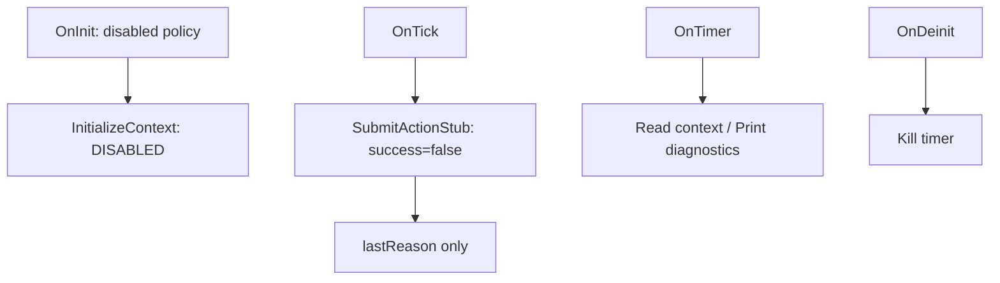

# Архитектура и реальные пути выполнения

BASE_SHA=4185b84f7a6a8847f6a9c5796f07113907be447d

Режим READ-ONLY ANALYSIS + AUDIT/TEST-ONLY. Источники не изменены. **AUDIT_COMPLETENESS=PARTIAL.** Native MQL5/MT5/broker/durable execution NOT_RUN. Proposed R0A–R0H не становятся нормативом из-за тестовых PASS. Все административные разрешения остаются NO.

`STATICALLY_INSPECTED`, `REFERENCE_EXECUTED`, `EXTRACTED_CPP_SUBSET_EXECUTED_NOT_NATIVE`, `HISTORICAL_EVIDENCE_ONLY`, `NOT_RUN`, `UNVERIFIED` не взаимозаменяемы.

## Два разных объекта аудита

Фактический EA — non-trading skeleton. Будущая HSBI — описанная в owner-документах система из planning/money/risk/execution/scenarios/persistence. Нельзя присвоить skeleton свойства всей проектируемой стратегии.

OnInit:21–26 проверяет policy и запрещённый dispatch, но не загружает positions/history или broker properties. Context после initialize имеет zero identity и не является production-ready context; это допустимо только для disabled skeleton. OnTick:37–38 не вызывает solver/risk/ledger/FSM. OnTimer:43 диагностирует; не подтверждает executions. OnTradeTransaction отсутствует. Поэтому реальная текущая FSM по этим callbacks остаётся DISABLED; manual cycle не исполняется.

## Объявленные библиотеки

Существуют real source bodies для broker-grid/cost/money/margin calculation, geometry, FutureSmall, NewFar, proof/ownership/runtime validators; economic/allocation records и сравнения; action/outcome/journal/snapshot DTO. Но producer actual MT5 history/account/EA-origin evidence, complete risk calculation и durable backend отсутствуют. `runtimeConfirmed=true` после OrderCalcProfit подтверждает лишь успешный расчёт, не Deal existence/actual profit/eligible funds.

```mermaid
flowchart LR
 Provider[Independent account/history/origin providers: absent] --> Econ[Economic immutable identity]
 Econ --> Reconcile[Reconciled actual posted economics]
 Reconcile --> Alloc[Authoritative allocation/consumption]
 Alloc --> Journal[Durable atomic journal/CAS: absent]
 Journal --> Available[Verified available reserve]
 Market[Typed market/cost/grid snapshots] --> Plan[Geometry / FutureSmall / NewFar]
 Available --> Plan
 Plan --> Risk[Runtime risk/margin proof]
 Risk --> Intent[Execution intent / preflight]
 Intent --> Engine[Transaction engine: absent]
 Engine --> Persist[Actual reconciliation + durable commit: absent]
 Persist --> FSM[Full guarded FSM: absent]
 FSM --> Scenario[Harvest / Partial / Final / Small scenarios: DTO only]
```

Это требуемая зависимость, не реализованный call graph. Fact include graph и function graph сохранены в INVENTORY; code-to-requirement matrix содержит199 definitions с path/line/calls. Лексический граф — overapproximation, не formal control-flow dominance proof. Для слоя Money есть зависимости на Planning/BrokerGrid и CandidateMoney→FutureSmall→Money, что усиливает coupling; header graph не равен доказанному бизнес-циклу и не утверждается compile cycle. Чистые DTO/common math логично выделять при отдельной архитектурной фазе, не расширяя MinimalR1.1 сейчас.

Execution/persistence validators принимают externally populated booleans/digests. Их проверка формы не создаёт независимую authority. Часть вспомогательных validators локально корректна при preconditions; обязательность caller и достоверность producer часто ещё не реализованы. Function presence, body compilation в adapter и root README acceptance не доказывают интеграцию.

Core Context cardinality охватывает лишь четыре слота: FSA-009 показывает пропущенный secondFar в initialBuy. Pure FSM допускает arbitrary reconciliation escape, но нет orchestration/admin resume enforcement. Нужно различать library predicate и реальное применение после completed+persisted event.
