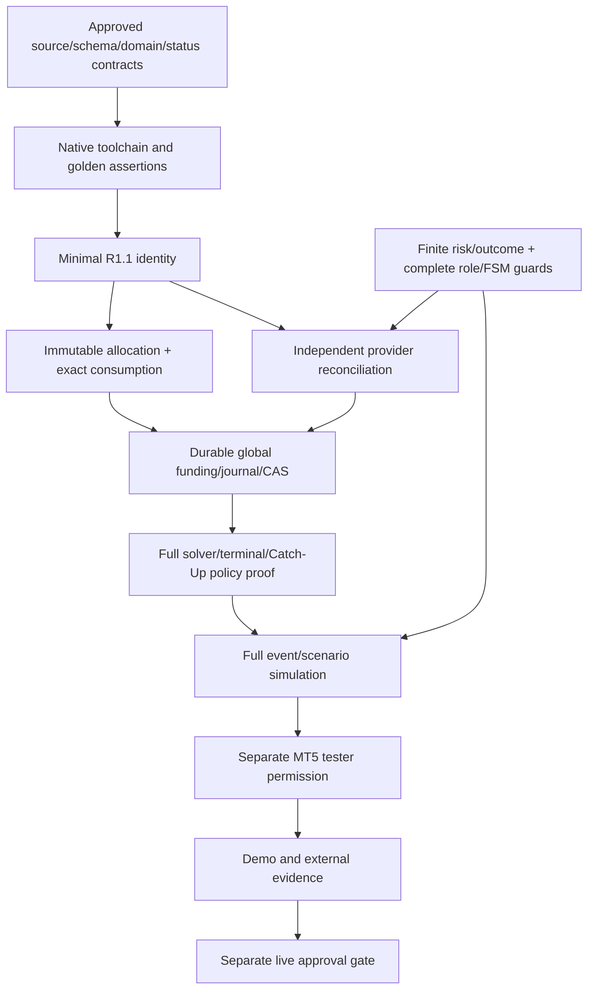

# Порядок будущих исправлений и разрешений

BASE_SHA=4185b84f7a6a8847f6a9c5796f07113907be447d

Режим READ-ONLY ANALYSIS + AUDIT/TEST-ONLY. Источники не изменены. **AUDIT_COMPLETENESS=PARTIAL.** Native MQL5/MT5/broker/durable execution NOT_RUN. Proposed R0A–R0H не становятся нормативом из-за тестовых PASS. Все административные разрешения остаются NO.

Критический путь к первой remediation: ограничить supported domain и утвердить обязательные source/equality/status/codec/legacy contracts; получить native toolchain/test plan; затем отдельное MinimalR1.1 задание на одинheader. До funding/execution должны быть устранены все применимые P0, а не толькоL01. Независимые ветви risk/cardinality могут проверяться параллельно по зависимостям, но ни один bypass не считается безопасным из-за наличия другого неисполняемого validator.

| Phase | Goal | Future scope | Dependencies/contracts | Required tests | Acceptance | Stop |
|---|---|---|---|---|---|---|
| GATE-0 | Admin contract reconciliation + native environment | Docs/Reports/new Tests only | D02/D08, schema/equality/status/codec/legacy compat; disputedD01,D04,D05,D06,CR09 as relevant | Independent records/negative/mutation/goldens; real MetaEditor readiness | Exact baseline, no approval inferred, explicit one-fileR1.1 task | Any unresolved mandatory schema/compatibility/native evidence ->stop |
| R1.1 | Minimal Economic Ledger Identity | Include/Money/HSBI_EconomicLedgerTypes.mqh only | Approved key/account/sourcebody/codec/status and nativeacceptance | Every immutablefield, sameNetcomponents, unknownlegacy/source, exact/alteredreplay; per-fieldmutants; main+harnessnative compile | No outside-header changes; no funding/dispatch; legacydiagnostic cannot become authority | Need provider/caller/helpers elsewhere ->request separate expanded scope, do not silently change |
| R1.2A | Finite data / complete role cardinality / checked revision | RiskGateResult,NewFarGateTypes;TransactionTypes,ExternalOutcome;Core Context/Invariants/StateMachine (exact separate allowlist) | Known finite inputs/limits/outcomes, allslots/actualidentifier set; explicitresume policy | NaN/Inf/negative domain,bounds,secondFar in every slot; actualtransaction zero deltas; mutation eachguard | Native assertions+existingcontracts preserved/classified | Any newfalsePASS or out-of-scope edits |
| R1.2B | Allocation identity/conservation/authoritative consumption | Money AllocationLedgerTypes,ReserveAllocationTypes,ReserveCatchUpEvaluator,MoneyState (separate approvedscope) | D01/phase,immutablegrants vs remaining,owner/bucket/source/cycle,postedcurrency/precision | per-source/globalclone,permutation,exhaustedsource,nohiddenrebudget,replay/conflict | Exact conservation and no new funding from booleanbranch; native differentialtests | Unknown history/units/authority=>unavailable notmintedmoney |
| R1.3 | Independent history/economic/risk/market providers | New provider files require new named allowlist, not created here | BrokerAccountMode/symbol/FX/posted amounts/EA-originjournal/candidateproof context | Real isolated read-only brokerhistory/provider tests and deterministic replays, no realaccounttrades | Expectedidentity independent, actual/projected/source eligibility distinct | Unavailable data cannot be fabricated byflags |
| R1.4 | Durable journal/restart/CAS and globally unique funding | Persistence backend/ExecutionJournal/Snapshot/RuntimeRestart namedseparately | Approved native codec/schema/source attribution and crashconsistent protocol | Crash everycommitpoint,corruption,fallback,concurrentdoublecommit,receipt alteration,lockfailure | Global funding/accountdebit conservation+exact replay proven on real backend | Any durable ambiguity/conflict stopsopens; no silentmigration |
| R1.5 | Geometry/solver/terminal proof correctness | Planning Geometry/FutureSmall/Aggregator/NewFar+Money Basket (separate task) | Activelegs/brokergridorigin,BigGross vsNet,independentRisk,terminalclosebudget,objective/CR09 approved | Zero/min/max/nonstandardstep,allrequiredlevels,worst margins,tailproof/plateau,minimumNvsobjective | Native solver+broker calculation proof, no promotion/dispatch | Unknown nextlevel/terminalaffordability remainsUNPROVEN |
| SIM-1 | Full scenario/FSM/event-engine simulation without brokerdispatch | Scenarios/Execution/Runtime/Main changes only after full named authorization | All monetary/provenance/persistence prerequisites; completedactualevents beforeadvance | Initialrollback,C/T/Sopen,Harvestallocation,Partial/Final/Small/NewFar; allfailure/restart/orderings | Deterministic full lifecycle and invariant evidence, no liveorders | Any earlyadvance/dualFar/doubleconsumption ->block |
| NATIVE-TESTER | Limited MT5 trading-logic test permission (future) | Explicit separately approved simulator/test-only/runtime boundary | Native compile allheaders and fullE2E simulatedproofs; adminapproval | RealMT5StrategyTester data/report/stress/accountmode/costs and holdout robustness | No realbrokerdispatch enabled; quantitative risk/strategy evidence reviewed | Current audit does NOT authorize this phase |
| LIVE-GATE | Demo forward then explicit narrowlylimited real admission | Only future dedicated security/adminscope | All gates,kill switches,capital/risk budgets,broker safeguards,operatorrunbooks | Demo/forward/economicreconciliation + manualkill/restart/crash tests | Separate explicit admin decision; not implied by any pastPASS | No permission in this audit |

Это dependency plan, не разрешение новыхфайлов/торговли. Ни один production файл не изменяется этим аудитом. Administrative choice нельзя заменить implementation convenience. Existing source may be patched only in its future explicitly approved task; multiple helper headers не прячутся в single-filephase. Native compilation mandatory before productionacceptance, no g++ substitute. Rollback ownfuturecommit отдельным reviewedrevert, сохранять observations/schema/receipts; no reset/rebase/force/compensatingtrades. No automatic stage advancement.
