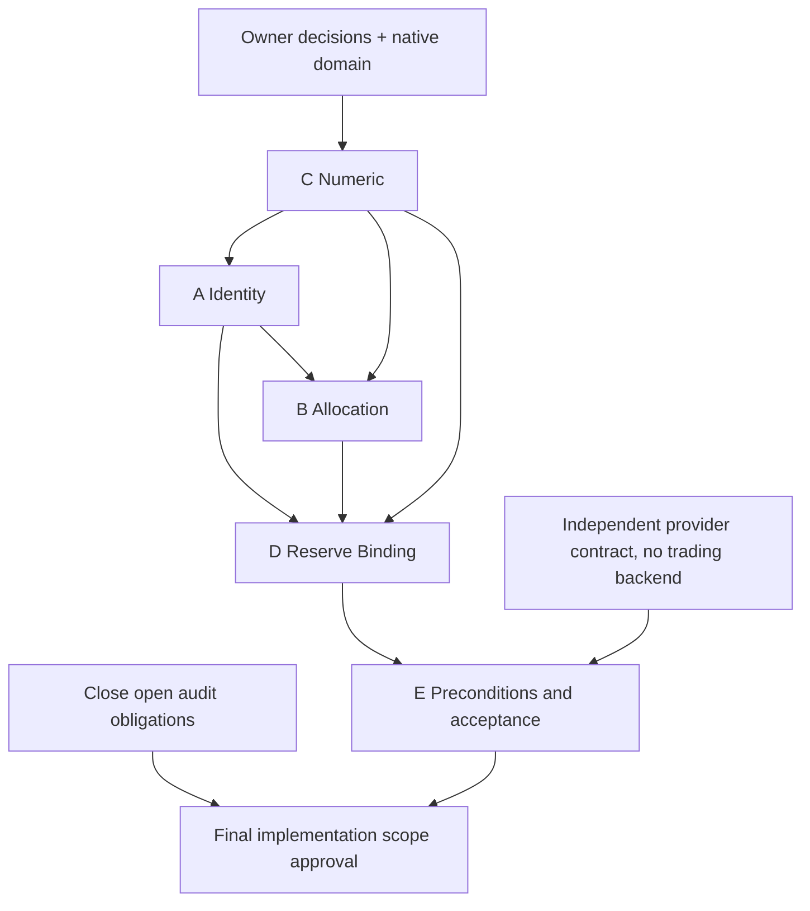

# R1.1 — ограниченный P0 dependency plan

BASE_SHA=398da88424f3fb7b30e5315fbc3bf89219dd9ad2. Статус **PROPOSED / READY_FOR_SCOPED_IMPLEMENTATION_REVIEW**, не разрешение реализации. R11_IMPLEMENTATION_ALLOWED=NO. Trading/dispatch/real trading=NO.

## R1.1-A — Identity

**Exact allowlist:**

- `Include/Money/HSBI_EconomicLedgerTypes.mqh`
- `Include/Core/HSBI_Identifiers.mqh`
- `Include/Money/HSBI_MoneyProofIdentity.mqh`

**ERR:** 001/002/003/013

**IMP:** 001/002

**Depends:** C → A

**Approvals:** D-02/D-08/D-12/D-13/D-15/D-16

**Pre:** Утверждены namespace/schema/body/canonical codec/domain и legacy mapping.

**Functions:** HSBI_BuildSourceDealKey, HSBI_ValidateEconomicRecord, HSBI_SameEconomicRecord, HSBI_ClassifyEconomicDuplicate, HSBI_SerializeEconomicRecord, HSBI_ValidateMoneyProofIdentity

**Acceptance:** Все immutable fields сравниваются; malformed namespace, altered component/price/role/position → CONFLICT/REJECT; unknown authority → UNAVAILABLE; exact replay zero delta.

**Tests:** P0-01; PRICE/POSITION/ROLE; different account/server/deal; provider mismatch; malformed key; native full-field goldens.

**Limitation:** PoC сравнивает существующий полный payload; account/server/schema в legacy record отсутствуют. Поэтому этот diff НЕ является полным исправлением A.

**Unchanged interfaces:** main EA, runtime disable/dispatch policy, existing normative Docs, frozen fixtures и historical results не входят в allowlist. Публичные подписи сохраняются; новые typed strict API только additive, явная schema/version и отказ legacy unsafe caller. Изменение enum ordinals или старого codec запрещено без отдельного reviewed migration.

**Backward compatibility:** старые serialized bytes сохраняются; read-only adapter не даёт funding authority. Unknown precision/owner/history → UNAVAILABLE. Новые safe API не считаются mandatory до проверки всех callers.

**Stop conditions:** зависимое owner approval отсутствует; новый BASE diverged; required file вне allowlist; source/provider incomplete; mutation survivor без объяснения; native compile/test отсутствует на acceptance; изменился no-trade policy; zero-delta нарушен. При stop не ослаблять expected и не расширять scope автоматически.

**Rollback:** future package в отдельном reviewable commit; до integration сохранить pre-change snapshots/hashes. При regression отменить именно пакет обычным revert после проверки зависимых commits, без reset/force; no-trade блок остаётся. Persistent schema migration только append-only и compatibility rollback/read-only, не перепись ledger.

## R1.1-B — Allocation

**Exact allowlist:**

- `Include/Money/HSBI_AllocationLedgerTypes.mqh`
- `Include/Money/HSBI_AllocationPolicyTypes.mqh`
- `Include/Money/HSBI_MoneyState.mqh`
- `Include/Money/HSBI_ReserveAllocationTypes.mqh`

**ERR:** 004/005/011/033

**IMP:** 002/003/004/009

**Depends:** C+A → B

**Approvals:** D-01/D-02/D-03/D-07/D-10/D-11/D-14/D-16

**Pre:** Утверждены committed/draft phase, residual, exact money profile, grant/reserved/free mapping и source owner.

**Functions:** HSBI_ValidateAllocationConservation, HSBI_ClassifyAllocationDuplicate, HSBI_CanConsumeAmount, HSBI_CanConsumeBucket, HSBI_ValidateAllocationPolicy, HSBI_ValidateMoneyState, HSBI_ValidateReserveAllocationSource

**Acceptance:** Nonnegative exact vector equality, source cap across event IDs, immutable replay; exhausted reject; per-owner reservation; checked state revisions; zero delta.

**Tests:** P0-02/03/05/13; UNDERALLOCATION; SECOND-ALLOCATION-EVENT; concurrent owner/migration unknown; crash/restart.

**Limitation:** PoC устраняет vector-only equality gap и negative/nonfinite buckets. Source registry, lifecycle и durable consumption потребуют отдельно reviewed additive provider interface; production backend не реализуется в R1.1.

**Unchanged interfaces:** main EA, runtime disable/dispatch policy, existing normative Docs, frozen fixtures и historical results не входят в allowlist. Публичные подписи сохраняются; новые typed strict API только additive, явная schema/version и отказ legacy unsafe caller. Изменение enum ordinals или старого codec запрещено без отдельного reviewed migration.

**Backward compatibility:** старые serialized bytes сохраняются; read-only adapter не даёт funding authority. Unknown precision/owner/history → UNAVAILABLE. Новые safe API не считаются mandatory до проверки всех callers.

**Stop conditions:** зависимое owner approval отсутствует; новый BASE diverged; required file вне allowlist; source/provider incomplete; mutation survivor без объяснения; native compile/test отсутствует на acceptance; изменился no-trade policy; zero-delta нарушен. При stop не ослаблять expected и не расширять scope автоматически.

**Rollback:** future package в отдельном reviewable commit; до integration сохранить pre-change snapshots/hashes. При regression отменить именно пакет обычным revert после проверки зависимых commits, без reset/force; no-trade блок остаётся. Persistent schema migration только append-only и compatibility rollback/read-only, не перепись ledger.

## R1.1-C — Numeric Safety

**Exact allowlist:**

- `Include/Risk/HSBI_RiskGateResult.mqh`
- `Include/Money/HSBI_MoneyState.mqh`
- `Include/Execution/HSBI_TransactionTypes.mqh`
- `Include/Execution/HSBI_ExecutionIntent.mqh`
- `Include/Execution/HSBI_ActionTypes.mqh`
- `Include/Execution/HSBI_EventTypes.mqh`
- `Include/Planning/HSBI_BrokerGrid.mqh`
- `Include/Risk/HSBI_NewFarGateTypes.mqh`

**ERR:** 009/010/011 (P0); 014/025/026/040/049 adjacent acceptance

**IMP:** 002/005/007

**Depends:** Первый после domain approval; не зависит от trade integration

**Approvals:** D-10/D-11/D-15; enum membership — existing closed domain

**Pre:** Подтверждены precision/ranges и exact enum sets; native baseline captured.

**Functions:** HSBI_ValidateRiskInput, HSBI_ValidateMoneyState, HSBI_TransactionBarrierPassed, HSBI_ValidateExecutionIntentStructure, HSBI_ValidateActionRecord, HSBI_ValidateEventRecord, HSBI_ValidateVolume, HSBI_EvaluateNewFarGates

**Acceptance:** Inputs/limits/intermediates finite; unknown enum rejected; min/max/grid obeyed; overflow no permit; existing valid controls unchanged.

**Tests:** P0-04/05/06/07; NaN limits; ±Infinity; bounds; invalid enum; price/volume grid; native long/ulong/double.

**Limitation:** PoC finite guards только в трёх headers. Все перечисленные domain/caller tests обязательны для acceptance; это не готовый полный numeric fix.

**Unchanged interfaces:** main EA, runtime disable/dispatch policy, existing normative Docs, frozen fixtures и historical results не входят в allowlist. Публичные подписи сохраняются; новые typed strict API только additive, явная schema/version и отказ legacy unsafe caller. Изменение enum ordinals или старого codec запрещено без отдельного reviewed migration.

**Backward compatibility:** старые serialized bytes сохраняются; read-only adapter не даёт funding authority. Unknown precision/owner/history → UNAVAILABLE. Новые safe API не считаются mandatory до проверки всех callers.

**Stop conditions:** зависимое owner approval отсутствует; новый BASE diverged; required file вне allowlist; source/provider incomplete; mutation survivor без объяснения; native compile/test отсутствует на acceptance; изменился no-trade policy; zero-delta нарушен. При stop не ослаблять expected и не расширять scope автоматически.

**Rollback:** future package в отдельном reviewable commit; до integration сохранить pre-change snapshots/hashes. При regression отменить именно пакет обычным revert после проверки зависимых commits, без reset/force; no-trade блок остаётся. Persistent schema migration только append-only и compatibility rollback/read-only, не перепись ledger.

## R1.1-D — Reserve Binding

**Exact allowlist:**

- `Include/Money/HSBI_ReserveCatchUpEvaluator.mqh`
- `Include/Money/HSBI_ReserveAllocationTypes.mqh`
- `Include/Planning/HSBI_NewFarSolver.mqh`
- `Include/Planning/HSBI_FutureSmallProofAggregator.mqh`
- `Include/Money/HSBI_CatchUpModel.mqh`

**ERR:** 007/008/013/033/048 (P0); 018/043 adjacent

**IMP:** 001/004/010/011

**Depends:** A+B+C → D; E provider preconditions для acceptance

**Approvals:** D-02/D-03/D-04/D-06/CR-09/D-07/D-08/D-13/D-14

**Pre:** Exact source/allocation and free balance provider protocol согласован; preview/funding result types разделены.

**Functions:** HSBI_EvaluateReserveCatchUp, HSBI_ValidateReserveAllocationSource, HSBI_ValidateReserveConsumption, HSBI_SolveNewFar, HSBI_AggregateFutureSmallProof

**Acceptance:** Projected never funds; scalar binding exact; exhausted/foreign source rejected; min required-level margin>0; no identity laundering; actual residual independent; direct public caller guarded.

**Tests:** P0-03/12; amount mismatch positive control; loss mismatch; sourceAllocationKey mismatch; exhausted source; selected-level counterexample; provider unavailable.

**Limitation:** PoC только public scalar binding и output finite. Full provenance/spendability нельзя получить локальным equality; provider отсутствует → funding unavailable.

**Unchanged interfaces:** main EA, runtime disable/dispatch policy, existing normative Docs, frozen fixtures и historical results не входят в allowlist. Публичные подписи сохраняются; новые typed strict API только additive, явная schema/version и отказ legacy unsafe caller. Изменение enum ordinals или старого codec запрещено без отдельного reviewed migration.

**Backward compatibility:** старые serialized bytes сохраняются; read-only adapter не даёт funding authority. Unknown precision/owner/history → UNAVAILABLE. Новые safe API не считаются mandatory до проверки всех callers.

**Stop conditions:** зависимое owner approval отсутствует; новый BASE diverged; required file вне allowlist; source/provider incomplete; mutation survivor без объяснения; native compile/test отсутствует на acceptance; изменился no-trade policy; zero-delta нарушен. При stop не ослаблять expected и не расширять scope автоматически.

**Rollback:** future package в отдельном reviewable commit; до integration сохранить pre-change snapshots/hashes. При regression отменить именно пакет обычным revert после проверки зависимых commits, без reset/force; no-trade блок остаётся. Persistent schema migration только append-only и compatibility rollback/read-only, не перепись ledger.

## R1.1-E — Integration Preconditions

**Exact allowlist:**

- `Include/Core/HSBI_Context.mqh`
- `Include/Core/HSBI_Invariants.mqh`
- `Include/Core/HSBI_StateMachine.mqh`
- `Include/Execution/HSBI_TransactionTypes.mqh`
- `Include/Persistence/HSBI_ExecutionJournal.mqh`
- `Include/Persistence/HSBI_ExecutionStateSnapshot.mqh`
- `Include/Persistence/HSBI_PersistenceInterface.mqh`
- `Include/Runtime/HSBI_RuntimeTransactionBarrier.mqh`
- `Include/Runtime/HSBI_RuntimeRestartValidator.mqh`

**ERR:** 010/012/013/033 (P0); 016/017/025/030/050 prerequisites; 038 deployment blocker

**IMP:** 005/006/008/009/015/021

**Depends:** A+B+C+D → E acceptance

**Approvals:** D-05/D-07/D-08/D-13/D-14/D-15/D-16

**Pre:** Полный mandatory caller graph, state mapping, journal schema и restart protocol согласованы; trading forbidden.

**Functions:** HSBI_ValidateContext, HSBI_ContextRolesConflict, HSBI_TransactionBarrierPassed, HSBI_RetryAllowed, HSBI_ClassifyJournalAppend, HSBI_ValidateExecutionStateSnapshot, HSBI_ProposeStateTransition; runtime validators по exact future diff

**Acceptance:** Far uniqueness во всех слотах; actual confirmed fill before next step; unknown outcome blocks retry; validate replay body before no-op; state increment overflow rejected; native acceptance separate.

**Tests:** P0-07/08/09/10/11/13/14; changed journal body retaining old digest; snapshot mismatch; every crash point; partial then delayed complete.

**Limitation:** PoC блокирует UNKNOWN/TIMEOUT retry. Не создаёт durable storage или full FSM и не доказывает loss bound ERR-038. Торговая интеграция исключена.

**Unchanged interfaces:** main EA, runtime disable/dispatch policy, existing normative Docs, frozen fixtures и historical results не входят в allowlist. Публичные подписи сохраняются; новые typed strict API только additive, явная schema/version и отказ legacy unsafe caller. Изменение enum ordinals или старого codec запрещено без отдельного reviewed migration.

**Backward compatibility:** старые serialized bytes сохраняются; read-only adapter не даёт funding authority. Unknown precision/owner/history → UNAVAILABLE. Новые safe API не считаются mandatory до проверки всех callers.

**Stop conditions:** зависимое owner approval отсутствует; новый BASE diverged; required file вне allowlist; source/provider incomplete; mutation survivor без объяснения; native compile/test отсутствует на acceptance; изменился no-trade policy; zero-delta нарушен. При stop не ослаблять expected и не расширять scope автоматически.

**Rollback:** future package в отдельном reviewable commit; до integration сохранить pre-change snapshots/hashes. При regression отменить именно пакет обычным revert после проверки зависимых commits, без reset/force; no-trade блок остаётся. Persistent schema migration только append-only и compatibility rollback/read-only, не перепись ledger.

## Все 14 P0 и граница решения

| P0 ERR | Пакет | Приёмка / остаточный blocker |
|---|---|---|
| ERR-001 | A | full immutable equality |
| ERR-002 | A | broker/server/account namespace |
| ERR-004 | B | immutable buckets |
| ERR-005 | B/C | nonnegative finite conservation |
| ERR-007 | B/D | exact allocation/provider binding |
| ERR-008 | B/D/E | source global free, exhausted reject, restart |
| ERR-009 | C | finite risk inputs+limits |
| ERR-010 | C/E | finite completed fills, unknown blocks next/retry |
| ERR-011 | B/C | money state finite/domain |
| ERR-012 | E | all slots/positions unique Far |
| ERR-013 | A/D/E | independent actual BigCore residual proof |
| ERR-033 | B/D/E | global source registry contract; actual backend unavailable blocks funding |
| ERR-038 | E deployment gate | unconditional market loss bound не исправляется локальным guard; R1.1 не обещает bounded loss, activation запрещена |
| ERR-048 | D | public proof value binding and direct caller negatives |

Разрешённые новые test/evidence paths будущего этапа: `Tests/R11P0/` и `Reports/HSBI_R11_P0_*`. Production allowlist выше — верхняя граница review, а не приказ изменить все файлы. Backend реализация, полный EA lifecycle, новые торговые сценарии, автоматический resume, profitability claims исключены из этого этапа. Достижимость исполнения всей стратегии и loss bound остаются внешними blockers.
