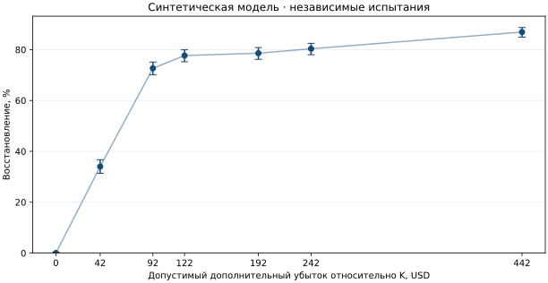

# HALR-01 — Итоговый отчёт

## 1. Краткий итог

При немедленном исполнении K фиксирует −$58 и достигает minimax-значения на допустимом множестве движений. Восстановление с положительным CyclePnL возможно на части путей синтетической модели. Цена этой возможности — худший убыток, которого избегает K после перехода во FLAT. Результаты поиска относятся к заданному процессу цены и конечной сетке параметров. Для лимита $58 доказана нулевая максимальная вероятность при жёстком номинальном ограничении. Для $100 отдельно доказана достижимая вероятность 8% за два события у конструктивной Safe Preserve. Это нижняя оценка оптимума, полученная вне сетки кандидатов.

## 2. Исходное состояние GitHub

База `work` — `d81c048bac82e7d8fd5e5c872d68a96e6983927f`. Исходное дерево проверено в чистом checkout. Исследовательская ветка `research/halr01` ведёт Draft PR #6 в `work`. UMLRS-01 проверен в открытом Draft PR #5 по исходному коммиту `e507cb93a1e721f3b436baf9c6403d4d18715fd2`. [HALR-01](https://github.com/ic8812825-maker/chatgpt.com-codex/pull/6) · [UMLRS-01](https://github.com/ic8812825-maker/chatgpt.com-codex/pull/5)

## 3. Денежная модель

У каждого исходного билета 1 лот. При движении ±300, спреде 20 и комиссии $4.50 за сторону ликвидационные вклады равны +$271 и −$329. В журнале mid-PnL и расходы разведены. Резерв закрытия становится фактической платой на исполнении. Сумма в цикле равна −$58 до и после номинальной ликвидации. Расходы начисляются один раз. Капитал $15 000, шаг 0.01, |Net|≤0.50, Gross≤5. После каждого fill обновляются экспозиция, PnL и DD. Оценка stop-out использует порог Equity/Margin. Исходный ledger задан готовой корзиной, поэтому результаты после начала восстановления отделены от тестов исполнения первоначального входа. [Денежный контракт](MONEY_MODEL_SPEC.md)

## 4. HALR-A

A1 держит 1.00 лота исходной убыточной ноги. Сдвиг Net против неё иногда требует открытия нового билета и увеличивает Gross. A2 разрешает сокращение исходного проигравшего и подбирает нижний предел его остатка от 0.01 до 1.00. Ограничение на промежуточный Net может оставить больший объём. A3 меняет рабочий Net по наблюдаемым смещениям, сначала нейтрализует его при развороте и допускает частичный Harvest рабочих ног. Ограничения частоты и резерва проверялись в сетке. Safe допускает выход по риску. Strict может завершить горизонт с открытым Core. Для Strict это отдельный исход и отдельная строка сравнения. [Спецификация A](HALR_A_SPEC_RU.md)

## 5. HALR-B

B1 даёт одну направленную попытку. B2 повторяет попытку после выхода и изменения точки отсчёта, в пределах лимита. B3 ждёт подтверждение с одной стороны порога двумя событиями. Это ослабляет реакцию на одиночный прокол и съедает часть хода при устойчивом движении. B4 сокращает Net по мере благоприятного движения и при завершении попытки возвращается во FLAT. При q=0.20 и базовых расходах для одной полной попытки нужен ход строго больше 319 пунктов после входа. При нескольких ложных входах прежние потери и тарифы добавляются к порогу. Ожидание во FLAT сохраняет достигнутый денежный результат. [Спецификация B](HALR_B_SPEC_RU.md)

## 6. HALR-M

M сравнивает реальные корневые преобразования билетов и точное Bellman-продолжение с горизонтом до двух событий в редуцированном пространстве. Обратный переход к оригинальным идентификаторам невозможен. Риск в DP проверяется на ограниченном множестве ±300; номинальные будущие расходы предполагают спред 20 и комиссию 4.50. Pure Minimax, Recovery Probability и Risk-Adjusted Recovery используют разные функционалы. Третий использует штраф верхней оценки CVaR95 при фиксированном пороге и расходы корневого действия. Общая граница Парето по наблюдаемым Recovery Rate, худшему убытку и CVaR95 сформирована после теста. [Спецификация M](HALR_M_SPEC_RU.md) · [Граница Парето](PARETO_FRONTIER.csv)

На 1200 независимых путях при бюджете $180 M-probability 258 раз выбрала SWITCH_TO_B. M-adjusted использовала 177 нейтрализаций REHEDGE и 9 действий HARVEST. В этом прогоне обе политики получали экспозицию через сокращение исходной корзины. После перехода во FLAT ни одна политика M не выбрала новый вход. Полный счётчик действий приведён в [аудите](AUDIT_RESULTS.json).

## 7. Математические результаты

Вложенность множеств допустимых политик даёт слабое превосходство оптимального гибрида при общем функционале. Строгое преимущество требует состояний, в которых архитектуры имеют различные и взаимно меняющиеся преимущества, и доступного перехода. Для реализованной редукции полная вложенность не доказана. Частичный Harvest при неизменной котировке сохраняет ликвидационный PnL и меняет будущий Net. Неподвижный mid и неблагоприятный адаптивный путь опровергают универсальную гарантию прибыли. Произвольный гэп при ненулевом Net исключает универсальную конечную границу убытка. [Классифицированные доказательства](MATHEMATICAL_PROOFS_RU.md)

## 8. Исчерпывающий перебор

Для каждого из 15 вариантов при бюджете $180 проверено 15 625 последовательностей D⁶ для каждой ориентации. Всего 468 750 испытаний этого сравнения. Политики с собственным коротким горизонтом закрываются раньше шестого события, длинные обрезаются шестым. Перебор покрывает фиксированные политики при номинальном исполнении. Оптимизация всего дерева действий была ограничена корневым набором и редуцированным продолжением. Частоты на полном дереве равновесны по путям, результаты статистического теста взвешены законом переходов. [Исчерпывающие строки](COMPARISON_RESULTS.csv)

## 9. Адаптивные и исполнительные испытания

На каждую политику приходятся 88 случаев с обеими ориентациями и зеркальными путями. В матрице есть тренды, боковики, смены режима, ложные пробои, расширение спреда, гэп, частичные исполнения, задержка и отказы. У адаптивного противника знак следующего движения вычисляется после получения Net; одинаковое правило может дать разные траектории для разных политик. Нули в исходном шаблоне adaptive служат обозначением этого правила.

{{STRESS}}

## 10. Оптимизация

На training использован фиксированный план перебора размеров, триггеров, попыток, горизонтов, резервов, долей Harvest и уровней Gross. У A2 перебраны все 100 значений нижнего предела остатка в сочетании с другими параметрами по фиксированному плану. Всего оценено 3339 сочетаний семей, параметров и бюджетов. Четыре лучших настройки каждой семьи на каждом бюджете перенесены на validation. Независимые тестовые сценарии используются после отбора. Для выбранных бюджетных политик проводится отдельный полный шестишаговый фильтр риска. Отдельный жёсткий денежный потолок торговых расходов в поиске не задан. Торговые расходы уменьшают весь CyclePnL и входят в критерий adjusted. Конечный горизонт и лимиты объёма ограничивают оборот. Чувствительность к комиссии $2.25, $4.50 и $9 на сторону рассчитана на фиксированных политиках. M сохраняет номинальную модель будущих расходов в DP даже при стрессовом тарифе. [Настройки и validation](OPTIMIZATION_RESULTS.csv) · [Тарифная чувствительность](COST_SENSITIVITY.csv)

## 11. UMLRS-01 J Balanced

J перенесён с триггером 140 пунктов, одним входом 0.12 лота, исходным горизонтом 12 и двушаговым резервом. Для сравнения путь заканчивается вместе с общим набором. На 1000 дополнительных номинальных сценариях итог совпал с архивным исполнителем с максимальной разницей ниже $0.00000001. Сопоставление при сбоях не публикуется ввиду различия моделей повторной заявки и частичных исполнений. [Проверка эквивалентности](audit_legacy.py)

## 12. Контроль K

Нулевой Net после полного закрытия защищает от дальнейших изменений котировки, комиссий и swap. В номинальной модели худший результат равен −$58. Pure Minimax может получить то же значение с закрытием. Стартовые частичные исполнения и задержка закрытия нарушают предпосылку мгновенного выхода K. [Парные результаты](PAIRED_RESULTS.csv)

## 13. Восстановление по риск-бюджетам

Лимит относится ко всему циклу. Дополнительный допустимый убыток равен лимиту минус $58. Частоты и интервалы Wilson относятся к 1200 независимым синтетическим испытаниям. Точный максимум внутрисценарного убытка указан для фиксированного исполнения и шести событий. При изменении условий исполнения применяется `RISK_BOUND_NOT_PROVEN` для рисковых политик.

{{BUDGET}}

## 14. Худшие убытки и хвостовое сравнение

Все строки ниже относятся к бюджету $180. Среднее и худший PnL указаны в долларах. CVaR95 показан как положительный убыток. Полные CSV содержат медиану, DD, CVaR99, P95/P99, число и среднее время восстановлений, оборот, компоненты расходов, стресс маржи, stop-out, нарушения, сбои и незакрытые остатки.

{{COMPARISON}}

## 15. Лучшие найденные параметры

В таблице бюджетов показаны семьи, выбранные до независимого теста. Полные параметры каждой выбранной политики содержатся в колонке params. При равенстве частот учитывался хвостовой риск, затем среднее по validation. Значения тестовой частоты не обязаны монотонно расти с бюджетом при конечной сетке, смене выбранной семьи и двухстадийной оценке. [Выбранные настройки](BUDGET_FRONTIER.csv)

{{PARAMS}}

## 16. Контрпримеры

Трендовые восстановления опровергаются как общая гарантия неподвижным mid и последовательностью действий против Net. Дешёвое сохранение исходного билета может проиграть по Gross, спреду и риску невозможности одновременного выхода. Повторные входы B проигрывают K на сериях возвратов. Успех M в номинальном продолжении не переносится на гэп вне дерева либо удержание противника при отказе. [Каталог контрпримеров](COUNTEREXAMPLES.md)

## 17. Риски исполнения

`BROKER_EVIDENCE_UNAVAILABLE`. Маржа рассчитана по модельной gross-схеме, а не по индивидуальным правилам брокера. Ограничения исполняются на каждом отдельном fill при доступной котировке. Модель задержки откладывает возможность исполнения до следующей попытки; исходное поручение на открытие может быть отменено. Частичное закрытие и серия отказов способны оставить риск после горизонта. Stop-out учитывается как сигнал к принудительному выходу при доступности исполнения; порядок реального брокерского StopOut не моделировался. Капитал и ликвидационная оценка не являются гарантией исполнения.

## 18. Недоказанные утверждения

Глобальный оптимум по непрерывной цене, полной сетке состояний и действий, робастный CVaR-оптимум, граница риска при произвольном гэпе, переносимость синтетической вероятности на рынок и реальная брокерская исполнимость остаются `NOT_PROVEN`. Один лишь шестишаговый перебор не устанавливает границу для всех восьмишаговых продолжений. Для M номинальная одношаговая индукция даёт условную гарантию на любом конечном горизонте при заданных допущениях. Отсутствие нарушений на выборке — эмпирический результат.

## 19. Следующий исследовательский этап

Расширить конечное дерево до полного горизонта и явно включить допустимые состояния задержанных заявок. На подтверждённых брокерских данных отдельно установить стоимость исполнения и область, где остаётся достижимой гарантированная ликвидация. Проверить переносимость на временно разделённых данных до рассмотрения производственного решения.

## 20. Вердикт

**`K_MINIMAX_WINNER`** для номинального исполнения и множества путей, включающего постоянную цену. Значение −$58 достигается немедленной ликвидацией. **`HALR_A_BEST_FOUND`** по процедуре отбора для бюджетов $150–$500. При бюджете $180 A3 достигла 77,67% (932/1200) с худшим номинальным результатом −$178. При бюджете $100 выбрана M-probability с 34,00% (408/1200) и худшей номинальной оценкой −$88. Обе политики допустили по четыре нарушения своего лимита в 88 стресс-испытаниях. **`NO_PROVEN_ADVANTAGE`** для превосходства M над контрольными вариантами по совместному критерию восстановления и риска. Компромиссы на синтетических путях показаны отдельно и не устанавливают превосходство вне заданной модели.
