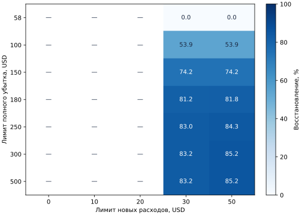

# HALR-02 — Risk-Constrained Adaptive Recovery

## 1. Вердикт

**`A3_RC_BEST_FOUND`** в исследованной номинальной сетке при $180 полного убытка и $50 новых расходов. Выбранная A3-RC завершила 981 из 1200 испытаний с положительным CyclePnL. На горизонте 12 событий это 81,75%, Wilson 95% 79,46–83,83%. Худший результат теста −$172, максимальные новые расходы вместе с резервом $36,25. Финал во FLAT подтверждён во всех номинальных испытаниях.

**`RISK_PROVEN_WITHIN_MODEL`** относится к формальному номинальному контракту. **`RISK_BOUND_VIOLATED`** относится к зафиксированным стрессовым нарушениям; общий перенос сертификата на другие условия исполнения имеет статус **`RISK_BOUND_NOT_PROVEN`**. При допущении полного отсутствия ликвидности до дедлайна широкий контракт даёт **`NO_FEASIBLE_RECOVERY_POLICY`**, включая основной бюджет.

**`NO_PROVEN_ADVANTAGE`** для универсального превосходства A3-RC или M-RC и для заявлений о рынке. **`HISTORICAL_VALIDATION_PENDING`**. Результаты вероятности относятся к синтетической модели с явно заданной персистентностью движений.

## 2. Исходный аудит

BASE work d81c048bac82e7d8fd5e5c872d68a96e6983927f, PR #5 e507cb93a1e721f3b436baf9c6403d4d18715fd2, PR #6 0da896a615b47771d9cf66b6bf7c55cc782b74fc. Оба исходных PR оставлены самостоятельными. 17 исходных тестов и 487 982 прогона воспроизведены в закреплённом исходнике. Все четыре нарушения A3 вызваны отказом выхода при оценке +$2, затем гэпом в 4000 пунктов против открытых 0.20 лота. PnL снизился до −$798. На предыдущих шагах закрытие было доступно. K при той же последовательности успевала выйти с −$58. [Аудит](BASELINE_AUDIT_RU.md) · [Разбор](HALR01_FAILURE_ROOT_CAUSE_RU.md)

## 3. Исполнение и допустимость

Все исполнимые политики проходят один Venue. Очередь обрабатывает частичные исполнения, истечение, UNKNOWN и отмену с возможным fill до подтверждения. Ограничения измеряются на каждом fill и событии цены. Средства в резерве закрытия и резерв для ожидающих открытий учитываются отдельно. Положительная оценка с остатком или незакрытым поручением не считается восстановлением.

Risk Controller проецирует последовательность fill и следующий худший шаг вместе со стоимостью выхода, маржой и горизонтом. При конфликте A3-RC вправе ликвидировать Core. В номинальном контракте закрытие подтверждается на той же котировке, а допустимый следующий шаг ограничен 300 пунктами. Для более широких схем частичного исполнения и задержки проведены стресс-испытания. Они не входят в формальный сертификат. Модель stop-out направляет аварийные заявки в общий Venue. Порядок реальных брокерских действий требует отдельного подтверждения. [Исполнение](EXECUTION_MODEL_SPEC.md) · [Деньги](MONEY_AND_COST_CONTRACT.md) · [Гейт](RISK_FEASIBILITY_SPEC.md) · [Доказательства](MATHEMATICAL_PROOFS_RU.md)

## 4. Независимое сравнение при $180/$50

{{COMPARISON}}

Восьмисобытийное сравнение показывает важный контрпример преимуществу гейта по доходности: A3 original восстановилась в 76,67%, начальная A3-RC — в 69,92%. У A3 original отсутствует сертификат этого гейта. Проверка портов A3, M-probability, B4 и J даёт 256 совпадающих номинальных итогов для каждого. При сбоях правила выбора портированы в новый Venue, поэтому история fill зависит от общего контракта HALR-02. [Проверка портов](PORT_PARITY.json)

При одинаковых горизонтах повтор заранее выбранных настроек даёт A3-RC против M-RC 69,08% против 62,92% за 8 событий и 81,75% против 66,33% за 12. Парное различие составляет соответственно +6,17 п. п. с Hoeffding 95% от −1,67 до +14,01 п. п. и +15,42 п. п. с интервалом от +7,58 до +23,26 п. п. Это чувствительность фиксированных настроек. Поиск M использовал предел 8 событий; при продлении до 12 параметры заново не подбирались. Глубины 6 и 8 дали одинаковую частоту для базовых настроек M, а редукция не гарантирует глобальный оптимум. [Парные результаты](PAIRED_COMPARISON.csv) · [Равные горизонты](MATCHED_HORIZON_PAIRED.csv)

Аварийный выход с закрытием Core дал 1200 FLAT. Диагностический Strict Core сохранил те же 981 восстановления, оставил 219 остатков и ухудшил худшую оценку до −$295. На этом наборе закрытие Core не снизило измеренную частоту восстановления; результат не распространяется на другие политики и исполнения. [Абляция](CORE_CLOSURE_ABLATION.csv)

## 5. Бюджеты расходов и риска

{{BUDGET}}

Все $0/$10/$20 исключены номинальной стоимостью обязательного исходного закрытия $29. При B=$58, C≥$29 ликвидация допустима, а вероятность восстановления при жёсткой защите равна нулю. При B=$180 и C=$30 найдена A3-RC с частотой 81,25% и максимумом расходов с резервом $29,87. При переходе к C=$50 частота выбранного варианта 81,75%. Выбор делался только на training и validation; независимая частота не обязана строго расти при ослаблении ограничения. Cmax относится к новым расходам с момента начала восстановления; исторические расходы $29 остаются в CyclePnL. [Двумерная граница](COST_BUDGET_FRONTIER.csv) · [Парето](RECOVERY_RISK_FRONTIER.csv) · [Параметры](SELECTED_POLICIES.csv)

## 6. Покрытие горизонта и стресс

{{EXACT}}

Полные деревья включают обе начальные ориентации. Мемоизация объединяет состояния с одинаковым продолжением, а поглощённые хвосты учитываются кратностью. Число путей не равно числу вызовов симулятора. Частота в равновесном дереве и статистическая частота Markov-модели имеют разное взвешивание. Если строка завершилась по лимиту состояний, сертификат допустимости остаётся следствием индукции; точное число восстановлений для неполного дерева отсутствует.

В 88 стресс-сценариях для каждого варианта A3-selected дала 32 нарушения, 72 завершения во FLAT и худший PnL −$22 483. Стресс включает намеренно крупное движение в stopout_gap. K-EXECUTABLE имела 24 нарушения, 72 завершения во FLAT и минимум −$630. K-IDEAL фиксирует −$58 по аналитическому определению. Сценарии с отказами, нулевой ликвидностью и UNKNOWN показывают причины различий. Адаптивный противник выбирает следующий шаг после наблюдения Net. Отдельно применён ограниченный профиль capacity, задержек, отказов и slip. Неблагоприятный сценарий подбирается после решения только в части движения цены; полного minimax-поиска по исполнениям не проводилось. [Стресс](ADVERSARIAL_RESULTS.csv) · [Свидетели](COUNTEREXAMPLES.md)

## 7. Историческая проверка и пределы

`BROKER_EVIDENCE_UNAVAILABLE`. Подтверждённые исторические Bid/Ask не получены. Обе пробы официальных источников вернули HTTP 429. Требования к данным и временным выборкам опубликованы. Исследование не даёт рыночной вероятности. Глобальный максимум по всем причинным политикам, значения за пределами сетки параметров, исполнимость при произвольных гэпах и строгое преимущество по всем метрикам не доказаны. [Исторические данные](HISTORICAL_VALIDATION.md)

Результаты, журнал заявок, тесты, короткие контрпримеры и исходные настройки приложены в Draft PR. Исследование автономно. [Draft PR #7](https://github.com/ic8812825-maker/chatgpt.com-codex/pull/7)
